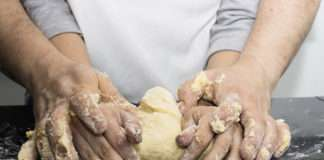

# Гэр бүл оршин тогтнохын утга учир

Гэр бүл аз жаргалтайгаар оршин тогноход эхнэр нөхрүүдийн хоорондын харилцаа ямар байх ёстойг харуулах сургамжит түүх.

Нэг хүү, эцэг эх нь хэрүүлтэй гэр бүлд өсч торнин, сайхан аз жаргалтай гэр бүлтэй болж амьдрахыг туйлаас хүсдэг нэгэн болж өсчээ. Тэр, -Миний амьдрал хэзээ ч ийм байх ёсгүй. Гэр бүл минь аз жаргалтай эв эетэй байх ёстой. Сайхан сэтгэлтэй дуулгавартай эхнэр олж гэрлэнэ гэж байнга бодож явсаар, сайхан сэтгэлтэй сахиусан тэнгэр мэт бүсгүйтэй таарч гэрлэв. Гэтэл жилийн дараа өнөөх сайн бүсгүй жинхэнэ мангас мэт зан ааштай болж, хүүхэд насанд нь гэр бүлд нь байсан шиг хэрүүл маргаан тэр хоёрын хооронд тасрахаа больжээ. “Аймшигтай эмэгтэй” гэж бодон, эхний үед миний өмнөөс бүхнийг хийж, сайхан байдаг байсан. Юу болчихно энэ вэ? гэж гайхширна. Харин эхнэр нь, зөв зорилготой сайн залуу байсан хүүхэдтэй болмогц, бид хоёрт санаа тавихгүй боллоо, би алдаа хийчихлээ гэж ганихрана. Нэг удаа залуу, шидтэн мэт амьдралд тусалдаг ухаантай өвгөн байдаг талаар хүмүүсээс дуулав. Эхнэртээ энэ талаар хэлж ятгасаар, хэрэлдэн барин тийш явахаар болж алсын замд гарчээ. Замдаа ядарч, бие биенээ буруутгаж хэрэлдсээр явж өнөөх өвгөн дээр хэрэлдэж маргалдсан хүмүүс орцгоов. Өвгөн тэр хоёртой олон ч юм ярьсангүй, -Би та хоёрт нэг зүйл үзүүлье гэж дагуулан явж нэг өрөөнд оруулав. Тэнд, дунд нь сайхан хоолтой тогоо бүхий томоос том дугуй ширээ тойрон суусан хүмүүс урт гэгчийн иштэй халбага барьцгаан түүгээр хутгаж авснаа амандаа хийж чадахгүй, турж эцэн өлсөж үхэх гэж байгааг харцгаав. Ингээд өвгөн дараагийн өрөөнд оруулсан бөгөөд яг адил ширээ тойрон суусан, мөн л урт иштэй халбагатай тарган цатгалан хүмүүс, хөгжилтэйгээр хооллох бөгөөд уг халбагаараа бие биенээ хооллож байв. Үүнийг харсан хос, чимээгүйхэн, өвгөнд талархаад буцахаар явжээ. Замын турш тэр хоёр бие биенээ налж, тэврэн явцгааж гэртээ ирцгээсэн бөгөөд тэд хоёр хүүхэдтэй болж, эв эетэй амьдрах болсон аж. Хоорондоо тэд, “Ухаантан гэж ухаантан л байдаг юм билээ шүү, тэр л бидэнд гэр бүлийн утга учирыг таниулсандаа” гэж үе үе дурсан аз жаргалтай амьдарч байгаа гэнэ шүү.
