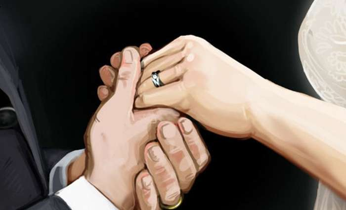
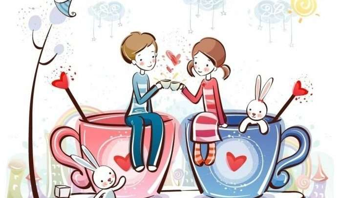

# Гэр бүл салалтаас сэргийлж,  нам “наадаг” эхнэр, нөхрийн 5 хэрэгцээ

Эхнэр эсвэл нөхрийн хууралт, урвалт нь, аз жаргалгүй хосын харилцаа ба аз жаргалгүй амьдралыг харуулдаг гол шинж бөгөөд гэрлэсэн хосын хэн хэнийх нь төрөлх хэрэгцээ хангагдахгүй байгааг илтгэдэг. Гэр бүлээсээ юуг ч юм авч чадахгүй байгаа хосын хэн нэг нь, өөр газар, өөр зүйлээс эрэлхийлж эхэлдэг нь урвалтад хүргэдгийг мэдэхгүй хүн биз ээ. Урвалт хууралтыг давж гардаг хос бараг байдаггүй гэнэ. Тиймээс, хэн нэгнийхээ төрөлх хэрэгцээ хангагдахгүй байгааг харуулах эхний илэрлээс эхлэн харилцаандаа санаа тавьж, хууралт хэмээх таагүй зүйлээс сэргийлэх нь зүйтэй байдаг байна. “Нөхрийн хэрэгцээ ба эхнэрийн хэрэгцээ” номыг зохиогч, америкийн сэтгэл судлаач Уиллард Хадли, 800 гэр бүлийг хамруулсан судалгааныхаа үр дүнд, хэн хэнийхээ хэрэгцээг мэдэрч хангаж чаддагаас, бие биенээ өгүүлшгүй сайханд тооцож явдаг хосуудын үндсэн хэрэгцээнүүдийг тооцон гаргажээ.

1. Эмэгтэйчүүдийн хувьд: -Халамж, энхрийлэл чухал хэрэгцээ. Бэлэг өгөх, тэврэх, үнсэх, гараас нь барих үед, эмэгтэй хүн өөрийгөө жинхэнэ хайрлуулж байна гэж сэтгэл ханамжтай байдаг чухлаас чухал хэрэгцээ.

Эрэгтэйчүүд: -Сексийн харилцаа чухал. Эмэгтэй нь дотно харилцаанд орохыг хүсдэггүй бол эр нөхөр нь энхрийлэл өгөхгүй, харин энхрийлэл өгөхгүйгээр эхнэрээсээ хүссэн таашаалаа авахгүй гэсэн хоёр талаас хамааралтай хосолмол хэрэгцээ.

2. Эмэгтэйчүүд: -Ярилцах хэрэгцээ. Эмэгтэй хүн эр нөхрөө өөрийгөө сонсоосой, бодол санааг нь хуваалцаасай гэж хүсдэг. Үерхэж буй дурлалт хосууд бие биетэйгээ их ярилцаж, үзэл сонирхолоо хуваалцаж байдаг. Яг энэ үеийн харилцаагаа, эмэгтэйчүүд үргэлжлээсэй гэж хүсдэг бөгөөд судалгаагаар 7 хоногт 15 цаг, өдөрт дундачаар 2 цаг орчим эхнэртэйгээ ярилцах сонсох шаардлагатай байдаг байх нь.

Эрэгтэйчүүд: -Эхнэр нь, амрах, зугаацах үеийн сайн анд, найз нөхөр нь мэт байгаасай гэж хүсдэг хэрэгцээ. Дуртай зүйлийг нь үгүйсгэхгүй, хамтрагч, бүр хамт хөл бөмбөг үзэж хашгирч суудаг бол бөөн кайф байдаг гэнэ.

3. Эмэгтэйчүүд: -Эр нөхрөө үнэнч, ил тод, нууцгүй байхыг хүсдэг. Гол хэрэгцээнийх нь нэг. Итгэлтэй харилцаа тэдний хувьд юунаас ч чухал. Эр нөхрөөсөө ил, гүндүүгүй сайхан чанарыг үргэлж хүсдэг.

Эрэгтэйчүүд: -Эхнэрийнх нь дур татам байдал мөн чухал хэрэгцээнийх нь нэг. Нэгд, тэд хүмүүст аятайхан эхнэртэйгээ харуулж байхыг хүсдэг. Хоёрт, хавьталт дотносолтын үедээ эрэгтэй хүн эмэгтэй хүнээс, сэтгэлээс гадна заавал гоо сайхан, үзэмжийг хүсч хүлээдэг жамтай. Эрэгтэй хүнд, эхнэрийнх нь бие мах бодын дур татам байдал яалт ч үгүй гүн гүнзгий, чухал хэрэгцээ нь болж байдаг.

4. Эмэгтэйчүүд: -Хангалтай мөнгө, элбэг дэлбэг амьдрал бол эмэгтэйчүүдийн бас нэг чухал хэрэгцээ. Тэд, маргаашдаа итгэлтэй байх, өдөр тутмын амьдралдаа хангалуун байхад нь мөнгө тус болно гэж итгэдэг.

Эрэгтэйчүүд: -Тэдний хамгийн чухал хэрэгцээ нь гэр бүлийн ая тухтай байдал, тавлаг орчин. Энэ хэрэгцээ нь тэдний хүсэмжлэн зөгнөдгөөр, гаднаас ирэх бүрт нь эхнэр нь, үүдээ нээж өгөөд баярлаж, хайр гийсэн харцаар угтаж, хүмүүжилтэй, цэвэрхэн, хөөрхөн хүүхдүүд нь тосч аван хүндэлцгээж, сайхан үнэртэх амттай хоол өрөөстэй ширээнд урин суулгаж хооллоод, оройн бяцхан зугаалгад хамтдаа алхан орж ирээд, хүүхдүүд нь тайвнаар унтахаар өрөөндөө орцгоож, тэр эхнэртэйгээ ярилцаж, мөн хэсэг зурагт үзээд, унтлагын өрөө рүүгээ энхрийлэлцэхээр, унтаж амрахаар орцгооно. Эмэгтэйчүүд энэ дүрслэлийг уншаад инээцгээх биз. Гэвч, энэ хэрэгцээ нь тэдний хувьд, тэр бүр илэрхийлж чаддаггүй мөрөөдөл нь, төрөлх хэрэгцээ нь байдаг гэнэ.

5. Эмэгтэйчүүд: -Эмэгтэй хүн, эр нөхрөө сайн эцэг байгаасай гэж хүсэмжилдэг чухлаас чухал хэрэгцээ. Бүр зүгээр нэг сайн эцэг биш, үлгэр дуурайл болохуйц аав байгаасай гэж хүсдэг. Хөөрхөн, бяцхан, хайртай үрээ эр нөхрийнхөө гар дээр байхыг харах нь тэдний аз жаргал, сэтгэл ханамж, юутай ч зүйрлэшгүй хэрэгцээ нь юм.

Эрэгтэйчүүд: -Бахархуулах хэрэгцээ. Эрэгтэй хүн өөрөөрөө бахархах дуртай төрөлх чанартай. Бахдах, үнэлэх хоёр ялгаатай байдаг бөгөөд, “Чи сайн шүү”, “Чи мундаг” гэх мэт урамшуулах үгс нь үнэлгээг илэрхийлнэ. Харин, заавал сэтгэл хөдлөлөөр дамжин илэрхийлэгддэг, эрэгтэй хүний үйл хөдлөл, байр суурийг сайшаасан бахархал бол эрэгтэйчүүдийн зайлшгүй гачигдаж байдаг нэгэн хэрэгцээ нь гэнэ. “Би чиний хүрсэн амжилтад баярлаж байна”, “Чи үнэхээр гоё, зохимжтой хувцаслах юм”, “Би чамаараа бахархах юм. Чи миний түшиг тулгуур” гэсэн үгнүүд, үнэн сэтгэлээс хэлэгдэж байвал эрэгтэйчүүд жинхэнэ сэтгэл ханамжийг амсдаг аж.

Энэхүү хэрэгцээнүүд нь хангагдаж байгаа тохиолдолд, эхнэр, нөхрүүд бие биенээ өгүүлшгүй сайханд тооцож, гэр бүлийн харилцаа нь батжин, бие биеэ хайрлах дур хүсэл, хайр сэтгэл нь ундран, үнэнч байдлын суурь нь улам бэхжиж байдаг байна.

