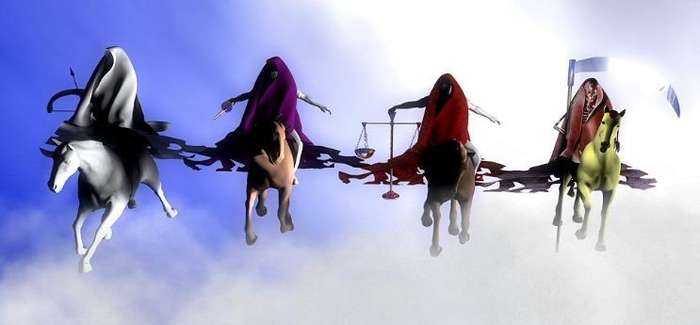

# Гэр бүлийг устгагч “Апокалипсисын 4 морьтон”

Гэр бүлийн маргаан, ямар ч гэр бүлд байдаг зүйл бөгөөд харин түүнийг гомдол, бухимдал агуулсан байнгын маргаан болгох уу, эсвэл бие биенээ ойлгох, нээх алхам болгон хувиргах уу гэдэг нь биднээс өөрсдөөс маань шалтгаалдаг. Хэрүүл маргааны үед гаргаж байдаг алдаанууд, мөн эдгээр нь цаашдын муу үр дагаваргүй үр дүнтэй байх талаар, түүнчилэн маргааныг хурцалдаг 4 биеэ авч явах байдал нь, салалтад хүргэх үр дагавартай байдгаас болгоомжлох хэрэгтэйг онцлон хүргэж байна.

1. Хэт шүүмжилэл. “Чиний энэ байдлаас залхлаа”, “Иш, зайлуул”, гэх мэт. Бусадтай харьцуулах. “Хүний ...-г хар”, “Чи хэзээ ч тэрэн шиг болж чадахгүй”, “Чи ч нэг ийм л дээ” эдгээр үгс маш хортой үр дагавартай байдаг. Хуралдсаар байгаад, дэлхийг ч бутаргах чадалтай үгс.\
2. Доромж хандах. Нүд, амаа эвгүй хөдөлгөн бие биенээ, “Чи ер нь ямар нэг зүйл хийж чадах уу” “Юу чаддаг юм” гэх мэт доромжлох. \
3. Өөрсдийгөө өмгөөлсөн, “Чи өөрөө тэнэг”, “Өөрийгөө хар”, “Чамаас л болдог”, “Чи л буруутай” гэсэн үгс нь, өөрийнхөө хариуцлагыг үгүйсгэн, бие биенийхээ зөв буруугаа хүлээх чадвар, уучилал хүсэх хандлагыг устгадаг. \
4. “Хөлдүү хана” шиг авир. Хүйтэн царайлан, үг дуугаа хураах шиг, хамтын амьдралыг устгагч байхгүй. Ийм байдлыг удаанаар даван тэсэх хайр дурлал гэж байхгүй юм. \
Эдгээр, хэрүүл маргааны үед гаргадаг занг, гэр бүлийн сэтгэл зүйчид, “Апокалипсисын 4 морьтон” гэж нэрлэдэг. Дэлхийн сүйрэлтэй дүйцүүлсэн нь нэгийг бодогдуулах биз ээ. Тиймээс зөв маргаж сурах хэрэгтэй байх нь. \
Гэр бүлийн маргааны үеийн хөгжилтэй нэгэн түүхийг хүргэе. \
-Би нөхөртөө, өөрийн гэсэн юмнуудаа аваад зайл гэсэн чинь, нөгөөх чинь, харин чемоданаа авчирж тавьчихаад, хүү бид хоёрыг чемоданд чихэх гээд эхэлдэг байгаа, тэгээд бид эвлэрсэн. \
Нэг иймэрхүү санаануудыг эрж хайвал яасан юм? Тийм үү? Хөөрхөн түүхүүд байвал хуваалцаарай!
