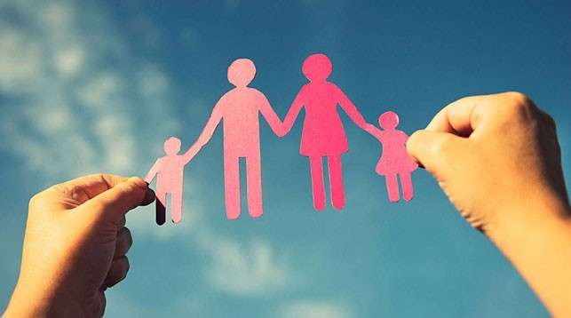
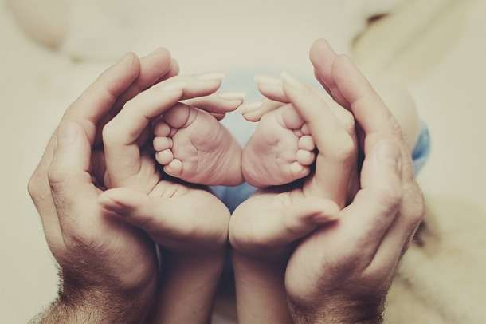

# Гэр бүлийн амьдралын хамгийн жаргалтай үе болон хүнд үе хэдийд тохиодгийг тогтоожээ

Гэр бүлийн амьдрал бат бөх харилцаанд байхад, гэр бүлийн хосуудын хамтын хүчин зүтгэл хэрэгтэйг хэн нэг нь мэддэггүйгээс, гэр бүл салалт ихэсч байна гэж мэргэжилтэнүүд үзэж байна. Европд, сүүлийн үеийн судалгаагаар, 2,1 сая гэрлэлтийн 950 мянган гэр бүл нь салдаг болох нь харагджээ. Slater & Gordon фирмийн мэгэжилтэнүүд, гэрлэсний дараа, хэзээ хамгийн жаргалтай байдаг, харин, хэдий үед хамгийн хэцүү байдаг болохыг тогтоосон судалгаа явуулжээ.

3 дах жил. Гэрлэсний дараах 3 жилд, хосуудын хайр дурлал дундарч, харилцаа нь таагүй болсноос салдаг гэсэн яриа байдаг. Гэтэл, харин ч энэ хугацаанд, хосууд бие биенээ таньж, алдаа дутагдлуудтайгаа эвлэрч, үр хүүхэдтэй болж, гэр бүлийн харилцаа нь улам бат бөх болсноор, хамгийн жаргалтай байдаг үе нь тохиодог гэнэ.\
5 дах жил. Энэ үед, хүүхдээ өсгөх, зэрэгцүүлэн ажил төрөл эрхлэх гэх мэт амьдралын томоохон асуудлууд тулгарч байдгаас ихээхэн ачаалалтай хамгийн хүнд үе тохиодог. Хамгийн анхны, салалтын тухай бодол орж ирдэг үе гэж үзжээ.\
7 дох жил. Хэрэв, 5 дах жилийн хүндрэлийг даваад гарсан бол дахин саад бэрхшээл учирдаг үе гэж үздэг. Энэ үед, гэр бүлийн амьдралд, хэрэгцээ өссөнөөр санхүүгийн асуудал, хүүхдүүдийнхээ төлөө санаа тавих асуудлууд ар араасаа гарч ирж, үүрэг хариуцлагаа хоорондоо хуваарилах зэргээс үүдэлтэй хүндхэн үе ирдэг. Энэ үеийг давснаар, гэр бүлийн урт удаан, аз жаргалтай амьдралд хүрдэг гэсэн судалгааны үр дүн гарчээ.\
Гэрлэлтээ, хамгаалахын тулд, дараах зүйлсээс болгоомжилох ёстойг зөвлөжээ.\
Биелэгдээгүй хүсэл хүлээлт. Хосууд, ихэвчилэн хавар намрын цагаар салдаг гэнэ. Бодож байснаар нь, амьдрал болоогүй тохиолдолд салцгаадаг аж.\
Асуудлуудаа хоорондоо ярилцаж зөвлөлдөхгүй байх. Залуу хосууд, аж амьдралын асуудлуудаа ярилцаж зөвлөлдөхгүй дуугүй байдгаас салдаг, сэтгэл санаагаа хуваалцаж, бүр ядахдаа, үзсэн киноныхоо тухай ч хоорондоо сэтгэгдлээ хуваалцаж ярилцаж байх ёстой байдаг байна.\
Сонсох хүсэлгүй байх. Салсан хосуудын ихэнхи, хэн нэг нь, нөгөөгөө сонсдоггүй, өөрийнхөөрөө байхыг тулгадгаас салдаг болох нь батлагджээ. Ийм гэр бүлийн харьцаа заавал салалтад хүргэдэг болох нь судалгаагаар харагджээ.\
Олон нийтийн сүлжээ, интернетийн хамаарлаас үүдэлтэй салалт ихэссэн судалгааны үр дүн гарчээ.\
Боловсролд анхаардаг хүмүүсийн дунд салалт бага байсан байна.
