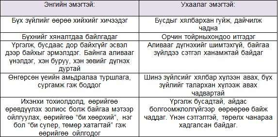

# Гэр бүлийн эв эеийг сахих сургамж

Нэгэн ахмад эмэгтэй, -“Охидууд минь, ухаантай хүн ба ухаантай эмэгтэй хоёр, хоорондоо тэс ондоо ойлголт гэдгийг, та нар насан туршдаа санаж явцгаа, учир нь, ухаантай хүн оюун санаа, ердийн бус сэтгэн бодох чадвараараа ялгарч байдаг бол, харин ухаантай эмэгтэй нь, өөрийн харилцаанд, ялангуяа гэр бүлийн хүрээлэлдээ, өөрийн ухааныг дөвийлгөдөггүй, гэр бүл, эр нөхрийнхөө хэнд ч хүндээр тусахааргүй, хамгийн аятай зөөлөн шийдвэрийг гаргахыг үнэн сэтгэлээсээ хичээдэг, ЭВ ЭЕ, АМАР ТАЙВАН БАЙДАЛ-ыг чин сэтгэлээс эрхэмлэдэг хүн байдаг. Манай эмэгтэйчүүд, ухаангүй үйлдлийг их хийцгээх юм. Юуны түрүүнд, халз тулаан болон ялалтыг тулааны дэвжээн дээрх тулаанчид шиг эрмэлзэх юм. Ийм үед, эрэгтэй хүн яадаг вэ? Тэд, зайлахаас аргагүй байдалд орж, зугтна. Ингээд тулалдаад байх нь зөв үү? Тиймээс, эр нөхрөө жинхэнэ эр нөхөр шиг байлгахыг хүсч байвал, эхнэр хүн өөрөө жинхэнэ эмэгтэй хүн шиг байх ёстой” гэж сургажээ.
