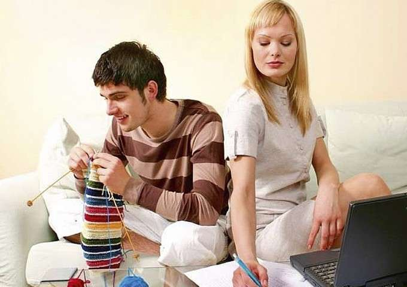
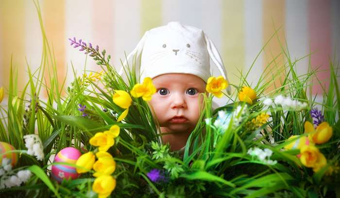

# Гэр бүлийн гишүүдийн үүрэг солигдохын уршиг

Хувь хүн, өсч байгаа орчиндоо төлөвшдөг. Ямар гэр бүлд өссөнөөс шалтгаалан, тэр үед авсан хүмүүжил, харилцаа амьдралд нь нөлөөлж мөн тийм л хэв маягаар инэвчлэн амьдралаа зохиодог.Төгс гэр бүлийг бид ихэвчлэн сурталчилгаанаас харж сэтгэлээ зогоон, харин амьдрал дээр байгаа гэр бүлийн харилцааг харж асар зөрүүтэйг нь мэддэг ч нүдээ аниад явах юм. Дахин давтан хэлье, гэр бүлийн аз жаргал болон зөв гэр бүлийн тухай ойлголтыг бид, төрж өссөн орчиноосоо л олж авдаг. Тиймээс гэр бүл доторхи, гэр бүлийн гишүүдийн үүрэг роль солигдсон тохиолдолд чухам ямар зүйл болж байдгийг харуулахыг хичээе. Харин хүүхдээ, ирээдүйд гэр бүлийн харилцаанд ямар үүрэгтэй байлгахыг хүсч байгаа болон, үүнд энэхүү үүргийн солигдолт нөлөөлөх орчин байгаа эсэх, байгаа бол тэрхүү үр дагавар танд, таатай байх уу гэдэг талаас бодож тунгаах асуудлыг танд өөрт чинь үлдээе.

#### Ээж нар нь, өрхийн тэргүүлэгчийн үүрэг гүйцэтгэдэг гэр бүл

Уул нь, ээж нар бол, өрхийн тэргүүлэгч аав нарын толгойг аятайхан хэрэгтэй зүг рүү нь эргүүлж өгөх ёстой, томоохон шийдвэр, асуудлууд дээр л тусалдаг үүрэгтэй “хүзүү” юм. Тэр, ээж учраас, үр хүүхдээ хайрлаж асрах, өсгөж хүмүүжүүлэх үүрэгтэй. Гэтэл орчин үед, өрхийн тэргүүлэгч болчихсон олон эмэгтэйг харж болно. Эхний үед хүүхдүүдэд ийм ээжтэй байх муугүй санагдна, мөн эрэгтэй хүн ч хариуцлага хөнгөрсөнд аягүйцэхгүй хүлээн авдаг. Гэвч, хэсэг хугацааны дараа, төрлөх байгаллаг чанар болох бүхнийг гартаа авах чанар нь, эр хүнд яалт ч үгүй сэргэдэгээс гэр бүлд таагүй уур амьсгал бүрдэх шалтгаан болдог. Мөн, бүх зүйл ээж шийддэг гэр бүлд өсч буй хөвгүүд, эр хүний хариуцлагатай чанар шаардлагатай эсэхийг ойлгохгүй өсдөг. Харин охид, ирээдүйн өрхийн тэргүүлэгч, эрэгтэй хүний үүргийг биелүүлэхэд бэлэн хүмүүс болж өснө.

#### Хүүхэд гэрийн “баатар” болсон гэр бүл

Ийм гэр бүл байдаг. Хүүхдээ, шүтэн биширч, бараг л мөргөх нь халаг, үгийг нь дагаж байдаг гэр бүл. Хүүхдийнхээ хүссэн бүхнийг биелүүлж, “толгой дээрээ гаргасан”-аас , хүүхдийн амиа бодох үзэл нь дээд цэгтээ хүрч, ийм болгосон томчуул өөрсдөө үйлчлэгч нь болдог. Ийм хүүхэд, биеэ даан асуудлыг шийдвэрлэх чадваргүй, бусдыг өөртөө үйлчлэх ёстой гэсэн бодолтой хувь хүн болон төлөвшдөг.

#### Эмээ өвөөгийн оролцоо давамгайлсан гэр бүл

Мөн, олон залуу гэр бүл, төрөл төрөгсөдтэйгээ хамт амьдрах үед,бүх зүйлийг нь хамт байгаа ээж, аав нь шийдэж, амьдралд нь оролцож зохицуулж байдаг. Энэ байдлыг харж өсч байгаа бага хүүхэд, өөрийнхөө ээж, аавыг өсч том болоогүй өөртэй нь адил гэж бодсоноос, өсөхдөө, ээж аавыгаа үл тоох хандлага гаргах нь ажиглагддаг. Иймэрхүү жишээг маш олныг гаргаж болох бөгөөд эдгээр нь, хүн бүр, өөрт оноогдсон байгалиас заяагдсан үүргээ юунаас ч хамаарахгүйгээр биелүүлэх, гүйцэтгэх ёстойг, мөн байгаллаг чанараа зөрчсөн ийм амьдрал сайн зүйлд хүргэхгүй байгааг тодорхой харуулж өгдөг ажээ.
