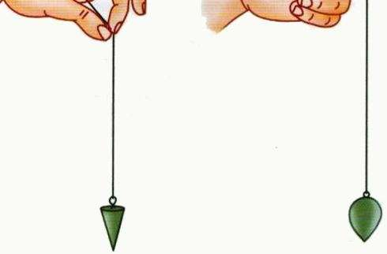
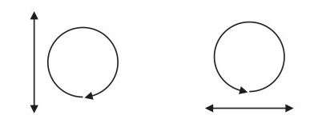

# Гэр орны энерги

Орон гэрийнхээ энергийг үе үе анхаарч шалгаж байх хэрэгтэй байдаг гэнэ. Эерэг сайн энергитэй орон байранд, асгарсан ус удаан хатна, ваартай цэцгүүд сайн ургана, төмөр эд, эдлэлүүд барьж хүрэхэд хүйтэвтэр, харин модон эдлэлүүд бүлээхэн байдаг. Харин, сөрөг муу энергитэй байранд, зоосон мөнгө унагахад жингэнэсэн чимээ гаргадаггүй, мөн, сүү түргэн гашилах, хоол цай түргэн хөрөх, давс маш хурдан усанд уусах, цөцгийн тос маш түргэн хайлах, лаа тортогтож асах, асах үедээ дөл нь тогтворгүй, амархан унтрах зэрэг шинж тэмдэгүүд илэрч байдаг байна.

---

Гэрийнхээ энергийг өөрсдөө шалгаж, ариулж болдог хялбар арга байдаг бөгөөд ердийн утсанд хүндрүүлэгч болгон, зөвхөн өөрийн эдэлж хэргэлдэг мөнгө, зэс, болор эдлэл уяж, дүүжин чиглүүлэгч мэт зүйл хийж гартаа барин гэр дотроо явж, тухайн газар бүрт зогсож шалгахад, хүндрүүлэгч урагш хойш савлах, эсвэл нар зөв эргэж хөдлөж байвал “эерэг”, хөндлөн савлах юмуу нар буруу эргэж байвал “сөрөг” энергитэй байгааг зааж байна гэдэг. Сөрөг энергитэйг заасан газарт дурын цахилгаан хэрэгсэл тавихад муу энерги саармагжина. Ийм газар буюу өрөө тасалгааны сөрөг энергитэй хэсэгт ном тавьж болдоггүй, учир нь ном энергийг шингээж эзэндээ дамжуулна гэж үздэг. Мөн, аягатай ус тэр хэсэгтээ тавьж хонуулаад, өглөө нь заавал босго давуулан асгаж болдог. Гэр орондоо хэрэглэгддэггүй зүйлс хурааж хадгалах нь гэр орны энергийг эвддэг бөгөөд ялангуяа таагүй, сөрөг дурсамж агуулсан эд зүйлсээс харамсалгүй салах хэрэгтэй гэж зөвлөдөг байна. Орон гэр бол бидний зүгээр унтаж, идээд амардаг газар биш, харин бидний хамгийн чухал амьдралын орон зай гэдгийг ойлгож эерэг сайн энергиэр дүүрэн байлгах ёстой бөгөөд гэр орон бол хүний нүүр царай, тусгаар орших орон зай, хамгаалагч цайз учраас байнга анхаарч, анзаарч байхыг хичээх хэрэгтэй байдаг ажээ.
