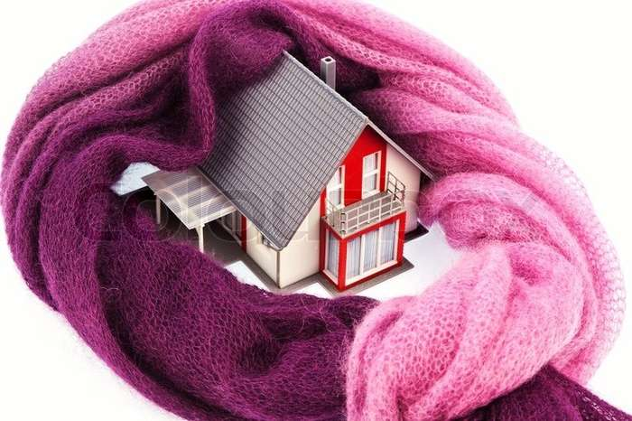
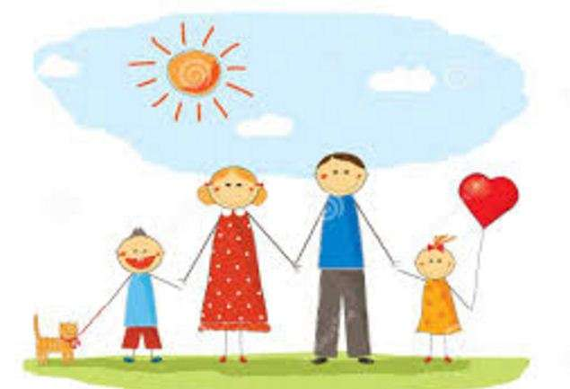

# Гэр орны энергиэ хамгаалах арга

Байр, байшин амьгүй, харин түүнийг хүмүүсийн бодол, сэтгэл санаа, хоорондын харилцаа, гэр бүлийн уламжлалт заншил амьтай болгодог гэж үздэг байна.

Гэхдээ зарим байр, байшин, орчинд амьдрал бүтэлгүйтэх тохиолдол байдаг бөгөөд үүнийг хүмүүс, ихэвчлэн атаа жөтөө, хар, цагаан хэл амтай холбон үздэг. Гэтэл, үүнийг, байр, байшингийн баригдсан газартай холбож үзэх нь буруу биш гэнэ. Хэрэв, барилга, хуучны булш байсан газар, газрын гүний голын дээр харалдаа, геопатоген бүсэд баригдсан бол таагүй байдаг байна. Үүнийг гэрийн тэжээвэр амьтад маш сайн мэдэрдэг байна. Амьтад, геопатоген бүсд хэзээ ч хэвтдэггүй, хамгийн эерэг энергитэй газрыг сонгож хэвтдэг. Гэтэл хүмүүс, өөрт эсрэгээр нөлөөлж байгаа, амрахгүй байх- өвдөх, ядрах-ажил бүтэхгүй байх зэрэг зүйлсийн шалтгааныг эрж хайхыг мэддэггүй, мөн мэдрэхийг хичээдэггүй хэнэггүй зангаасаа болж муу үр дагаварт хүрч байдаг байна. Бүрэн амрахгүй байвал, ороо сэлгэж тавьж, сайн энергитэй байршил хайхын оронд тавилга ингэж тавиастай нь сайхан харагддаг гэх мэтээр өөрсдийн эрүүл мэнд амьдралыг хоёрдугаарт тавьдаг ажээ. Орчин үед, байр нь, зориулалтын өрөө тасалгааны зохион байгуулалттай байдаг болсон тул амрахад таатай газрыг гэртээ сонгох нь, улам бэрхшээлтэй болж байгааг хүлээн зөвшөөрөхөөс өөр аргагүй юм. Гэхдээ, амьдралын тань уур амьсгал таагүй болоод байвал, багахан ч атугай зүтгэл гаргаж шалтгааныг нь олохыг хичээгээрэй. Байр, тасалгааны ханаар сөрөг энергийн урсгал явдаг гэж үздэгээс лаа асаан ариулж байх, мөн өнцөг буланг таагүй гэдэг тул сандал, креслийг буланд байрлуулж суухгүй байхыг хичээх ёстой аж. Мөн, буруу хэрэг хийсэн хүүхдээ буланд зогсоож шийтгэж болохгүй, энергээ алддаг. Наад захын энэ сануулгуудыг хүлээн авч, мөн гэр бүлийн аз жаргалыг хамгийн их хамгаалдаг бие мах бод, ёс суртахуун, сэтгэл санааны ариун байдал, гэр орны цэвэр цэмцгэр байдлыг сахиснаар аливаа муу зүйлсээс зайлсхийнэ гэдгийг ойлгон хэрэгжүүлж байх хэрэгтэй. Уур уцаар, хэрүүл маргаан нь орон гэрийн энергийг мөхөлд хүргэдэг. Мөн эмзэгхэн энергитэй байдаг тул хүүхдүүдэд маш муу тусдаг. Өөрийн гал голомтоо, үр хүүхдийнхээ сэтгэлд, сайн сайхан дурсамжууд үлдээхүйцээр, өсч том болоод явсан ч дахин дахин ирэх сэтгэлтэй байхаар, сайхан эвсэг гэр бүлийн уур амьсгал бүрдүүлэх нь, хэнд ч, юунд ч дийлдэшгүй орчинг бий болгоно гэдгийг ойлгох хэрэгтэй.
