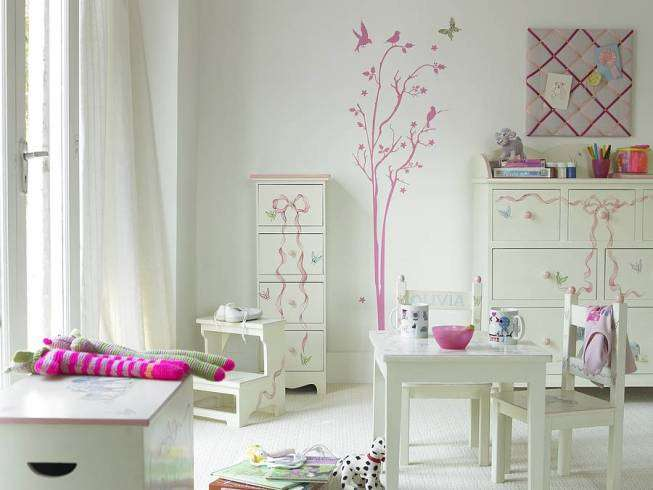

# Гэр орон бол эмэгтэй хүний нарийн нүдэнд үл үзэгдэх бие юм

Эмэгтэй хүн гэртээ орж ирэхэд, түүний нарийн үл үзэгдэх бие гэрээр тархаж, нэгэн цул мэт болдог гэх бөгөөд гэрийн эд эдлэлийн эвдэрхий байдал, санжиганасан бариул, хаалга нь хаагдахгүй шүүгээ гэх мэт зүйлс нь энэхүү нарийн биеийг нь гэмтээж өвчин болгох боломжтой байдаг гэнэ. Тиймээс эмэгтэйчүүд эвдэрхий зүйлс, засварт илүү анхаарч, өөрөө ч мэдэхгүй биеэ өвчин эмгэгээс хамгаалахын тулд эр нөхрөө шаардаж байдаг байх нь. Харин халамжтай, эхнэрийнхээ эрүүл мэндэд санаа тавьдаг эрчүүд үүнийг мэдэрч ойлгож байдаг бөгөөд түүний гэр орондоо санаа тавьж, засаж хийж байгаа бүхэн тухайн зүйлсийг засч янзлахын зэрэгцээ эмэгтэй хүний нарийн үл үзэгдэх биеийг эмчилж байдаг байна. Тасралтгүй дуслах усны крант, чихарч санжиганасан эвдэрхий зүйлс нарийн биеийг гэмтээж бие мах бодыг нь өвчилүүлдэг. Эхлээд эмэгтэй хүн бухимдамтгай болж дараа нь уур уцаартай болж өвдөж эхэлдэг. Тиймээс гэр орон бол эмэгтэй хүний нарийн үл үзэгдэх бие юм.

