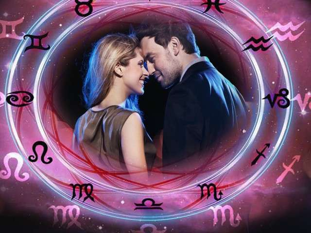
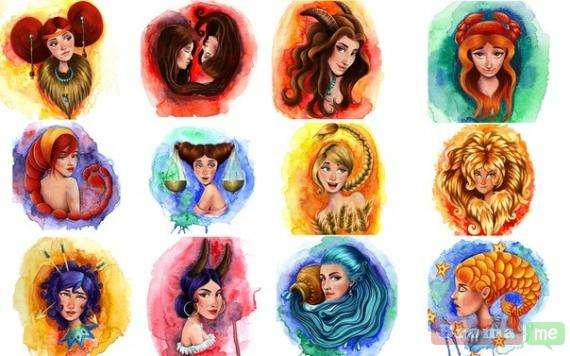

# Гэргий нарын зурхай

#### Хонь

Хонины ордны эмэгтэйчүүд, зоримог, романтик, үе үе тааварлашгүй зан гаргах нь ажиглагддаг. Үнэнч, зөрүүд, идэвхитэй, хүссэндээ хүрэх чадвараараа гайхуулж байдаг. Хүссэн л бол, шийдвэртэйгээр, тойруу замыг сонгохгүй урагшилна. Аливаа зүйл таалагдаж байгаа, эсвэл таалагдахгүй байгааг огт нуухгүйгээс гадна хүсвэл түрүүлж сэтгэлээ илчлэх нь ч бий. Энэ занд нь зөөлөн зантай эрчүүд, дэнгийн эрвээхэй шиг дурлацгаах ба хатуухан эрчүүд хэсэг тэмцэлдээд итгэж болохыг нь ойлгодог. Мөн эдгээр эмэгтэйчүүд бага зэрэг эрчүүдийг үл ойшоох хандлага гаргах талтай ч хэзээ ч үглээ яншаа, дорой зан гаргахгүй. Харин тэд, “эрэгтэй хүн”-ий амьдралаар амьдрахаар шийдсэн бол, эргэн тойрныхных нь хувьд байгалийн гамшиг учирлаа гэсэн үг. Түүний хүсэл, ажил хэрэг дуусашгүй өрнөнө. Тэд, хонины ордны эр хүнтэй гэрлэх нь ховор. Арслан, нумын ордтой таарах ч, “асч-унтарсан” амьдралаар амьдардаг. Ихэр, хумх, жинлүүрийн ордынхонтой амархан зохицдог. Маш сайн ээж, хайрыг нь гундаахгүй бол маш үнэнч, гэр бүл, гал голомтынхоо сайн хамгаалагч байдаг. Түүний уралдан тэмцэлдэх дуртай зан, байнга таарч тохирохыг шаардахаас гадна эр хүнээс давуу зан чанарыг хүсч, түүнд нь сөгдөхийг хүсдэг. Үгүй бол тэр өөрөө, бүхнийг хялбархан шийдэж чадна. Тэр бол төвийн тоглогч. Өөрийнхөөрөө байж чадаагүй хонь-эмэгтэй аюултай, аз жаргалгүй байдаг. Түүнтэй шударга харьцаж, үе үе жижиг сажиг асуудлаар маргалдаж байх гэмгүй. Хонь-эмэгтэй, хүнийг өмссөн зүүснээр биш, харин чухам хэн бэ, гэдэг талаас голчлон авч үздэг.

#### Үхэр

Энэ эмэгтэйчүүдийг Венерагийн охид гэж үздэг бөгөөд гоо үзэсгэлэн, хайр дурлалын биелсэн амьд дүр гэж үздэг. Тэд төвийг сахисан, хэзээ ч эмэгтэйгээрээ үлдэж чаддаг хүмүүс. Эрэгтэйчүүдийг нугалах, эмэгтэйчүүдийг чимэх “зөөлөн сул” зантай. Гэхдээ хэрэгтэй цагтаа, шийдэмгий, хурдан үйлдэл, уйгагүй зүтгэлийг гаргаж чаддаг. Тэд хартай, өөрийн эрэгтэйг өөрийн өмч гэж үздэг. Амьдралыг төгс болгох, зөв амьдралыг эрхэмлэдэг тэд, урвалтыг өршөөж чаддаггүй. Маш зөрүүд, өөрийн дотоод хууль дүрмийг ягштал биелүүлэхийг хүсдэг. Ойр дотныхныхоо өмнө хүлээх үүргээ маш сайн мэдэрдэг. Тиймээс тогтвортой амьдралд дуртай, итгэл найдвартай эрэгтэйг эрж хайдаг. Гэрэлт ирээдүйн гэгээн амлатуудаар түүнийг худалдаж авч чадахгүй. Энэ эмэгтэйчүүд, сайн найз, сайн эзэгтэй, үнэнч гэргий, шаардлагатай ээж юм. Энэ авъяас чадварууд нь төрлөхөөс заяагдсан байдаг. Мөн, тэд, хурааж цуглуулах, хадгалах, хайрлах, тайтгаруулах гайхалтай чадвартай. Эрэлхэг, итгэлтэй эрэгтэй хүнийг үнэлдэг. Тэд тав тухыг бүтээх, гэр бүлийн амьдралын төлөө төрсөн юм шиг хүмүүс. Арслан, хонь, ихэрийн ордныхонтой гэрлэхээс зайлсхийх хэрэгтэй гэдэг. Хумх, үхэрийн ордтой сайн тохирдог.

#### Ихэр

Энэ ордын эмэгтэйчүүд, эмэгтэй зүрхтэй эрэгтэй ухаантай хүмүүс. Тэд эрэгтэй логиктой учраас зан чанар нь хоёрдмол байдаг ба энэ нь бухимдуу байдалтай болгодог. Олон хувилбаруудаас сонголтыг гайхалтай сайн хийдэг. Тэд хөдөлгөөнтэй, ухаантай, амьдралд хайртай, хурц ухаантай, адал явдалд дуртай. Тиймээс, тэд эхнэр, гэрийн эзэгтэй байхаас гадна эр нөхрийнхөө найз, удирдагч болох нь бий. Зорилгодоо өөрийн зүтгэлээр хүрэхийг илүүтэйд үздэг ба аливааг дуурайх хуулбарлах чадвартай, мөн өөрийн аз жаргалын төлөө зоригтой үйлдэл хийдэг. Болж буй үйл явдлуудыг бүгдийг мэдэж байх дуртай ба тод томруун, энгийн биш халамж, санаа тавих байдал тэдний сэтгэлийг татдаг. Тэд зочид ирэхэд болон алс хол явах, аялах дуртай. Тэд зурхай, төлөгийг хүлээн зөвшөөрдөг ч, өөрийн бодлоор эр нөхрөө сонгодог. Ухаантай, өөрт нь тохирох талаас хардаг. Сэтгэл санааны гүн гүнзгий харилцаанд орох асуудал, тэдний хувьд хүнд байдаг, үүнийгээ ч тэд мэддэг. Ихэр, хоньны ордынхон таардаг. Матар ихэр хоёр тохирохоос гадна бие биенээ нөхөж, ийм хос, ихэвчлэн ажил албаны өндөр амжилтад хүрдэг. Ус мах бодтой ордуудтай таардаггүй, бусад ордуудтай тохирдог.

#### Мэлхий

Энэ эмэгтэйчүүд, маш мэдрэмтгий зөөлөн хүмүүс. Тэд үүнийгээ нууж явдаг. Тэд гэр бүлийн амьдралын төлөө заяагдсан. Амьдралдаа ямар ч үүрэг гүйцэтгэсэн гэр бүлдээ бүхнээ зориулдаг. Хэдийгээр маш мөрөөдөмтгий ч эр нөхрөө сайтар бодож сонгодог. Тэд эр хүний хувьд оньсого шиг хүмүүс. Учир нь эрэгтэйчүүд, тэдний, харилцааны нарийн ширийн асуудлуудыг ойлгодоггүй. Хэдийгээр тэд, амьдралд бодитоор ханддаг боловч, сэтгэл санааны байдал нь их өөрчлөгдөж байдаг. Тэднийг сар эрхшээдэг гэдэг. Сарыг, амар амгалан байдал, зохилдлогоо, гэр бүлийн уламжлалт ёс, үнэт зүйлсийг ивээдэг хамгийн эмэгтэй гариг гэж үздэг байна. Тиймээс эдгээр эмэгтэйчүүд, чанд ба романтик, ухаан ба мэдрэмж зэргийг хослуулсан байдаг. Тэд хамгийн сайн халамжит ээж, үнэнч хань, мөн гэр орон, гэр бүлээ нэгдүгээрт тавьдаг хүмүүс. Түшиг тулгуур болох, амьжиргаатай эрэгтэйг сонгодог. Тиймээс, тэд, хэдийгээр сэтгэл санааны харилцан ойлголт бэрхтэй ч ихэр, жинлүүр, хумх, түүний үйлдэл зан чанарыг тайлбарлаж чаддаггүй ч хонь, арслан, нумын ордны хүчирхэг эрчүүдийг сонгодог.

#### Арслан

Арслан-эмэгтэй хайр дурлал, секс, гэрлэлтийн хооорондын ялгааг маш сайн мэддэг. Эрэгтэй хүнд өндөр шаардлага тавьна. Тэд тансаг амьдрал, зугаа цэнгэл, эд баялагт дуртай мөн удирдах захирах, анхаарлын төвд байх дуртай байдаг. Өөрийн үзэл бодол, гэр бүл, өөрийгөө хамгаалж чадна. Үр хүүхдүүд төрүүлж, үлгэр жишээ ээж болдог. Маш их дотоод эрч хүчтэй тул, гэрээс гадуурхи ажил төрөлд илүү анхаарах хандлага гаргадаг. Тэд, эрх мэдэлтэй баян эсвэл гарын доор хүнийг сонгодог. Гэвч, хамтын амьдрал, хамтын эрх ашгийн үүднээс зан чанараа өөрчлөх чадвартай. Нэр төрөө хайрлах сэтгэл, сайхан сэтгэл нь тэднийг амьдралын ямар ч байдлаас гарахад нь тусалж байдаг. Дотоод ертөнц нь төгс ийм эмэгтэйчүүд, тухайн нийгмийнхээ чимэг нь болох нь олонтаа байдаг.

#### Охин

Тайван төлөв зантай, ойр дотныхныхоо өмнө хүлээх үүргээ мэддэг, сул дорой хүмүүсийг ойлгодог. Үлгэр жишээ гэрийн эзэгтэй, ажилсаг, арвич хямгач, хичээнгүй, тусалж дэмжихэд бэлэн байдаг хүмүүс. Түүний аливааг бодитоор харах дүгнэх зан, хөл дээрээ бат зогсох боломжийг өгч байдаг. Тэд, албан тушаал, нэр төрд эрмэлздэггүй, үүний оронд бүх зүйлээ гэр бүлдээ зориулахыг эрхэмлэнэ. Хүүхэд хүмүүжүүлэхдээ гарамгай. Тэд нэг бол хэт нямбай, эсвэл салан задгай байх магадлалтай. Ямар ч тохиолдолд гэр орноо эмх цэгцтэй байлгаж, ёс журмын дагуу амьдардаг. Биеэ баримтгай, шийдэмгий биш, ажил хэргээ урсгалаар явуулах хандлагатай, амархан гомддог. Сэтгэл зүрх, оюун бодол хоёроо ижил хэмжээнд авч үзэн итгэдэг учраас, хүсэл, бодит байдлын ялгаанд эмзэглэж, өөрийгөө хамгаалах чадвар султайгаа бусдаас илүү мэдэрч байдаг. Энэ байдлаа засахын тулд байнгын завгүй байдал, үүрэг зорилгоор өөрийгөө дарж байдаг. Тэр даруу, бүрэг ичимтгий ч зарим үед өөрчлөгдөх нь бий. Тэр, өөрийн төсөөлөл, шаардлагад нийцэх нөхөр сонгодог. Тиймээс дараа нь урам хугарах байдалд орох нь олонтаа байдаг.

#### Жинлүүр

Энэ эмэгтэйчүүд, зөөлөн, сэргэлэн, хатуу, зоримог, дайчин чанаруудыг хослуулсан зантай байдаг. Тэд ихэвчлэн сайхан төрхтэй, дур булаам байдаг. Тэд өөрийгөө өндөрт үнэлдэг, мөн тансаг, амар хялбар амьдрахаар заяагдсан хүмүүс. Тэд тааламжтай харьцаа, тав тухад дуртай, бие мах бод, сэтгэхүйн ачаалалд бэлтгэгдээгүй байдаг. Эр нөхөр нь үүнийг урьдчилан мэдэж, огцом өөрчлөлт, таагүй зүйлсээс хамгаалж байх хэрэгтэй байдаг аж. Жинлүүр-эмэгтэй сайн сайхны мэдрэмж нь маш өндөр хөгжсөн, хүссэнээрээ байдаг, мөн заримдаа хүйтэн “Цасан хатан” шиг болж байдаг. Тэр бусдын хайрыг татах увидастай. Тэр, мөн гоо үзэсгэлэнт Венерагийн эрхшээлд багтах ба эргэн тойронд нь эрэгтэйчүүд эргэлдэж байдаг. Гэр бүлийн амьдралд эрт ордог. Эр нөхрөө өөрөө сонгох ба нэг бус удаа гэрлэх нь бий.

#### Хилэнц

Өөрийгөө хамгаалах чадвартай, хатуу зантай, зөөлөн зүрхтэй, туйлшрамтгай. Хэзээ ч өөрийгөө гомдоох байдалд оруулахгүй. Хувийн амьдралдаа сэтгэлийн хөдөлгөөнтэй, романтик, энэ нь ажил төрөлдөө бодитоор хандахад нь саад болдог. Тэд эмэгтэй зан, зоримог дураараа зан хоёрыг зэрэг гаргаж чаддаг. Тэд өндөр хөгжсөн зөн совин мэдрэмжтэй. Совингоороо ханиа сонгоно. Барагтай бол алддаггүй. Маш хартай. Бараг бодлоороо удирддаг. Далдын хүчтэй. Соронз мэт. Гал мах бодтой ордуудтай зохицох бөгөөд амраг, дайчин нөхөр, сайхан гэргий болдог. Түүнийг хичнээн дулаацуулж халамжлана, төдий чинээ үнэнч, халамжтай, хайртай хүнийхээ төлөө яахаас ч буцахгүй болж байдаг. Тэр өөрийгөө хайртай хүндээ бүрэн зориулж, үүнийхээ зэрэгцээ мөн захирч байдаг. Хилэнц-эмэгтэйн, хайрыг нь татах хэрэгтэй бөгөөд үүнийхээ хариуд хамгийн өндөр, хамгийн сайхан сэтгэлийг харамгүй авна.

#### Нум

Эдгээр эмэгтэйчүүд багын, хүүхэлдэйгээр тоглодоггүй, хөвгүүдтэй модонд авиран, хашаа хороо давж, өвдөгөө шалбалсан шиг өсдөг. Тэд, зугаа цэнгэл, аялал, бүжиг, спортод дуртай, нийтэч, бусад эмэгтэйчүүдэд дургүй байх хандлагатай. Эрэгтэй хүн болж төрсөн бол, мөн эрэгтэйчүүдтэй адил эрхтэй гэж боддог. Тэд, хувийн эрх чөлөө, тусгаар, хамааралгүй байдлыг эрхэмлэдэг. Эр нөхрөө сонгохдоо, юу эрхэлж байснаас эхлүүлээд, гадаад төрх, яаж хувцасладаг, үсээ хэрхэн засуулсан, ямар зангиа зүүдгийг нь хүртэл шинждэг. Түүний хувьд, төгссөн сургууль, биеэ барих чадвар, даруу зан, уламжлал ёс зүйг хэрхэн үздэг зэрэг нь гол шалгуур нь болдог.

#### Матар

Энэ эмэгтэйчүүд, банзал өмссөн Карнеги л гэсэн үг. Тэд, сайн хань хүлээн, ирээдүйгээ төлөвлөн, таамаг болгоомжлол дүүрэн суудаг. Сүйт бүсгүйн жинхэнэ төрх. Маш удаан сонголт хийнэ, мөн өөрийн хүчээр хүрэх зүйлд нь гэр бүл нөхөр садаа болох вий гэж болгоомжилдог. Харин, гэрлэвэл, эр нөхрийнхөө өмнө гарч болох, нийгэмд байр суурь эзлэх боломжийг уйгагүй дэмждэг, итгэлтэй, хөдөлмөрч, шударга, аж ахуйч эмэгтэй. Гэхдээ нөхөр нь, түүний энэхүү зүтгэлийн хариуг амжилтаар барих ёстой гэдгээ мэддэг байх ёстой. Тэр, Карнеги шиг “гэр бүлийн” сэтгэл зүйч. Хэзээ инээмсэглэх, хэзээ сонсохоо сайн мэднэ. Ээж хүний хувьд, хүүхдүүддээ хатуувтар, хүмүүжил, боловсрол ирээдүйд нь санаа тавьдаг. Энхрийлэл хайраар дутмаг юм шиг ч ингэж өсгөснөөрөө энэ эмэгтэй, хүүхдийнхээ ирээдүйг баталгаатай болгосон байдаг. Тэд ямар ч мэргэжлээр үр дүнтэй ажилладаг. Албан тушаал, улс төр аль ч чиглэлээр амжилтад хүрнэ.

#### Бумба

Хамгийн нууцлаг эмэгтэйчүүд. Түүнийг ойлгоход хэцүү, заримдаа тэр өөрийгөө ч ойлгодоггүй. Үйл хөдлөл, хэлэх үг нь тааварлагдашгүй, бодол нь ч ердийн бус байдаг. Сонгосон эрэгтэй нь ч чамин. Нэг л том үсгээр тодорхойлмоор хүмүүс байдаг. Тэд бэрхшээлээс айдаггүй, хөнгөн, нийтэч боловч оньсого шиг хүмүүс. Биеэ даасан, хамааралгүй, өөдрөг. Энэ байдал нь эрчүүдийн анхааралд өртүүлж байдаг. Гайхалтай хурц ухаантай, тусархуу, бусдыг ойлгохыг хичээдэг. Нөхөрлөл, хайр хоёрыг хооронд нь ялгахгүй зовох хандлагатай. Итгэл үнэмшил, тооцоонд тулгуурлан гэрлэдэг. Тэд, хүнийх нь хувьд биш өөрийн зохиосон дүр төрхтэй гэрлэх магадлалтай байдгаас нэг бус удаа гэрлэх нь бий. Ижил зүйл эрхэлдэг, нэг үзэл бодолтой хүнтэй гэрлэх хэрэгтэй. Ихэр, жинлүүр, бумба, нумын ордныхон таардаг. Охины орд тохирохгүй гэдэг.

#### Загас

Эмэгтэй хүний зантай эмэгтэй хүмүүс. Ихэвчлэн сэтгэл булаам байдаг. Хэрэв тэд гадаад үзэмжээрээ байлдан дагуулж чадахгүй бол дотоод гоо үзэмжээрээ ялж байдаг. Хамгийн сайн жүжигчид. Сонсох чадвар, итгэн үнэмших чадвар, уян хатан сэтгэхүй, гүн гүнзгий сэтгэл хөдлөл энэ чанарыг нь илэрхийлдэг. Маш их мэдрэмжтэй, эмзэг зүрх сэтгэлтэй. Далд ухамсар, зүрх сэтгэлдээ илүү итгэдэг. Тэд түр зуурын, газрын бус гэмээр дур булаам хүмүүс. Итгэл үнэмшлийн өндөр чадвараасаа болж, ёс журам сахигч эмэгтэйгээс эхлээд хэв журам зөрчигч хүртэлхи, нийгмийн янз бүрийн давхаргыгн төлөөллийг тэргүүлэх магадлалтай байдаг. Дурламтгай, хайр дурлалынхаа төлөө өөрийгөө золиослодог. Тэд, итгэл, найдвар хайраар амьдардаг. Ихэнхидээ, хуурагдаж, бусдын нөлөөнд орох гээд байдаг. Мөн тэд, халамжтай, бусдыг ойлгох чадвартай, дэмжлэг туслалцаа үзүүлэх дуртай байдаг. Ийм эмэгтэйчүүдийн дэргэд эрэгтэй хүн, эр хүн гэдгээ мэдэрч байдаг. Загас-эмэгтэй, гэр бүлийн амьдралаас жаргалыг олж байдаг бөгөөд түүний хувь заяанд хамт байгаа эрэгтэй маш их нөлөө үзүүлдэг. Ямар нөхөртэй байна, амьдрал нь мөн тийм байдаг бөгөөд паразит-эрчүүд, азгүйтсэн харчуудын өгөөш болохдоо амархан, учир нь зоримог бус зан, зовлон хуваалцдаг зан, хийсвэр сэтгэхүйгээс нь болдог байна. Сэтгэл ойлгохыг хичээснийхээ хариуд “зовоогч”-той болдог. Тэдний амьдрал зовлонтой байх нь олонтаа. Тэдэнд түшиг тулгуур болох, амьдралыг нь чиглүүлэх сайн хань хэрэгтэй байдаг. Мэлхий, матар, хилэнц, үхэрийн ордууд таарна гэж үздэг. Өөр бусад ордуудтай асуудалтай байдаг байна.
