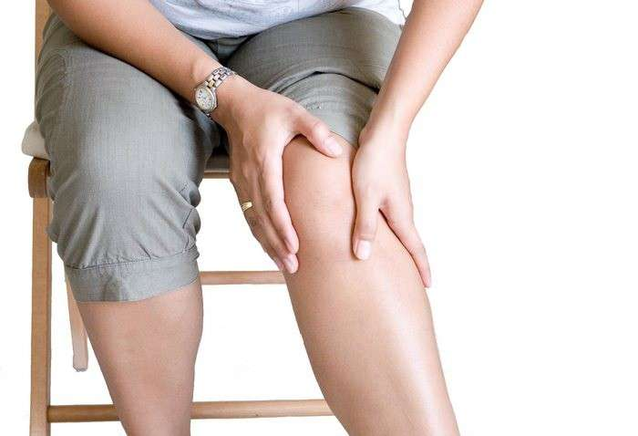
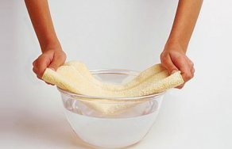

# Гэрийн нөхцөлд үе мөчний өвдөлтийг эмчлэх арга

Гарын дорх, айл бүрт байдаг, мөн эмийн сангаас авч хэрэглэх боломжтой дараах зүйлсээр өвдөлттэй биеийн хэсгүүд дээрээ компресс маягаар тавьж өвдөлтийг дарах аргыг танилцуулъя

Орц:\
-1 хоолны халбага бүдүүн ширхэгтэй бор давс\
-1 литр ус\
-80 грамм, 10%-н нашатырны спирт\
-10 грамм камфор\
Бэлтгэх:\
Усанд, давсаа хийж сайтар хутгана. Тусад нь нашатырны спирт камфор хоёрыг сайн сэгсэрч холиод, давсны уусмалтайгаа нийлүүлэхэд цагаан өнгийн нэвс маягийн зүйлс бий болох бөгөөд үүнийг арилтал сэгсэрснээр бэлдмэл бэлэн болно. Толгойн өвчний үед, бэлдмэлээ халааж толгойгоо норгоод дулаан боож унтдаг. Үе мөчний өвдөлтөд, бэлдмэлдээ алчуур норгож өвдөлттэй хэсэгтээ тавьж гадуур нь гялгар уутаар ороож, дулаан бооход намддаг. Өдөрт 2-3 удаа ороож болно.
