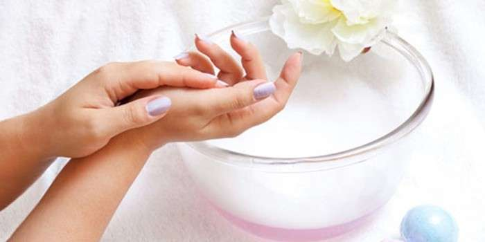

# Гэрийн нөхцөлд, гарын арьсаа арчлах үр дүнтэй аргууд

Эмэгтэй хүн бүр 100% сайхан харагдахыг үргэлж хичээж байдаг бөгөөд энэ нь, гоолиг бие, сайхан үс толигор зөөлөн арьс юм. Гарын арьс, гадны таагүй нөлөөлөлд хамгийн их өртөж байдаг бөгөөд гарын арьс асуудалтай байх нь, гар үргэлж нүдэнд харагдаж байдгаас мөн, бүх зүйл гараар хийгддэг зэргээс, хүн гараа нуух, ичих, олны дунд эвгүйцэх зэрэг таагүй байдалд оруулж байдаг. Ингээд, гарын арьсаа гэрийн нөхцөлд арчлах үр дүнтэй аргуудыг танилцуулъя.

**Төмсний маска** Ардын эмчилгээнд, төмсийг арьсыг зөөллөх, тэжээл өгөх гайхалтай чадвартай гэж үзэж, дээр үеэс гарын маска болгон хэрэглэдэг байжээ. 2 ширхэг төмсийг чанаж, нухаад нимбэгний шүүс 3-5 дусал нэмж, уг маскаа гартаа түрхээд гадуур нь марлаар ороож 15 минут байлгаад угаадаг\
**Өндөгний маска** Энэ маска гарын арьсыг толийлгож залуужуулдаг гэдэг. Нэг өндөгний шар, 1 хоолны халбага овъёосны гурил, 1 цайны халбага зөгийн балыг хольж гартаа түрхээд хөвөн даавуун бээлий өмснө. Унтахдаа хийвэл сайн бөгөөд шөнийн турш үйлчлэх боломж өгөх хэрэгтэй\
**Ургамлын тосны маска** Хамгийн хялбар арга: гартаа ургамлын тос ахиухан түрхээд хөвөн даавуун бээлий өмсөж унтахад гар сайхан болдог\
**Содтой усанд гараа дүрэх арга** Арьс сайртаж хуурайшсан бол, 2 хоолны халбага содыг 1 стакан усанд найруулж, 10 минут гараа дүрнэ. Долоо хоногт нэг удаа энэ аргыг хэрэглэдэг\
**Крахмалтай усанд гараа дүрж арчлах арга** Арьс хагарч, эвэршсэн нөхцөлд,1 хоолны халбага крахмалыг 1 литр усанд найруулж, 15 минут гараа дүрнэ. Дараа нь гарын тэжээлийн тос түрхэх хэрэгтэй\
**Маалингын гурил, бүйлсийн тосны холимогт гараа дүрж арчлах арга** 2 хоолны халбага маалингын гурил, 1 цайны халбага бүйлсийн тосон дээр халуун ус хийж, зутан шиг болгоод гараа 15 минут дотор нь байлгаад, дараа нь бүлээн усаар угаана. Гарын арьс гайхалтай сайхан болдог\
Гар арчлах зөвлөгөө: гараа хэт халуун усаар угаахад, гар сайртна. Хүйтэн усаар угаахад гарын арьс сулардаг. Гараа угаасны дараа аль болох хуурай болтол арчих нь сэв толбо үүсэхээс сэргийлнэ. Хүйтний улиралд дулаан бээлий байнга өмсөх, гэр орны ажилд резинэн бээлий заавал өмсч занших хэрэгтэй.
