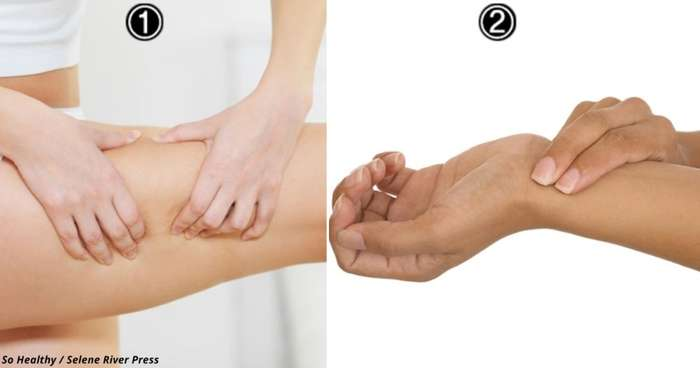
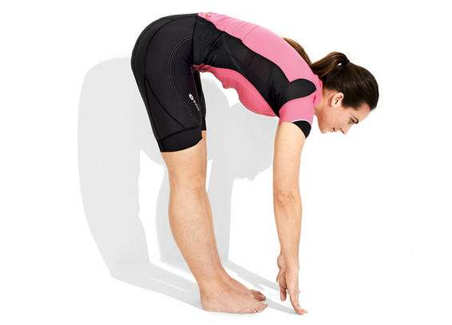
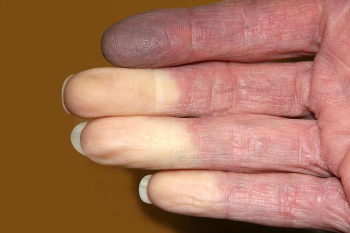
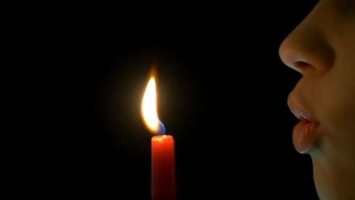
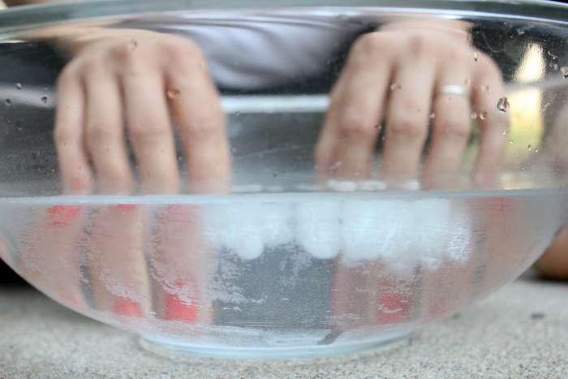
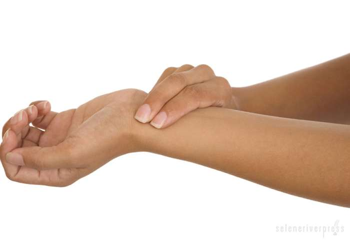

# Гэртээ, эрүүл мэндээ шалгах арга

Эрүүл байх нь бидний амьдралын хамгийн сайхан зүйл гэдэгтэй хэн ч маргахгүй биз ээ. Магадгүй та, эмнэлэгээр явах завгүй байж болох юм...

Тиймээс, ажил дээрээ болон гэртээ, эрүүл мэндийн байдал, наад захын бие организм дах өөрчилөлтүүдээ шалгах 7 арга байдаг байна. Зарим өөрчилөлтүүд анзаарагдвал эмчид хандан шалгуулах хэрэгтэйг хэлэх юун.

#### 1. Нурууны уян хатан байдал.

Биеэ эгцлэн зогсоод, өвдгөө нугалахгүйгээр хоёр гараа шаланд хүргэ. Хоёр алгаараа хүрч байвал нурууны уян хатан байдал тань сайн байна.

---

#### 2. Бие организмд шингэн хуралдаж буй эсэхийг шалгах

Гуя, шилбэний хэсэгт, 4-5 газар эрхий долоовор хуруугаараа чанга чимхэж базаад гараа авахад, чимхсэн газрын арьсны цайсан өнгө дороо арилж байвал шингэн хуралддаггүйн шинж. Энэ үед, хонхойлт илэрч байвал хавантай буйг харуулах бөгөөд хүнс тэжээлээсээ давсаа хасч, бэлэн боловсруулсан хүнсний бүтээгдэхүүн хэрэглэхгүй байхыг зөвлөдөг.

---

#### 3. Цус багадалт

Цус багадалттай эсэхээ шалгахын тулд, гарын алгаа дээш харуулан, гараа урагш сунгаад гараа атгаж хэдэн секунд болоод гарын алгаа харах хэрэгтэй. Гарын алга цайсан эсвэл хурууны нугалаа хэсгүүдээр цайсан байдал нь хэсэг хугацаанд үргэлжилж байвал цус багадалтын анхны шинж илэрч байна гэж үзнэ. Оношоо заавал эмчид үзүүлэн шалгуулаарай. Мах, ногоон өнгөт хүнсний нгоо хүнсэндээ түлхүү хэрэглэхийг зөвлөдөг.

---

#### 4. Уушигны үйл ажиллагаа

Уушигны үйл ажиллагаа болон уушигтай холбоотой өөрчилөлтүүдийг шалгахын тулд, лаа асааж, 30 см-ийн зайд зогсож, хамраараа аль болох гүнзгий амьсгаа аваад лааг үлээнэ. Унтрааж чадахгүй олон үлээж байвал биеийн илүүдэл жинтэй, тамхи татдаг мөн уушиг архаг өвчилөлтэйг харуулна. Хэрэв, үлээх үед буюу амьсгаагаа гаргах үед хоолойноос дуу авиа дагалдан гарах байдал ажиглагдвал астма /багтраа/, тэр дундаа шөнөдөө ханиалгадаг бол уг өвчин газар авсаныг заана. Эмчид яаралтай ханд.

---

#### 5. Цусны эргэлт

Саванд мөстэй ус хийж хуруунуудаа 30 секунд дүрэх. 30 секундээс илүү хугацаагаар дүрж болохгүй. Хуруунуудын өнгө цайж эсвэл хөхөлбөр өнгөтэй болсон бол цусны эргэлтийн норм алдагдаж буйг харуулна.

---

#### 6. Макулодистрофия буюу нүдний торлог бүрхүүлийн цусан хангамжийн өөрчлөлтөөс харааны гажиг үүсэх өвчилөл

Үүнийг шалгахын тулд, Амслерын хүснэгтийг ашигладаг. Уг хүснэгтийг, нэг нүдээ гараараа хаагаад, 30 см-ийн зайнаас төв цэгрүү нь ээлжилэн харна. Энэ үед хүснэгтийн шулуун шугамнууд тэгш бус харагдах, шугамнууд байраа өөрчилөх, сүүдэртэж харагдах, долгиотож үзэгдэх нь хараанд гажилт орж буйн шинж.

---

*Харааны хүндэвтэр гажилт үүссэн үед уг хүснэгт дараах байдлаар харагддаг.*

---

#### 7. Зүрхний үйл ажиллагаа

Биеэ суллан, нүдээ аньж 5 минут тайван сууна. Дуу чимээгүй орчинд байх нь сайн. Гарын бугуйн дээрээ хоёр хуруугаа тавьж судасны цохилтоо тоолно. Минутад 60-100 цохилохыг хэвийн гэж тооцдог. Хэрэв уг нормоос хэт ялгарч байвал өндөр даралттай холбон үздэг. Эмчид хандан эргэлзээгээ тайлах хэрэгтэй.
