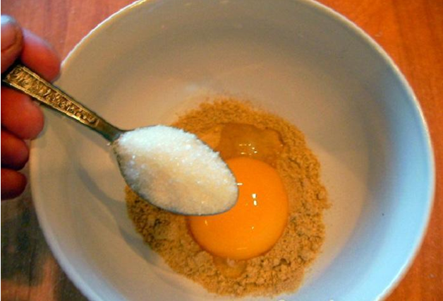

# Гич, элсэн чихрийн бэлдмэл үсийг ургуулж, өтгөрүүлдэг

Энэ маскийг хэрэглэхэд сарын дараа үр дүн нь харагддаг. Нунтаг гичийг эртнээс, үс ургуулахад хэрэглэж ирсэн байдаг. Гич нь, үсний илүүдэл тослогийг шингээх, арьсны цусан хангамжийг сайжруулах, тослогийн булчирхайн үйл ажиллагааг тохируулах үйлчилгээтэй байдаг ба мэдрэг арьстай, харшимтгай хүмүүс уг бэлдмэл дээрээ оливын тос, миндалийн тос, өндөгний шар, тараг нэмж хэрэглэдэг.

Орц:\
Нунтаг гич - 2 хоолны халбага\
Халуун ус – 2 хоолны халбага\
Өндөгний шар – 1 ширхэг\
Элсэн чихэр – 2 цайны халбага\
Оливын эсвэл дурын гоо сайхны тос – 2 хоолны халбага\
Бүгдийг нь хольж сайтар хутгана. Өндөгний шарыг зөгийн балаар сольж болно. Маскаа үсний уганд хагалж самнах маягаар илүү сайн түрхэж үзүүр хэсэгрүү түрхдэггүй. Үсэндээ усны малгай өмсөж, гадуур нь дулаан алчуураар бооно. 15 минутаас 1 цаг тавьдаг бөгөөд анх тавихад толгой халуун оргих, тэсмээргүй мэдрэмж төрдөг ч 15 минут тавих хэрэгтэй бөгөөд ямар ч хортой нөлөөлөл явагддаггүй. Яваандаа дасч, 1 цаг хүртэл тавих нь үр дүнтэй гэдгийг мартаж болохгүй. Энэ маскыг 7 хоногт 1 удаа, хэрэв тослог үстэй бол 2 удаа тавихад маш сайн үр дүнтэй байдаг. 1 курс нь сар орчим байх бөгөөд үүний үр дүнд үс тань, хурдан ургаж, өтгөн торгомсог болж, тослогтох хугацаа уртасч мөн угаах хугацааны зай уртасдаг.
