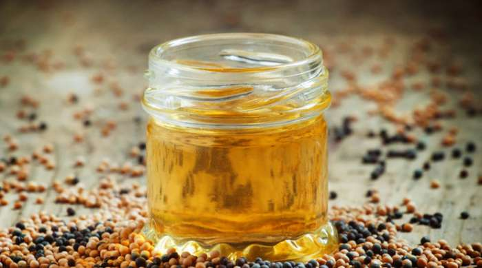

# Гичний үрийн тосны ашиг тус

Энэхүү тосыг эрт дээр үеэс, эмчилгээ, гоо сайхан, хүнсний зориулалтаар өргөнөөр хэргэлж иржээ. Бие организмд ашигтай идэвхит бодисын агууламжаараа тэргүүлдэг, үнэт тос юм. Найрлага дах А аминдэм нь дархлааг сайжруулж, нүдний харааг сайжруулах ба Е-ийн агууламж нь, үрэвслийн эсрэг, холестерин бууруулах, хялгасан судасны ханыг бэхжүүлэх, цусны бүтцийг сэргээх үйлчилэлтэй. Мөн D аминдэмийн агууламж нь өндөр байдгаас бамбай булчирхайн үйл ажиллагааг дэмжиж, зүрх судасны өвчилөлөөс сэргийлэх, зөнөглөлтөөс бүрэн сэргийлэх чадвартай. В6, В3, холин, К амин дэм, биологийн идэвхит фитостеролууд, фитонцидууд, синегрин, хлорофил, эфирийн тосны агууламжаар гайхалтай баялаг тос бөгөөд байгалийн антибиотик гэж үздэг. Хоол боловсруулах эрхтэний үйл ажиллагааг сайжруулах, тархины үйл ажиллагааг идэвхижүүлэх, цөс ялгаралтыг хурдасгах, элэг, нойр булчирхайн үйл ажиллагааг идэвхижүүлэх, цус өтгөрөлттэй холбоотой цус харвалтаас сэргийлэх, цөсний чулуу, шар өвчин, элэгний хатуурлын өвчинийг анагаах, цусны бүтцийг сайжруулах үйлчилэлээрээ зүрх судасны өвчин эмгэг, цусны даралт ихсэх өвчин, цус багадалт, тромб зэрэгт нэн тустай эмчилгээний үйлчилэл үзүүлдэг. . Эмчилгээний зориулалтаар өдөрт 30 граммыг ууж хэрэглэнэ. Мөн, үе мөчний өвчин, булчингийн зангирал, гэмтэл бэртэл, тулай өвчины үед гаднаас түрхэж хэргэлэхэд өвчин намдаах, үрэвсэл дарах, хавдар буулгах үйлчилгээтэй. Тамирчид ачаалал ихтэй дасгал сургуулилтын дараа хэргэлдэг байна. Уг тос ургийн бойжилтод маш сайн нөлөөлж төрөх үеийн аливаа хүндрэл гарахаас сэргийлдэг. Хөхөнд сүү оруулах, сүүний чанарыг сайжруулах үйлчилэл үзүүлдэг бөгөөд цэвэршилтийн үе, сарын тэмдэгийн үеийн өвдөлт, хэмнэл алдагдах үед ихээхэн тустай байдаг. Эрэгтэй эмэгтэй хүний бэлгийн үйл ажиллагааг сайжруулж спермийн боловсролт, чанарт нөлөөлж үр удмын генетикийн эрүүл мэндийг сайжруулдаг. Мөн түрүү булчирхайн өвчинүүдэд хэрэглэх нь үр дүнтэй. Амьсгалын замын өвчинүүдийн үед гадуур түрхэж хэрэглэх нь мөн сайн үр дүнд хүргэдэг. Арьсны үрэвсэл, батга, харшилд хэргэлэх ба үсний уганд түрхэж хэргэлэхэд үс уналтыг зогсоож, бууралтахаас сэргийлнэ. Бариа засалд массажны тос хэлбэрээр хэргэлэх нь эмчилгээний давхар үр ашигтай байдаг байна. Өдөрт нэг удаа 1 халбагыг ууж хэрэглэнэ. Хэтрүүлж болохгүй. Болгоомжилох: миокард, ходоодны хүчил ихсэлт, гастрит, 12 нугалаа гэдэсний шарх зэрэг өвчинүүдийн үед дотуур хэргэлж болохгүй.

