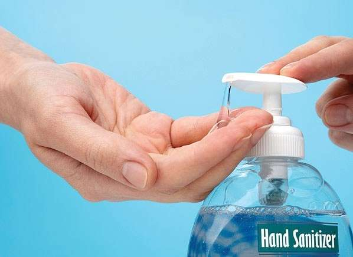
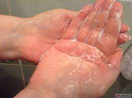

# Гоёмсог савлагаатай аажим үхэл

Сүүлийн үед, хүмүүс, бактерийн эсрэг саванг, хувийн ариун цэврийг сахихад, хялбар мөн хэргэлэхэд амар гэж хүлээж авсанаар, шингэн ба ердийн хэлбэрээр түгээмэл хэргэлдэг болоод байгаа билээ.

Гэтэл энэ саван, хор хөнөөл учируулж болох нян бактерийг устгахын зэрэгцээ, хүний биед нэн шаардлагатай байдаг, бие организмын үйл ажиллагааг тогтворжуулах үүрэгтэй бактеруудыг хамт устгадаг байна. Эдгээр ашигтай бактерууд устсанаар, дархлаа унаж өвчилөлд өртөх магадлал өсдөг бөгөөд өвчилөх эрсдэл хоёр дахин ихэсдэг. Түүнээс гадна, халдвараас сэргийлэх бактерийн эсрэг бодис нь, эндокрины системыг гэмтээдэг, дааварт нөлөөлдөг Бисфенол бодисын хэмжээг организмд иэхсгэдгээс, зарим эрхтэний үйл ажиллагаанд сөрөгөөр нөлөөлөх эрсдэлийг дагуулдаг аж. Саяхны нэгэн судалгаагаар, организм дахь Бисфенолын түвшиний өсөлт, олон төрлийн хүнд хэлбэрийн өвчилөлүүд болох хорт хавдар, зүрх судасны системийн өвчилөл, чихрийн шижин, үргүйдэл зэрэг өвчинүүдийн шалтгаан болдог гэсэн үр дүн гарчээ. Бактерийн эсрэг, ариутгалын бодис зөвхөн хор хөнөөлтэй нян бактеруудыг устгадаг гэж тооцож байдаг нь эндүүрэл гэнэ. Өдөр бүр хэргэлэгддэг, энэхүү саван удаанаар үхүүлэх тунгийн хэмжээнд үйлчилэх боломжтой аж. Биеэ бодоорой.
