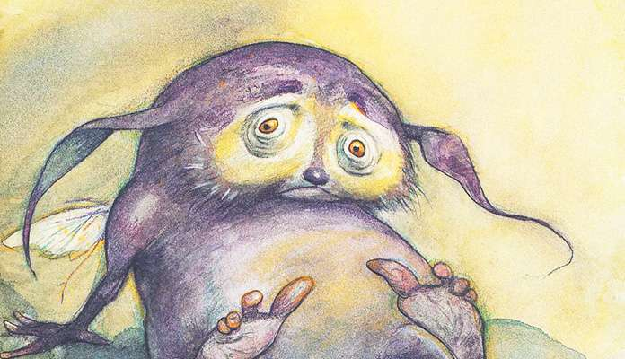

# Гомдолоос салахад тустай сургамж

“Гомдол” яг л хэнд ч гэмгүй бяцхан амьтан шиг байдаг. Зөв харьцах тохиолдолд, ямар ч хоргүй. Хэрэв гаршуулж өөртөө суулгая гэж оролдохгүй бол хэнийг ч оролддоггүй. Харин түүнийг эзэмдэх оролдлого хийх нь тун гунигтай төгсгөлтэй.

. Бяцхан, хөдөлгөөнтэй амьтан “гомдол”, хүний бие рүү анзаарагдахгүй орчихдог. Хүн үүнийг шууд мэдэрдэг бөгөөд гомдмоор санагдаад, юм болгонд гомдоод эхэлдэг. Бяцхан амьтан маань тэгтэл, “Хөөе, намайг гаргаач, суллаж тавиач. Би санамсаргүй орчихлоо. Энд чинь хав харанхуй юм. Намайг явуулаа ч!”, хэмээн хашгирч эхэлдэг ч, хүмүүс амьтны хэл сонсох нь бүү хэл өөрийгөө ч сонсохоо больчихсон учраас анзаардаггүй. Зарим хүнд, бүр энэ байдал нь таалагдаж, үргэлж гомдон, бараг л харьцааны хэрэгсэл болгочихдог. Үүгээрээ хайртай дотны хүмүүсээ дарамтлах зэвсэг болгох нь ч бий. Гэтэл бяцхан амьтан маань гарах гарц хайж, гарцаа олохгүй байсаар өлсөж, юу олдсоноо идэж эхлэх бөгөөд хүн энийг бас л шууд мэдэрч, энд тэнд нь өвдөж эхэлдэг. Гэсэн ч хүн түүнийг явуулдаггүй дасчихсан байдгаас бяцхан амьтан “гомдол” ч мөн дасч, хүнийг дотроос нь идэж томорч, шимж, биеийнх нь нэг хэсэг болон, хүн ч улам сулран, өвдөхийн хирээр, “гомдол” өсдөг аж. Хүний хувьд, түүнийг гаргаад суллачих л хэрэгтэй гэдгийг мэддэггүй бөгөөд өвдөлт, азгүйтлийн шалтгаан нь үүнд байна гэдгийг мөн мэддэггүй байна. Хэрэв, “гомдол”-оо суллачихвал, хүнд ч амар, бяцхан “гомдол”-д ч амар байхсан.\
Гомдол нь, хүний сэтгэл санааны нэгэн хэлбэр бөгөөд хэзээ ч эерэг байдалд хүргэдэггүй, хүний эрч хүчийг сулруулж, аажмаар эрүүл мэндэд нөлөөлдөг, мөн харьцааны асуудлыг хүндрүүлж байдаг зүйл юм. Ан араатан, сул доройг барьдаг хуультай. Тиймээс сул доройг харуулдаг гомдолоос салах хэрэгтэй ажээ
