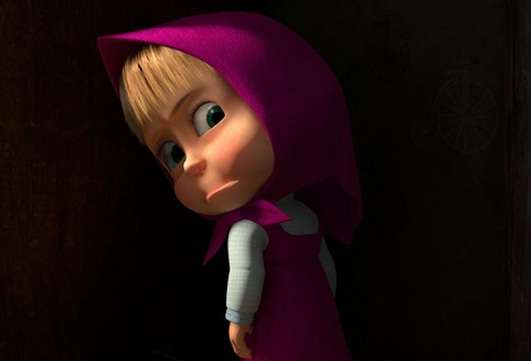

# Гомдсон  “хүн” ба гомдоосон “этгээд” хоёрын аль нь ч буруугүй

Гомдол бол, хүн, хэн нэгнээс эсвэл бусдаас, өөрийн хүсэл зорилгод нийцсэн үйлдэл, харьцаа шаардан хүлээж, тэр нь биелээгүй тохиолдолд гарч ирдэг, ихээхэн уршиг дагуулдаг сэтгэлийн хөдөлгөөний илрэл юм.

Ямар нэг өөрт таатай зүйлийг бусдаас шаарддаг хүний зөв үү?\
Эсвэл бусдыг гомдоохгүйн тулд, бусдын шаардлагад нийцүүлэн амьдрах ёстой болдог хүний буруу юу?\
Энэ хоёр асуултыг ”өөртөө” тавиарай.\
Бага хүүхэд хүслээ биелүүлэхийн тулд уйлж гомдон, эх эцэг нь гомдохоос нь айн, хүслээр нь байлгасаар, эцэст нь биеэ даах чадваргүй “хүмүүжилгүй” гэсэн тодотголтой нэгэн болдогийг нийтээрээ мэднэ. Тэгвэл бид, хүслээрээ байж, “хүмүүжилгүй” нэгэн болох гэж гомдоод л явах уу. Гомдол хуралдсаар, хүсээгүй олон сөрөг зүйлд хүргэдэг. Гомдол явсаар “хараал” болдог гэж үзэх нь ч бий.
