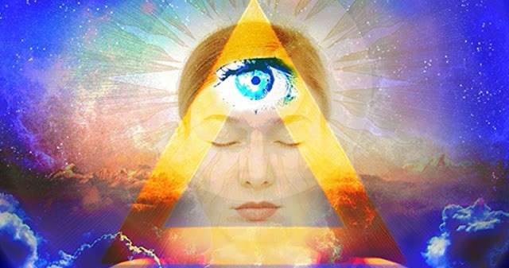
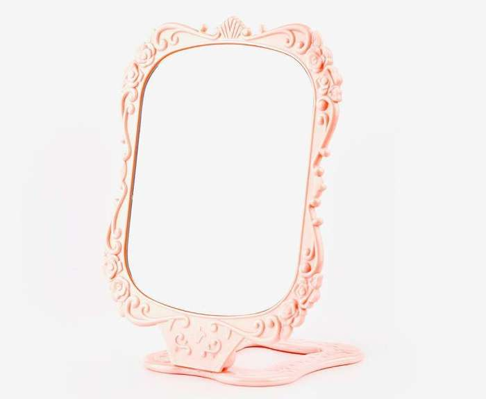

# Гоо үзэсгэлэн сэтгэлийн сайхнаар хэмжигддэг

Бурхан, бүхнийг тус тусын,өр өөрийн гоо сайхантай бүтээсэн гэдэг. Гэсэн ч бид аливааг гоё сайхан, муухай үзэмжгүй гэж ялган үздэг. Хөөрхөн царай, сайхан галбирт тооцогддог зүйл болон муухай царай, галбиргүй бие хаа гэж үздэг гадаад үзэмжийн ойлголт бол харьцангуй, түүхээс харахад, эрин зуун бүр, өөр өөр гоо сайхны үнэлэмжтэй байсан нь харагддаг. Дундад зуунд махлаг эмэгтэйчүүд сайханд тооцогдож байсан бол одоо үед туранхай эмэгтэйчүүд гоо сайхны хэв загвар болох жишээний. Тэгээд ч хүн бүрийн гоо сайхны үнэлэмж өөр учираас нэг хэсэгт нь сайхан харагддаг хүн, нөгөө хэсэгт нь муухай харагдах нь ч бий. Мөн царай муутай, муухайд тооцогдох хүмүүс сайхан сэтгэлийн ачаар гоо үзэсгэлэнг давж, дарах нь ч бий. Тэд байхгүй зүйлээ нөхөх чин эрмэлзэлтэй байдгаас гайхамшигтай амжилтад хүрдэг. Муухай хүмүүс байдаггүй, харин анзаардаггүй нүд байдаг гэсэн хэлц үг ч байдаг. Царай муутай хүмүүс байдаггүй, харин өөрийгөө арчилдаггүй залхуу хүмүүс байдаг. Гоо үзэсгэлэнгийн ойлголт бол нэгдсэн шалгууртай ойлголт биш бөгөөд гоо үзэсгэлэнтэйд тооцогддог одуудыг хүн бүр янз янзаар харж хүлээн авдаг. Гэтэл, төгс царай зүстэй биш ч, дотроосоо гэрэлтсэн дур татам хүмүүс байна. Адриана Члентано, Жерар Депардье, Хью Лори нар гоо үзэсгэлэнт хүмүүс гэж үү? Тэднийг төрөлх зан чанар, дотроос нь гэрэлтэх гэрэл гэгээ, гал цогтой харц нь л дур татам болгож, гоо үзэсгэлэн, зөв төрхийн билэгдэл хүйтэн харцтай грек төрхийг ардаа хол хаяж, олны зүрх сэтгэлийг байлдан дагуулсаар байдаг. Тиймээс хүн бүрийн дотор орших дотоод гоо үзэсгэлэн болох сайхан чанарууд л жинхэнэ гоо үзэсгэлэн бөгөөд загварын сэтгүүлийн хавтсан дээрх шиг дүр төрхтэй ч, хоосон харцтай, мангардуу царайтай, маникюр массажнаас өөр ярих сэдэвгүй бүсгүйчүүд дур татам гэж үү? Стандарт царай зүсгүй ч, сайхан яриа хөөрөөтэй, дотроосоо гэрэлтсэн бүсгүй дур булаам байх нь гарцаагүй. Тиймээс гоо үзэсгэлэн бол сэтгэл, зан чанартай яалт ч үгүй холбоотой бөгөөд муухай царай төрхтэй хүмүүс байдаггүй харин муухай зан араншинтай хүмүүс л байдаг, хүн зөвхөн дотоод сэтгэлээрээ л өөрийгөө муухай харагдуулдаг гэсэн судалгааны дүгнэлт гарсан байдаг. Муухай, сайхан ямар ч төрх хүний зөвхөн гадна бүрхүүл, харин гоо үзэмж нь сэтгэлээр илэрдэг. Сэтгэл муу бол ямар ч гоо үзэсгэлэнт төрх бүдгэрнэ. Харин сайхан сэтгэлтэй, энэрэл хайраар дүүрэн, амьдралын баяр баясгалантай, тусархуу, хүнлэг зантай, боловсролтой хүний муухай царай, эвгүй төрхийг хэн ч анзаардаггүй нь, хүмүүс түүний дотоод гоо үзэсгэлэнг олж харж чадаж байгаатай холбоотой бөгөөд хамгийн зөв хүлээн авалт, мэдрэмж, мөн хүмүүний төрөлх чанар ажиллаж буйн илрэл гэдэг. Эрэгтэй, эмэгтэй хоёр хүний жинхэнэ хайр дурлал, зөвхөн бие биенийхээ бие мах бодыг хайрладаг дээр тогтдоггүй, харин дотоод ертөнцийнхөө сайхныг олж харж, хайрлалцаж буй эсэх дээр тогтно. Тэгээд ч бие мах бодын гоо үзэсгэлэн цаг хугацааны үрээр өнгөрөн одож, залуу насны гоо үзэсгэлэнгээс өтөлж хөгширсөн сайхан биш бие мах бод л үлдэж, муухай, сайхан бүх хүмүүс адилхан гоо үзэсгэлэнгээ гээнэ. Харин сайхан сэтгэл, дотоод гоо үзэсгэлэн өөрчлөгдөхгүй улам баяжсаар байдаг. Жинхэнэ гоо үзэсгэлэн бол хайр энэрэл, сайхан сэтгэлээр хэмжигддэг аж.

