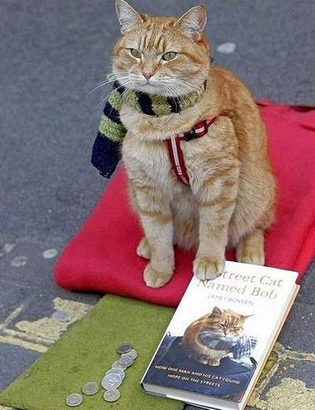

# Гудамжны хөгжимчинийг хар тамхинаас гаргасан муур

Хар тамхины хамааралтай болчихсон тул, Джеймс Боунийг, дийлэхээ больж зовж шаналсан гэр бүлийнхэн нь, гэрээсээ хөөжээ. Тэр 3 жил, Лондонгийн гудамжаар тэнэж, дуу дуулж хөгжимдөж явсан бөгөөд нэг өдөр нэгэн шар мууртай учирсанаар амьдрал нь нэг мөсөн үндсээрээ өөрчилөгдсөн байна. Тэр явж байгаад сарвуу нь гэмтэж цусанд хутгалдсан уг муурыг хайхрахгүй өнгөрч чадалгүй, малын эмнэлэгт аваачиж үзүүлжээ. Дараа нь, нөгөө муур нь бас тэнэмэл муур байсан хэдий ч, хөгжимчин залуугаас салахаа болих нь тэр. Тэр ч мөн дасч, Боб гэж нэрлэн, үргэлж хамт явах болсон бөгөөд, Джеймсийг гитараа тоглон дуулж байхад хүзүүний ороолт зүүсэн шар муур нь хажууд нь сууж олны анхаарлыг татан, бас ч үгүй сарвуугаа өгч мэндлэх, хойд хөл дээрээ босч зогсож “мяулж” сурсанаар орлого нь нэмэгдэх болжээ. Мөн сайн найз, гэр бүлийн гишүүнтэй болсон Джеймс хар тамхинаас ч гарсан гэнэ. Нэг удаа, үзэгчидийн дунд байсан утга зохиолын ажилтан Мария Панчос, шар муурных нь харцанд уярсандаа тэр үү, Джеймсийг, мууртай болсон түүхээ бичиж өгөхийг хүсчээ. Ингээд, Джеймсийн, “Гудамжны муур Боб” ном хэвлэгдэн гарч, английн бестселлер болсон байна. Тэр, уг номондоо Лондоны гудамжны амьдралд тэр хоёрт тохиолдож байсан сонирхолтой зүйлсийг бичсэн гэдэг. Уг ном нь 18 хэлээр орчуулагдан хэвлэгдэж, кино тавих санал хүртэл ирсэн байгаа гэнэ. Гэхдээ, Джеймс Боб хоёр гудамжны амьдралаа одоохондоо орхих бодолгүй байгаа гэнэ. Учир нь, тэд олны танил болж ихэд жаргалтай байдаг аж. Боб муур мөн жаргалтай, Лондонгийн метроны ажилчид үнэгүй зорчих тасалбар хүртэл түүнд өгсөн байдаг гэнэ.

---

---

---

