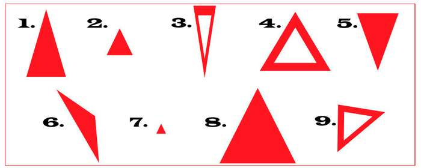
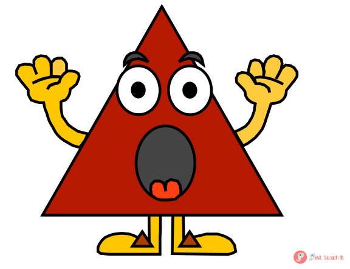

# Гурвалжин дүрс ба хүний зан чанар /сонжоо/

Гурвалжингаар бол, хүн болгонд ямар нэгэн хурц өнцөг эсвэл шулуун шугам байдаг бөгөөд түүнийгээ бусдад ил гаргахыг төдийлөн хүсдэггүй бөгөөд эдгээрүүд нь нийлж нэг гурвалжин мэт нэгэн цогц хувь хүн болдог. Та аль гурвалжин бол? Гурвалжингуудаас сонгож, өөрийнхөө талаар уншаарай.

---

1. Та их амбицтай, зорилгодоо хүрэхийн тулд тэмцдэг. Үргэлж ажилаа хэрхэн амжуулах талаар бодож, хүссэндээ хүрэхгүй бол тайван байж чаддаггүй хүн\
2. Найз нөхдөө их чухалчилдаг, тэдэнд хэцүү хүнд үед нь тусалдаг, мөн өөрөө ч тусламж хүлээж байдаг. Бусдаас тусламж авахыг хэвийн зүйл гэж боддог ба ямар нэг асуудлыг 100% бие даан шийдэх боломжийг үндэслэлгүй гэж үздэг\
3. Та хүнтэй танилцах үедээ, өөрийн тухай ярих дургүйгээс өөртөө саад үүсгэдэг. Гэхдээ явцын дунд танилцаж итгэснээр энэ байдал тань засардаг. Ер нь та хамгаалалтыг чухалд тооцон, эргэн тойрныхоо хүмүүсийг өөрийн дүгнэлтээр хүлээн авахыг илүүд үздэг\
4. Та, бусдад санаа тавьдагаараа бахархдаг. Илэн далангүй, байр байдлаа бусадтай хуваалцдаг бөгөөд хар буруу санаагүй, нуух зүйлгүй өөдрөг хүн. Инээмсэглэл нүүрнээс тань салдаггүй\
5. Та, үргэлж өөрийн сайн талыг харуулахыг хичээж явдаг. Мөн өөрийгөө халамжлахгүй бол өөр хэн ч халамжлахгүй гэж тооцдог. Та их дотогшоо хүн, урьдчилан ашиг орлого, алдагдалаа тооцохгүйгээр, ямар нэг зүйлд оролцдоггүй\
6. Та амьдралдаа юу дуртайгаа хийж эрх дураараа байхыг эрмэлздэг. Аливаа үр дагаварыг учрахад нь болъё гэсэн бодолтой. Та, гайхалтай олон талт баялаг амьдралаар амьдардаг бөгөөд ямар нэг зүйлийн хажуугаар мэдэж танихгүйгээр өнгөрөхийн оронд, эрсдэлээс айхгүй үзэж хүртэж явдаг\
7. Та, сэтгэлээ гонсойлгохгүйн тулд, хүслээ дарж явдаг. Азгүйтэл, шаталтыг үзэн яддаг. Тиймээс, ихэвчлэн гүйцэлдэх зорилго тавьдаг эсвэл би үүнийг чадахгүй гэж үнэмшүүлэн, хэрэв азгүйтвэл хэлж байсан юм чинь хэмээн ичгүүргүйгээр хүлээн авдаг. Та заримдаа эрсдэлтэй зүйлс хийхийг оролдох хэрэгтэй. Таны дотоод нөөц, хүчин чадал бодсоноос тань хавьгүй илүү байгаа\
8. Та, амьдралынхаа эцэст харамсахгүйгээр байхыг хүсч, бүрэн дүүрэн амьдралаар амьдрахыг хүсдэг. Тиймээс ямар ч зүйлийг өөдрөг, итгэлтэйгээр хийж хүссэнээ авч чаддаг. Та, хөдөлмөрч, эрч хүчтэй, үргэлж ямар нэг зүйл эрхэлж явуулж байдаг. Өөрийгөө найз нөхдөөрөө хүрээлүүлэх дуртай\
9. Та, маш амархан уйддаг. Тиймээс таны хувьд шинэ зүйлс чухал байдаг. Асуудлыг ихэвчлэн, бусдаас өөрөөр, өвөрмөц шийддэг. “Энгийн” гэдэг үг танд огт зохихгүй. Та, маш сонирхолтой хүн учраас бусад хүмүүс танд, татагдаж байдаг

- Энгийн, энэхүү гурвалжингууд хэлбэр, дүрс, хэмжээний ялгаагаараа, хүнийг тодорхойлж, сэтгэл судлал хэмээх нууцлаг, хүчирхэг шинжлэх ухаан, иймэрхүү сонжоог ашиглан, оюун сэтгэлийн орон зайд шинжилгээ судалгаа явуулан, тэр нь таарч байдаг нь сонин.
