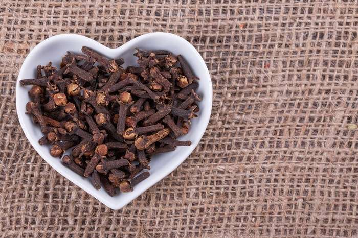
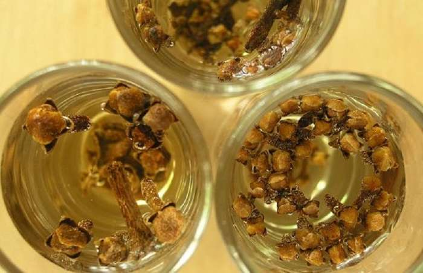

# Гвоздика амтлагч буюу хатаасан улаан лиш цэцгийн эмчилгээний ашиг тус

Хүнсний дэлгүүр, захын хоол амтлагч худалдаадаг тасгуудад зарагддаг жижиг ууттай “гвоздика” амтлагч нь, В-н төрлийн амин дэм, А провитамин /бета-каротин/, С, Е амин дэм, омега-3, эфирийн тосны баялаг агууламжтай байдаг байна. Энэ хатаасан цэцгийг зажилж хэрэглэхийг зөвлөдөг бөгөөд хямд үнэтэй ба олон өвчиний үед тустай байдаг байна.

-Өдөр бүр 2 ширхэгийг зажилахад архаг ангинаас сална. Хоолой өвдсөн үед зажилахад өвдөхөө больдог.\
-Хооллохоос 30 минутын өмнө хэдхэн ширхэгийг зажилахад, 2 хоногийн дотор гэдэсний цагаан хорхой устдаг. 1 ширхэг уг хатаасан цэцгэнд, эвгенол, кариофиллен, иланген зэрэг үнэртүүлэгч бодисууд бүхий эфирийн тосны агууламж нь 20% байдаг. Тиймээс, цагаан хорхойноос гадна бие дэх халдварт нянгуудыг /стафилококк, дифтерий, сүрье/ мөн устгах чадвартай байдаг байна.\
-Амны хөндийн үрэвслүүдийг эмчилдэг. Бохьны оронд зажилахад, стоматит, пародонтоз, буйлны үрэвсэл эдгэдэг. Ямар ч ам зайлагчаас илүү, амны эвгүй үнэрийг дардаг бөгөөд дахин үнэр гаргахаас сэргийлдэг хамгийн хямд арга болж өгдөг.\
-Эвгенолын агууламж нь хорт хавдарыг зогсоох, дахин үүсэхгүй байхад нөлөөлдөг. Энэ нь зохих шинжилгээ судалгаагаар нотлогдсон байдаг бөгөөд хавдарын удамшилын магадлалтай хүмүүс урьдчилан сэргийлэх үүднээс хэрэглэж байхыг зөвлөдөг байна.\
-Бага даралтыг өсгөх үйлчилэл үзүүлдэг. 2 ширхэгийг зажилах нь нэг аяга кофе уусантай тэнцдэг. Бага даралтаас шалтгаалдаг, сульдалт, толгой эргэх, толгойн өвчин намддаг. Энэхүү 2 ширхэг гвоздика нь, эрч хүчийг сэргээж, бие организмын хамгаалах чадварыг өсгөдөг.\
-Нойргүйдэлд мөн тустай бөгөөд тайвшруулах үйлчилгээтэй байдаг нь, энэхүү анхилуун үнэрт амтлагчийн агууламж дах В-ийн төрлийн амин дэмийн үйлчилэлтэй нь холбоотой юм.\
Худалдан авсан амтлагч “гвоздика”-н чанарыг шалгахдаа, савтай ус руу хүчтэйхэн шидэхэд цэцэг нь дээшээ босоогоор хөвөх эсвэл савны ёроолд босоо байдлаар тогтож байвал эмчилгээний чанараа алдаагүй эфирийн тосоо хадгалсан хэвээр байна гэсэн үг аж. Харин хөндлөн хөвөх нь эфирийн тос нь ууршиж, эмчилгээний чанаргүй болсныг заадаг байна.
