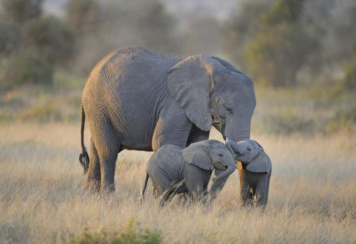
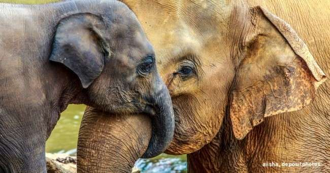

# Ихэнхи адгуусан амьтадад “ эмээ” байдаггүй, харин заан “эмээ”-тэй

Бид, эмээ нарыг хайр халамжтай, ухаалаг, туршлагатай, мэдэхгүй зүйл үгүй хүмүүс гэж авч үздэг. Заануудын хувьд ч бараг адил байдаг байна.

Хамгийн ахмад “эмээ” заан, сүргийн ахлагч байдаг бөгөөд, “эмээ”-тэй сүргүүд олон тугалтай /амьд үлдэх магадлал өндөр/, “эмээ”заан тэднийг сургаж, хардаг, ус, тэжээлээ хаанаас олохыг зааж өгдөг, бусад сүргүүдтэй таарахад, зохицуулалт хийдэг гээд жинхэнэ “эмээ”-гийн үүргийг гүйцэтгэдэг гэнэ. Үүнийг 40 жилийн турш, профессор Филлис Ли 800-д заан дээр судалгаа явуулснаар тогтоожээ.
