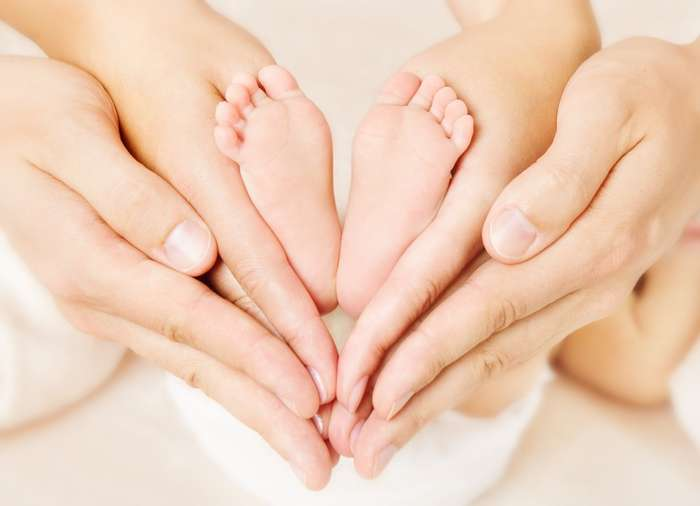
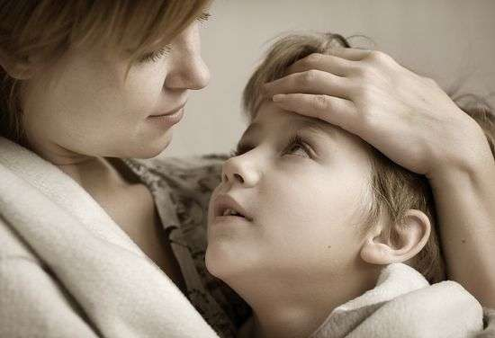

# Илж энхрийлэхийн ач тус

Хүний гарыг, бүхнийг хийдэг, мөн сэтгэлийн эрхтэн гэж үздэг байна. Эртний эмч, домч нар, мөн одоогийн бариа засалчид, гараараа өвчин илааршуулах эмчилгээ хийж ирсэн байдаг. Хүн бүдэрч уначихаад, хамгийн түрүүнд өвдсөн газраа гараараа барьж авдаг ба энэ үед өвдөлт зүгээр болох шиг болдогийг үзээгүй хүн үгүй биз ээ.

Гараас сэтгэлийн хүч, дулаан ялгардаг гэнэ. Хайртай, сайн хүний тэврэлт хичнээн таатай байдаг билээ. Хайртай хосууд мөн гараараа тэврэлдэж хайрлалцна. Ээжийн гарын илч, хүүхэддээ сэтгэлийнхээ дулааныг өгч, хүүхэд ч үүнийг гараар дамжуулан мэдэрч байдаг. Хүүхдийг багад нь хангалттай илж энхрийлээгүйгээс, өсч том болохдоо хатуу, хахир хүн болдог гэх бөгөөд эх дэлхий түүнийг хүлээн авсаныг мэдрээгүй байдаг гэж үздэг аж. Хүүхдийг илж энхрийлэх нь, түүнийг, илэлт энхрийллээс авч байсан дулаанаа, мөн бусдад өгөх дамжуулах чадвартай болгодог гэдэг байна. Амьдрал ахуй, ажил төрөлдөө илүү анхаарч, хүүхэддээ цаг зав бага гарган, уул овоо шиг их тоглоом, хүүхэд асрагч, сайн цэцэрлэг сургууль зэргээр өөрсдийн хайр энхрийллийг сольж, юугаар ч сольшгүй эх эцгийн хайраар үр хүүхдээ дутуу өсгөх цаг үеийг хүлээн зөвшөөрч, өсвөр залуу үеэ, хүйтэн хөндийгөөр нь дуудаж суугаа маань бидний буруу бус уу. Хайр энхрийлэл хамгийн их хэрэгтэй байдаг нялх бага насанд нь, хайрлан илж энхрийлэх цаг завгүй байсан эх эцгийн хүүхдүүд өсөх үедээ дутуу, авч чадаагүй энхрийллээ тохиолдлын хайр секс, найз нөхдийн хүрээллээс эрж хайн асуудалд орж байдгаас гадна гэр бүл зохиох, үр хүүхэдтэй болохоос айдаг, сэтгэлийн хүч сул, бусдад сэтгэлийн дулаанаа хуваалцах чадваргүй хүмүүс болцгоодог. Тиймээс, санаачлагыг хойшлуулалгүй гартаа авч, сэтгэлээрээ амьдарч эхлэн, гарт тань нуугдан буй сэтгэлийн дулаанаа, үр хүүхэд, хайртай дотныхондоо өгч, хажуудаа налуулан суулгаад халуухан гараараа илж таалан хайр энэрлийг утгаар нь цогцлоох боломж мөн таны увидаслаг гарт буйг ашиглаарай. Байгаль эх дэлхийнхээ, өвс ургамал, амьтныг гараараа илж эхэл. Амьд бүхэн хүний гараар илүүлэх дуртай байдаг бөгөөд хорвоод, хайр энхрийллээс илүү дээд зүйл гэж байдаггүй. Ингэж байж бид, жинхэнэ хүн болно...
