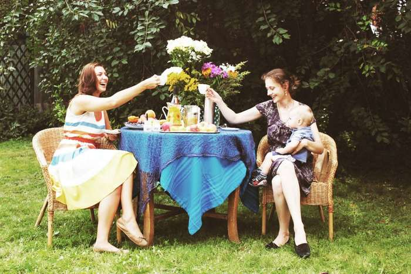

# Инээж баясч буй таны зураг, амьдрал ухамсарт тань нөлөөлдөг

Өөртөө болон амьдралд эерэгээр хандахын ашиг тусын тухай бүгд мэддэг. Үүний нэг хэлбэр нь болох толинд өөрийгөө харж инээмсэглэх зөвлөгөөг мэдэхгүй хүн бараг үгүй. Тэгвэл мөн, үүнтэй адил бас нэг хялбар үр дүнтэй арга нь, ердөө л, инээж баяссан зургаа угаалгаад, нүдэнд үзэгдэх газраа ил өлгөх юм байна.

Энэ судалгааг хийсэн сэтгэл зүйчийн тэмдэглэлээс: \
-Хүний, эерэг сэтгэл хөдлөлийн илрэл болох инээх баясах үеийг буулган авсан зураг, сэтгэхүй болон эмчилгээнд нөлөөлж болох уу? гэсэн удаан бодсон асуултынхаа хариултыг олохын тулд би, өөрийн инээсэн олон зургууд дундаас нэгэн таалагдсан зургаа авч томоор угаалган ханандаа өлгөв. Эхний үед харах болгондоо: -“би чинь ийм хөгжилтэй, баяр баясгалантай юм байна шүү дээ”, гэсэн бодол төрж байсан. Удалгүй дотоод түгшүүрт бодлууд багасч байгаа нь анзаарагдаж эхэлсэн. Ингээд, 3 сар гарны дараа миний удамшлын цусны даралт ихсэх өвчний шинж тэмдэг нэг мөсөн алга болсоныг мэдэв. Би мэдээж баярласандаа, зурагруугаа харж байгаад бодолдоо, -“нээрээ би чинь хөгжилтэй баяр баясгалантай, одоо бүр эрүүл” гэж хэллээ. Энэ үедээ би, 3 сард ийм сайн үр дүнд хүрлээ, харин 3 жилийн дараа юу болох нь ойлгомжтой гэж бахдалтайгаар бодсон доо. Үүний дараа би мэргэжлийнхээ дагуу, өөрийн туршлагаа хуваалцсан сэтгэл зүйн зөвлөгөө өгч эхэлсэн. Гэтэл хэсэг хугацааны дараа үйлчлүүлэгчдийн маань янз бүрийн өвчнүүдийн /мэдрэл, шархлаа, арьсны, даралт/ эдгэрэлт явагдаж байгаа талаар хэлцгээх болсон бөгөөд үүнийг би, тэдний дотоод ухамсарт өмнө нь, өөрийнх нь дүр төрх байгаагүй, одоо харин хөгжил баясалтай төрх нь ухамсарт нь сууж нөлөөлжээ гэж тайлбарладаг. Би өөрийн ажилладаг сургууль, анги танхимд, инээж баяссан хүүхдүүдийнхээ зургийг тавьснаар итгэмээргүй үр дүнд хүрч, хүүхдүүдийн хоорондын харьцаа эвсэг, зөрчилдөөнгүй болсон нь миний хамгийн гол үр дүн болсон гэж үздэг. Үйлчлүүлэгчдийн маань зарим сэтгэгдлүүд: \
“Би, таны зөвлөснөөр инээж баяссан нөхрийнхөө болон өөрийнхөө зургийг 20х30, хүүхдүүдийнхээ зургийг 15х20 хэмжээгээр угаалган голд нь өлгөөд дор нь бид нэг гэр бүл, нэг нь нийтийн төлөө, нийт нь нэгийнхээ төлөө гэж бичсэн. Одоо бидэн шиг нэгдмэл гэр бүл байхгүй” /хүүхдүүдтэйгээ ажиллах зав муутай гэр бүлд өгсөн зөвлөгөө/\
“Би зүрх судасны өвчнөөр удаан өвдсөн, таны зөвлөгөөр инээж баяссан зургаа харж, өөрийгөө эрүүл баяртай байгаагаар төсөөлсөөр эдгэрлээ. Хязгааргүй баяртай байна.” /Самара. Архитектор Сергей/\
“Би хүүгийнхээ инээд баясалтай зургийг фото салонд авахуулж, доор нь –би хөгжилтэй, амьдралд хайртай гэж бичүүлээд орных нь ард өлгөсөн. Хүү минь өөртөө итгэлтэй болж, ангидаа сайчуулын тоонд орлоо. Баярлалаа” гэх мэт сэтгэгдлүүд хөвөрдөг. Албан газар, анги танхимдаа хамт олноороо инээд баясалтай авахуулсан зургаа өлгөхөд хамт олны уур амьсгал маш эерэг түвшинд хүрч буй сэтгэгдлүүд ирсээр байна. Сэтгэл зүйч Алексей Чалый.

Энэхүү үнэт зөвлөгөөг, та бүхэн, ойр дотны өвчтэй зовлонтой хүмүүс, өөр хоорондын харьцаа, үр хүүхдүүдийнхээ хүмүүжилд авч хэрэгжүүлнэ гэсэн итгэлтэйгээр, эх нийтлэлээс нь товчлон хүргэлээ. Амжилт хүсье!
