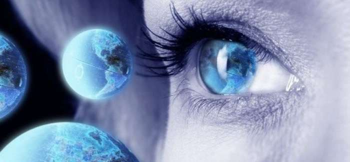

# Ирээдүй рүүгээ өнгий /тест/

Ирээдүй бол жинхэнэ нууцлаг зүйл гэдэгтэй хэн ч маргахгүй. Зуун зууны турш хүмүүс ирээдүйгээ мэдэх орлдлого хийсээр ирсэн. Өнөөдөр та ирээдүйгээ нээх сэтгэл зүйн тестээр орж, ирээдүйгээ харах гээд үз. Өөрийнхөө өмнө шударга нээлттэй байж хариултыг илүү үнэн болгохын тулд шууд хариулахыг хичээгээрэй.

**Асуулт:** /хариултаа тэмдэглээд, харгалзах асуултын хариулттай тулгаарай/\
Шар, цэнхэр, улаан, ногоон, хар /аль нэг өнгийг сонгох/\
Таны нэрийн эхний үсэг?\
Таны төрсөн сар? \
Цагаан, хар /аль нэгийг нь сонгох/\
Ойр тойрныхныхоо хэн нэгний нэрийг маш түргэн бичнэ үү\
Таны дуртай тоо? \
Машин, онгоц /аль нэгийг нь сонгох/\
Нуур, далай /аль нэгийг нь сонгох/

---

**Хариулт:**\
**Сонгосон өнгөний тайлал:** \
Шар – та аз жаргалтай хүн. Зовж зүдэрсэн нэгнийг тайтгаруулах увидастай\
Цэнхэр – та түргэн зантай, бусдаас хайр энхрийлэл шаардаж байдаг\
Улаан – таны амьдрал хайраар дүүрэн. Та эрч хүчтэй хүн. \
Ногоон – та тайван уужуу зантай, уурлах уцаарлах тань ховор хүн юм. \
Хар – та уур цухалтай, чанга. \
**Нэрийн эхний үсэг:** \
А-К -таны амьдрал хайр, эв эеэр дүүрэн юм\
Л-Р -хувийн амьдралд тань эргэлт гарах нь\
С-Я -хайр дурлалд азтай\
**Төрсөн сар:** \
1-3 сар -сайхан жил хүлээж байна\
4-6 сар -хайрын асуудал үүснэ\
7-9 сар амжилттай жил, бүх зүйлд нөлөөлөхүйц өөрчлөлтийг хүлээ. \
10-12 сар -хувийн амьдралд асуудал гарна. Гэхдээ та их ололтод хүрнэ\
**Өнгө:** \
Хар -хүндэвтэр гэмээр сорил хүлээж байна. Гэхдээ үр дүнд нь баярлахаар\
Цагаан - танд итгэлтэй хүн байдаг. Тэр хүн бүх чадлаараа тусалдаг, үүнийг нь та анзаардаггүй. \
Нэрийг нь бичсэн хүн таны жинхэнэ найз\
Дуртай тоо, таны амьдралд нөлөөтэй ирээдүйн найз нөхдийн тоо, \
Машин - та өөрчлөлтөд дургүй\
Онгоц - адал явдалд дуртай\
Нуур -та үнэнч хүн\
Далай -та бусдад аз жаргал өгч чаддаг болов ч тааварлашгүй хүн юм\
**Хүсэл:** \
1-3 үгтэй бол биелэх магадлал 80%, багахан зүтгэ\
3--5 үг, биелэлт\
6 - үг, хүлээлт\
7-с дээш ертөнц таныг сонсож байна.
