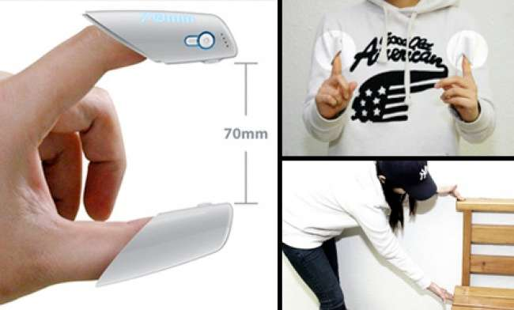
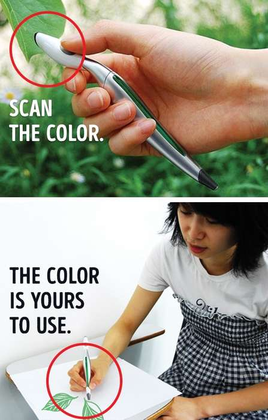
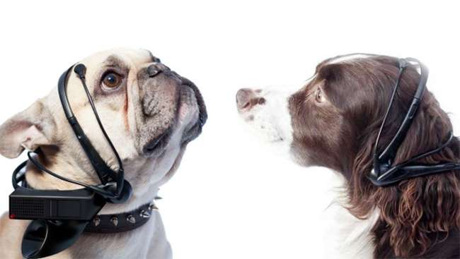
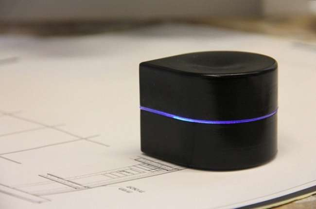
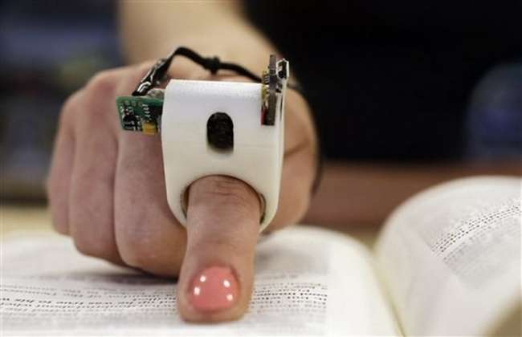

# Ирээдүйг өөрчлөх гайхалтай 6 бүтээл

#### 1. Хуруу шугам /Finger ruler/

Ихэнхи хүмүүс ямар нэг зүйлийн хэмжээг хэлэхдээ гараараа барагцаалаад л хэлдэг. Харин одоо та, тэгэх шаардлагагүй боллоо. Учир нь энэ шугам нь танд тухайн зүйлийхээ хэмжээг илүү нарийвчлалтай, хялбар аргаар хэлж болох боломжийг олгоно.

---

#### 2. Бичих өнгийг хүссэнээрээ тохируулдаг үзэг /Scan and draw pen/

Энэхүү гайхалтай үзэг нь бүх төрлийн өнгөөр зурж бичиж болох ба загвар зохион бүтээгч болон зураачдын жинхэнэ мөрөөдөл.

---

#### 3. Нохойны хэл орчуулагч /Dog to Human translator/

Энэхүү төхөөрөмж нь танд нохойтойгоо шууд харилцах боложийг олгох юм. Ноходтой харицах нь зөвхөн хүүхэлдэйн кинон дээр гардаг гэсэн ойлголт үгүй боллоо. Энэ төхөөрөмжний тусламжтайгаар, таны нохой хүсч байгаа зүйлээ шууд хэлж чадах юм, “Би өлсөөд байна”, “Би салхилмаар байна” гээд л. Хөгжилтэй биш гэж үү?

---

#### 4. Харанхуйд гэрэлтдэг ургамал

Биотехнолгийн мэргэжлийн багийнхан харанхуйд гэрэлтдэг ургамалыг байгалийн өөрөө гэрэлтэгч бодисуудыг ашиглан бүтээжээ.

---

#### 5. Зөөврийн мини принтер /Portable mini printer/

Израйлийн ZUtA компани нь халаасанд багтахаар хэмжээтэй принтерийг зохион бүтээжээ. Энэ нь ямар ч төрлийн зүйлийг хаана ч хэвлэх боломжтой. Танд хэрэгтэй ганц зүйл бол үүнийг удирдах ухаалаг утас.

---

#### 6. FingerReader

Энэхүү төхөөхөмж нь бөгж шиг хэлбэртэй, хуруундаа зүүдэг бөгөөд, бичигдсэн текстийг чангаар уншдаг байна. Түүнчлэн орчуулж чаддаг. Энэ төхөөрөмж нь хараагүй, хөгжлийн бэрхшээлтэй хүмүүст тусгайлан зориулагдсан. Хэрвээ та ямар нэгэн текст унших гэж байгаа бол зүгээр л хуруугаараа чиглүүлэх хэрэгтэй. Уншиж байх үед текстэн дэх, мөрнөөс гарах үед энэхүү төхөөрөмж нь чичирхийлж дохио өгдөг байна.

Энэхүү гайхалтай нээлт, бүтээлүүдийг хараад “Надад байгаасай” гэж өөрийн эрхгүй бодмоор.
