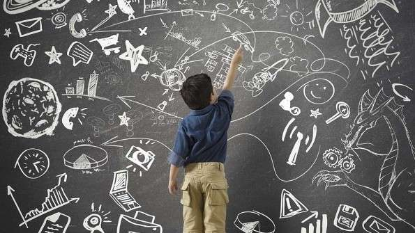

# Ирээдүйн асуултын хариулт өнөөдөрт оршдог

• **Ирээдүйгээ хэрхэн сайжруулах вэ?** \
Ирээдүйг өнөөдөр бий болгох хэрэгтэй. \
• **Ирээдүй рүү хэнтэй хамт явах вэ?** \
Өөрийнхөө ачааг чамд үрүүлэхгүй байж чадах тийм хүнтэй хамт яв. \
• **Ирээдүйд би аз жаргалтай байх болов уу?** \
Чиний хувьд аз жаргал гэж юу вэ гэдгээ л таниж чадвал аз жаргалтай байж чадна. \
• **Ирээдүйн баялгийг хэрхэн, яаж олж авах вэ?** \
Түүнийг өнөөдөр олж авч бий болго. Тэгээд түүнийгээ хадгалж чаддаг бол. \
• **Ирээдүйн зорилгод хэрхэн хүрэх вэ?** \
Өнөөдөр чи бүтээн байгуулж байгаа юм бүх чинь. \
• **Би ирээдүйд ямар болох вэ?** \
Би яг одоо өөртэйгээ ажиллана. \
• **Миний ирээдүй хэнд хэрэгтэй бол?** \
Яг өнөөдөр чи хэний төлөө амьдарч байна, тэр бүхэнд чиний ирээдүй хэрэгтэй. \
• **Ирээдүйд надад олон асуудал учрах болов уу?** \
Өнөөдрийн асуудлыг өнөөдөрт нь шийдвэрлэж ирээдүй рүү бүү авч яв. Тэгвэл чамд олон асуудал учрахгүй. \
• **Миний ирээдүйн байдал ямар байх вэ?** \
Түүнийг өнөөдөр л бий болго. \
• **Ирээдүйг өөрчилж болох уу?** \
Өнөөдрийг өөрчлөх хэрэгтэй. \
• **Сайхан ирээдүйг мөрөөдөх хэрэгтэй юу?** \
Өнөөдөр л тэр сайхныг хийх илүү чухал. \
• **Би ирээдүйд юу үзэх вэ?** \
Хүссэн бүхнээ биш тэмүүлж байгаа оргилоо л үзнэ. \
• **Ирээдүйд бас зорилго байх болов уу?** \
Би өнөөдөр зорилготой бил үү? гэж өөрөөсөө асуу. \
• **Ирээдүйн амьдрал тааламжтай болох болов уу?** \
Энэ бол өнөөдрийн ялалтын сургамжаас хамаарна. \
• **Ирээдүйд би олон найз нөхөдтэй байх болов уу?** \
Чиний өнөөдрийн үнэ цэнээс хамаарна. \
• **Ирээдүйгээс би юу хүлээж авах вэ?** \
Өнөөдөр юу хайж, олж, бүтээж байна түүнийгээ хүлээн авна. \
• **Ирээдүйд би алт мөнгө хуримтлуулах болов уу?** \
Хэрэв чи түүнийг өнөөдөр эрж хайх юм бол мэдээж шүү дээ. \
• **Би ирээдүйд их зүйл мэдэх болов уу?** \
Өнөөдрийн хийсэн алдаанаас бүх зүйл хамаарна. \
• **Ирээдүйд би арвин их туршлагатай байх болов уу?** \
Хэрэв чи өнөөдөр л түүнийг хуримтлуулвал чи арвин их туршлагатай байх болно. \
• **Ирээдүй гэрэлтэй байх болов уу?** \
Хэрэв чи өнөөдрийг харанхуй байлгахгүй байвал ирээдүй чинь гэрэлтэй байх болно. \
• **Би ирээдүйд юунд суралцах вэ?** \
Чи өнөөдөр юунд суралцаж байна, түүндээ үргэлжлүүлэн суралцална. \
• **Ирээдүйд миний үнэ цэнэ их байх болов уу?** \
Энэ бол өнөөдрийн чиний олж авсан үнэ цэнээс хамаарна. \
• **Би ирээдүйд өөрчлөгдөх болов уу?** \
Бид бүгдээрээ л сайжирч болно, гэвч өнөөдөр л эхлэхгүй бол оройтно. \
• **Ирээдүйд намайг хүндэх болов уу?** \
Хэрэв чи өнөөдөр өөрөө өөрийгөө хүндэх юм бол, ирээдүйд чамайг хүндэх болно. \
• **Ирээдүйд хүмүүс намайг хайрлах болов уу?** \
Өнөөдөр хүмүүсийг хайрла. \
• **Ирээдүйд би одоогийнх шигээ эрүүл байх болов уу?** \
Өнөөдөр л эрүүл мэндээ сайн хамгаал. \
• **Ирээдүйд надад цаг хугацаа олдох болов уу?** \
Өнөөдөр чамд цаг хугацаа бага байна. Ирээдүйд улам багасах болно.
