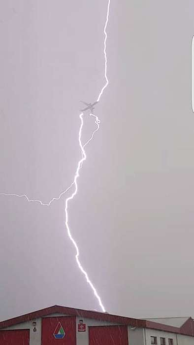

# Исландын Кеблавик хотоос Парис руу нисэхээр хөөрсөн WW404 рейсийн онгоц аянганд цохиулжээ

10-р сарын 3-ны өглөө, нисэх буудлаас хөөрөөд удалгүй, аянганд хэрхэн дайрагдсаныг камер бичиж авчээ.

Flightradar-н мэдээлснээр, уг онгоц, ослын буулт хийлгүйгээр осол аюулгүй нисч, францын нийслэлд амжилттай газардсан талаар мэдээлжээ.
