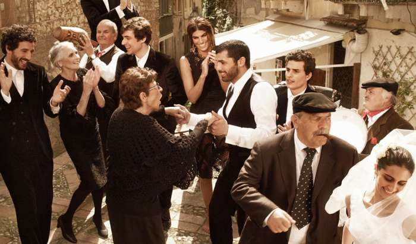

# Италичуудын амьдралын 8 зарчим

Нарлаг итали орны, ард иргэд урт насалж, аз жаргалтай амьдардагаараа дэлхийд тэргүүлдэг. Тэд маш өөдрөг сэтгэлтэй, хөгжилтэй ард түмэн гэдгийг бид, кино, ном зохиолоос мэддэг. Тэдний яриа хөөрөөн дунд үргэлж, la dolce vita буюу амтлаг амьдрал гэсэн үг хэрэглэгдэж байдаг нь, тэдний амттай амьдардагийг нотолно бус уу. Италичуудыг мэргэн цэцэн үгтэй, амьдралыг өөрийнхөөрөө байж өнгөрүүлж чаддаг хүмүүс гэдэг. Тэднээс авч хэрэгжүүлж болохуйц, зарим туршлагаас хүргэе.

#### Итали эмэгтэйчүүд, хэзээ ч муу хувцасладаггүй.

Бэлтгэлийн өмд, пүүз өмсөөд, үсээ хааш яаш боочихсон, нүүр амаа янзлаагүй итали эмэгтэй байдаггүй. Тэд өндөр өсгийтэй туфли өмсөж, өөрийгөө арчлахгүйгээр гадагш гарахгүйгээс гадна, сайхан бие, сайхан төрхтэй арчаатай хүн л аз жаргалтай байдаг гэж үздэг. Чанаргүй хямд хувцас огт хэрэглэдэггүй бөгөөд “чанартай цөөн” гэсэн зарчимыг баримталдаг.

#### Тэд хэзээ ч хэмжээ хэтрүүлэн уухгүй.

Итали дарс хэдийгээр алдаршдаг хэдий ч, энэ орны иргэд өдөрт, нэг дарсны хундагаас илүү дарс уудаггүй. Үүнийгээ эрүүл саруул байхад хангалттай хэмжээ гэж үзнэ. Тиймээс, итали зоогийн газарт орж суух завшаан тохиовол, уух зүйлээ шилээр нь захиалахгүй байхыг зөвлөе. Зочломтгой римчүүд, гудамжаар пиво уун алхах аялагчидад найрсаг хандах боловч, дотроо эвгүйцсэн бодолтой хүлээн авч байдаг байна. Тэдний иймэрхүү зан заншлыг хүндэтгэх хэрэгтэйг мэдээд авахад илүүдэхгүй биз ээ.

#### Тэд хэзээ ч нойтон үстэй гадагш гардаггүй.

Тэд, үсээ угаачихаад хатаалгүй нойтон үстэй явж байвал тань, огт ойлгохгүй хялайцгаах болно. Өөрсдийн эрүүл мэнддээ маш анхааралтай ханддаг учраас хүйтэн сэрүүнд маш дулаан хувцасладаг. Хүзүү хэсгээ маш дулаалдаг бөгөөд хэзээ ч дааруулж болохгүй гэж үздэг.

#### Байгалаараа хэрэглээг эрхэмлэдэг.

Аль болох, цахилгаан агаар сэлгэгч, сэрүүцүүлэгч хэрэглэхгүй байхыг хичээдэг. Зуны хэт чийгшилтэй агаартай үед, тэд хойд нутгийн сэрүүн газарруу хэсэг хугацаагаар аялах маягаар асуудлаа шийдэж байдаг.

#### Алдарт пастагаа жин нэмэх талаас огт хардаггүй.

Зөв хооллолтоор өвдчихөөд байгаа хүн төрөлхтөнөөс ялгаатай нь, италичууд, нүүрс ус, улаан буудайн гурил түлхүү хэрэглэхээс огтхон ч айдаггүй. Тэд, паста, шинэхэн цагаан талх, пиццагаа амтархан иддэг авч таргалдаггүй. Нууц нь маш энгийн: хооллохдоо маш соёлтой, удаанаар, амтархан таашаалтай иддэг. Италичуудын маш бага хувь махлаг байдаг гэсэн судалгаа байдаг.

#### Сав суулга, хооллох хэрэгсэлд өндөр ач холбогдол өгдөг.

Италийн ямар ч хоолны газарт, нэг удаагийн аяга хэрэгсэл хэрэглэдэггүй. Тэд, хооллохыг таашаал авах хэмжээнд авч үздэг учраас хооллолт бүрийн ширээ засалтад их анхаардаг. Гудамжаар юм идэж ууж явахыг зүгээр л ойлгохгүй.

#### Италичууд оройн хоолондоо зууш хэрэглэдэггүй.

Мөн хачиртай талх, эрдэнэ шишийг оройн хоол гэж үзэхгүй. Тэд, 3 төрлийн хоолноос бүрдсэн оройн хоолыг зөвхөн халуунаар нь зооглохыг л, оройн хоол гэж үзнэ.

#### Амьдралын алгуур, аажим аяар хэмнэлийг эрхэмлэдэг.

Италичууд, тэвчээрийг хамгийн сайн зүйл гэж үздэг. Тэд, бүх зүйлийг алгуур аажмаар хийнэ. Энэ зарчим бараг бүх зүйл дээр анзаарагддаг. Хооллохоос авахуулаад хоорондын харилцаан дээр хүртэл харагдна. Яаруу сандруу уулзалт хийхгүй. Тэд, бусад улсуудад завгүй хүмүүс 10 минутад хооллодог гэдгийг ойлгож чадахгүй. Мэддэггүй нь ч яамай даа. Харин, амьдралын утга учирыг тэд мэдэх юм даа...
