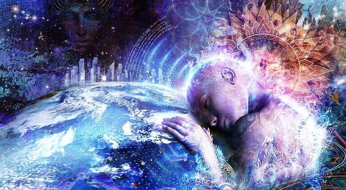
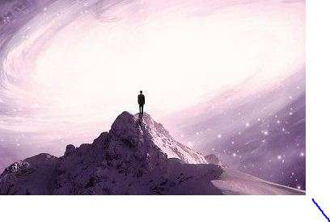

# Итгэл үгүй бол оршихуй танд итгэхгүй

Хүн төрөлх чанараараа амьдрах буюу хорвоогийн жамаар амьдрахын тулд орчлон ертөнцдөө итгэж амьдрах ёстой байдаг аж. Хүний орчлонгийн бүх зүйлс хүний гараар бүтээгдээгүй. Хүн бүрэлдэх, төрөх нь биднээс огт шалтгаацахгүй нэгэн нууц хуулиар зохицуулагддаг, түүнчилэн бид өөрсдийн хүсэл зоригоос болж хорвоод мэндэлдэгггүй, харин ертөнцийн нэгэн тайлагдашгүй дотоод хуулиар зохицуулагдан төрдөг. Хэвлийд бойжин торних үр хөврөл хэний тогтоосон хугацаанд захирагдан төрдөг, үр хөврөл бүрэлдэх нөхцөлийг хэн зохиосон байх вэ гэх мэтчилэн бид чухам хэнд, юунд захирагддагаа мэдэхгүй амьдарсаар байдаг юм. Материаллаг түвшинд хими физикийн хууль үйлчилж, харин хүсэл зоригийн түвшинд метакогнитив хууль үйлчилдэг бөгөөд энэхүү чухал хуулийг аз жаргал гаднаас ирдэг, харин бид өөрсдийгөө аз жаргалгүй болгодог гэсэн энгийн үгээр тайлбарлаж болдог. Бүх хүн аз жаргалтай байхыг хүсдэг, гэтэл яагаад бүх хүн өөрсдийгөө аз жаргалтайд тооцдоггүй юм бол? Хүмүүс, аз жаргалтай амьдралыг хүсч сурахаасаа өмнө амьдрах, амьд үлдэхэд эрмэлзэх сэтгэл нь давуу байдлаар өөрөөр хэлвэл дасан зохицохын тулд амьдарч байдаг. Өсч хөгжих, өөрийгөө бүрэн илэрхийлэх, боловсруулах хүсэл зоригийн үнэлэмж нилээд хожуу бий болж, бүр илрэхгүй байх нь ч бий. Зөвхөн тухайн орчиндоо таатай байх, таашаал тааламжийг бүрдүүлэхээр амьдарч буйгаа амьд үлдэхийн төлөөх завсар зайгүй эрмэлзлэл гэдгийг ойлгохгүй аз жаргалыг эрэлхийлсэн хүсэл зориг гэж үздэг. Тэгвэл, бидний хүсэл зоригоос гадуур, сайн сайхан зүйлс биднийг хүрээлж байгаасай гэж хүсвэл, хорвоогийн жам, ертөнцийн хууль, төрөлх чанартаа захирагдан амьдаръя гэвэл, дараах зүйлсийг хийхгүй байх ёстой болдог байх нь. \
-хүлээлтийн байдалд амьдрахгүй байх /тусламж, аврал, өглөг, амлалт/\
-санаа зовинол, түгшүүр, бачимдал, аливаад үхэлдэх мэдрэмжээс ангид байх\
-ямар ч зүйлээс баталгаа болон талархал, төлөөс хүсэмжилж хүлээдэггүй байх\
-гомдолоо нуудаггүй, дардаггүй байх\
-мэхлэлт, хуурмаг байдлаас салангид байх\
-бусдыг буруушааж, буруутай гэх ойлголт өгдөггүй байх\
-юуг ч, хэнийг ч хянах сэтгэлгүй байх\
-айдас болгоомжлолоос ангид байх\
Эдгээр үхмэл муу чанарууд, амьдралын мөн чанарыг мэдэхгүйн улмаас айх, аливаа хохирлоос амссан зүйлээс үүдэлтэй ганцаардах мэдрэмж, өөртөө итгэлгүй зан, хорвоо ертөнцийн хууль тогтоолд итгэхгүй байх зэргээс зуршил болон суудаг. Гэтэл бидний амьдран буй ертөнц, итгэл үнэмшил үгүй бол оршихуй танд итгэхгүй гэсэн зарчимын дагуу ажиллаж байдаг аж. Тиймээс бидний өмнө, өөрийгөө нээж боловсруулах буюу амьдралын утга учирыг таньж мэдэх болон үл тайлагдах нууцлаг ертөнцийн хуульд захирагдах эсвэл амьд үлдэхийн тулд буюу амьдрахын төлөө тэмцэлдсэн амьдралаар амьдрах гэсэн хоёр зам л үлддэг. Хүний хүсэл мөрөөдөл бол хүний доторхи луужин, харин өөрийгөө боловсруулах буюу амьдралыг таних, өөрийгөө нээх, ертөнцийн хуулийг дагаж мөрдөх, захирагдах эрмэлзлэл бол тэрхүү мөрөөдлийг гүйцэлдүүлэх боломж юм. Үйл хөдлөл, мэдлэг, эрмэлзэлгүй мөрөөдөл нь, хүслээс гадуурхи амьдралын төгсгөлд ирдэг өөрийн оршуулгыг мөрөөдсөнтэй дүйцнэ. Амьдралд өөрийгөө аз жаргалтай болгох боломжийг Хорвоо ертөнцөд өгөхийн тулд, хүн өөрийнхөө өөрийн хүслээр бус төрсөн, мөн төрсөн зорилго, төрлөх чанар, энэ хорвоод мэндэлсэн утга учирыг мэдэхэд өөрийгөө зориулах ёстой байдаг аж. Энэ бол бидэнд яг одоо байгаа, дэргэд маань буй ганцхан боломж юм.
