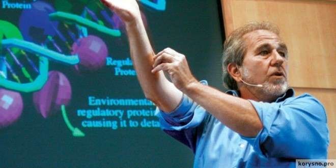
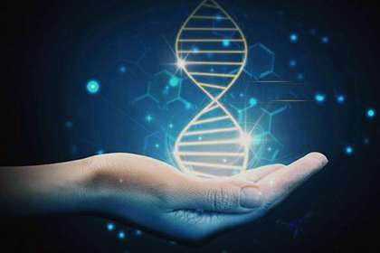

# Итгэл ямар ч өвчнийг эдгээх чадалтай

Итгэл, хүний бие организмын генийн кодыг өөрчилж өвчинийг эдгэрүүлэх чадвартай болохыг генетикчид нотолжээ. Харин, хэвлэл мэдээллийн хэрэгслүүд дээр үхлийн оноштой өвчинөөс эдгэрсэн хүмүүсийн тухай гайхмаар тохиолдлууд нийтлэгдэх, мөн энэ талаархи яриа ярилцлагын үед эмч, эрдэмтэд анхны онош нь буруу тавигдсан, эсвэл боломжгүй зүйл гэж няцааж дүйвүүлэн, шүүмжлэлтэй хандаж байдаг. Гэтэл, америкийн генетикч Брюс Липтон, жинхэнэ итгэлийн тусламжтай, бодол санааныхаа хүчээр хүн ямар ч өвчинөө эдгээж болно, энэ нь ямар ч нууцлаг хүч, далд зүйлстэй холбоогүй, харин чиглэгдсэн, төвлөрсөн сэтгэхүйн үйлчилэл, организмын генийн кодыг өөрчилж чаддаг болохыг туршилтаар нотолжээ. Хүний амьдрал, генд нь суусан программаар явагддаг, хүн бол нэг төрлийн биоробот, өөрийн генийн кодоо өөрчилөх боломжгүй гэж олонхи эрдэмтэн судлаачид үзэж байсан 1980-д онд, Липтон эсийн мембраны онцлогийг судлах туршилтууд хийх үедээ, эсэд гадны нөлөөлөл үзүүлэхэд генийн бүтэц өөрчлөгдөж буйг анзаарсан бөгөөд сэтгэхүйн үйлдэл буюу бодлын хүч, итгэлээр эсэд өөрчилөлт явагдах эсэхийг судалж эхэлжээ. Тэрээр, -100-д жилийн өмнөөс , өвчитнүүдэд тухайн өвчинг нь эдгээнэ гэж итгүүлэн саармаг үйлчилгээтэй эм хэрэглүүлэхэд эдгэрч байсан олон тохиолдлууд ба шалтгааныг нь одоо ч тайлбарлаж чадаагүй эдгээр туршилтуудын дүгнэлт нь, эмний эдгээх чадварт өвчтөн итгэснээр организмд нь эдгэрэлт явагддаг болохыг харуулж буйг, мөн ийм эдгэрэлт явагдсан гайхалтай тохиолдлуудыг судалж эхэлсэн. Үүнд эмч, анагаах ухааны эрдэмтэд тун таагүй, үл ойшоон хандаж байсан нь гайхмаар. Уг нь, ийм ганц тохиолдлыг ч өлгөн авч судламаар юм гэж одоо ч гайхдаг. Харин би, хүн биологийн төрлөх чанараа итгэл, бодлын хүчний тусламжтай удирдаж болно гэдгийг нотолж чадлаа. Жишээ нь, өвчтэй хүн эдгэрнэ гэдэгтээ, далд ухамсарынхаа түвшинд бүрэн итгэж чадсан тохиолдолд үр дүн нь гарч эхэлдэг. Энэ нь амаргүй. Ихэнхи хүмүүсийн далд ухамсарт суусан мэдээллүүдийн 70% нь сөрөг, 30% нь эерэг байдаг. Үүнийг эсрэгээр эргүүлж чадвал, бидний итгэлийн хүч, эсийн түвшинд өөрчлөлт хийж бие организмд нөлөөлнө. Тиймээс өөдрөг хүмүүс ихэвчилэн хүнд өвчинийг ялж гарсан байдаг. Хүний зөвхөн энэ чанар нь, хүнийг дэлхий дээрхи бусад бүх амьтдаас ялгах хамгийн том ялгаа юм гэж ярьжээ.

