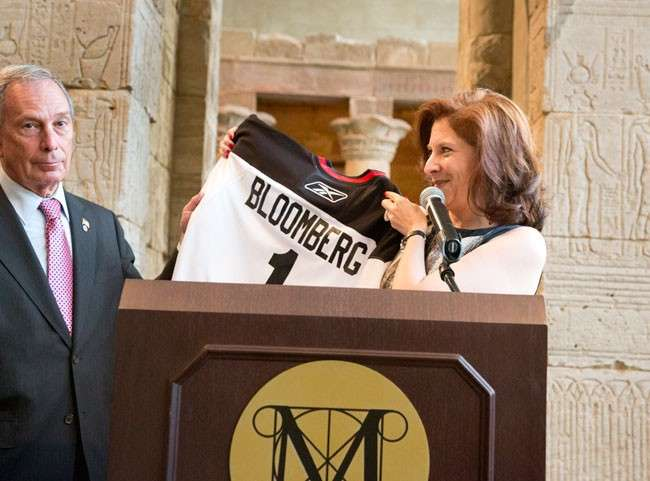

# Ийм хотын дарга байдаг

Майкл Блумберг-халуун орны загас сонирхогч хүн юм. Тэрээр Нью-Йорк хотын дарга болмогцоо, хотын захиргааныбайрандаа асар том хоёр аквариум байрлуулж түүнийхээ төлбөрийг өөрөө хийсэн бөгөөд хотын дарга хийх 12 жилийн турш энэхүү аквариумнуудыг арчлах зардалд гарсан 62400 долларыг мөн төлж байсан байна. Түүнчлэн, энэ хугацаанд хотын захиргааны ажилтануудын өдөр бүрийн өглөө, өдрийн цайг өөрийн халааснаас дааж, 890000 доллар төлсөн бөгөөд хотын захиргааны ажлаар хол ойр явахдаа, өөрийн хувийн нисдэг тэргээ шатахууныг нь өөрөө дааж 6 сая доллар зарцуулсан аж. Мөн хотын захиргааны эзэмшлийн хотын даргын байр засах ажилд 5 сая доллар, өөрөө амьдардаггүй боловч зарцуулсан байна. 2.7 сая долларын хотын даргын цалингаасаа хотын дарга болмогцоо татгалзаж, өөрийн хөрөнгө, Bloomberg LP компаниас, 263 сая долларыг соёл урлаг, эрүүл мэндийг дэмжих үйл ажиллагаанд зориулсан байна. Метрополитен музейд л гэхэд, “аудио тайлбарлагч”, вай-фай –тай болоход нь 3 сая доллар өгсөн бөгөөд Queens Theater жил бүр 100 мянган доллар нэргүй хандивлагчаас ирдэг байсны, хандивлагч нь, хотын дарга Блумберг байсныг сүүлд нь мэджээ. “Нью-Йорк таймс” сонины судалгаагаар, хотын дарга Блумберг, хот удирдаж байсан хугацааны турш шагнал урамшуулал, улс төрийн кампанит ажлууд, буяны үйл ажиллагаа, нийгмийн зорилтот хөтөлбөрүүдэд, хувиасаа, нийт 650 сая доллар зарцуулсан гэж гарсан байна. “Нью-Йорк таймс” мэдээндээ: “ Урд нь, хотын даргад, хотын дарга байсных нь төлөө хөлс төлдөг байсан бол, энэ удаад, хотын дарга энэ албан тушаал хашиж байгаагийнхаа төлөө өөрөө хөлс төлж байна” гэж бичжээ.
