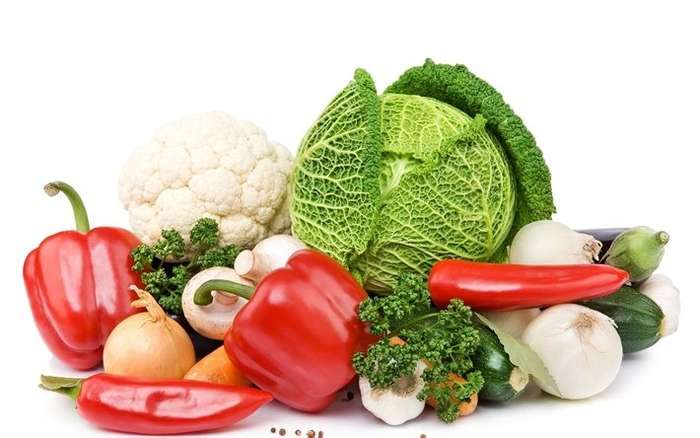
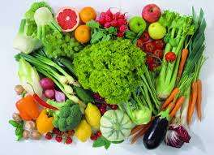

# Кальцийн өндөр агууламжтай хүнсний ногоо, ургамлууд

Хүний биеийн бараг бүх кальци, хүний шүд, ясанд оршдог. Маш бага хэмжээний кальци цусны эргэлтийн системд оролцдог бөгөөд энэ нь, нервийн лугшилтуудыг дамжуулах, зүрхний лугшилтыг зохицуулах, булчингийн эдийг агшаах зэрэг амин чухал үйлчлэл үзүүлж байдаг байна. Хүний организм, цусны эргэлтийн системээс кальцаа байнга, хөлс, шээс ялгадсаар алдаж байдаг бөгөөд кальцаа яснаасаа, эсвэл хэрэглэж буй хоол тэжээлээс нөхөж байдаг байдаг аж.

. Хүний ясанд байнгын задрал, сэргэлт явагдаж байдаг бөгөөд 30 нас хүртэл, яс сэргээгдэж байдаг бол 30-с хойш эсрэгээр өөрчлөгддөг. Кальци алдах үе нь, бидний хоол тэжээлээс авах уураг болон бусад хооллолтын дэг, амьдралын хэв маягаас ихээхэн шалтгаалдаг аж. Тиймээс хүн, хоногт нэмэлтээр зайлшгүй авах кальцийн хэмжээг нас тус бүрээр ангилсан байдаг. 51 наснаас дээш хоногт 800мг, жирэмсэн эмэгтэйчүүд 1200мг, цэвэршилтийн үед 1300мг, 25-45 насныхан 900мг, 15-19 насанд 1200мг кальцийг хоол тэжээлээс авах ёстой байдаг байна. Кальцийг, уургаар баялаг хүнс, шээсээр дамжуулан гадагшлуулдаг, мөн амьтны гаралтай уураг кальцийг угаадаг, натрийн нэгдэл өндөр /давс, хийжүүлсэн ундаа, сод хэрэглэсэн гурилан бүтээгдэхүүнүүд/ хүнснүүд мөн кальцийг угаана, кофейн кальцийг хурдан гадагшлуулдаг, тамхидалт организмын кальцийн алдагдлыг өндөрсгөдөг. Харин, биеийн тамирын дасгал хөдөлгөөн, наранд амарч зугаалах, /ясыг тэтгэдэг дааврыг ялгаруулдаг Д аминдэмийг авах боломж олгодог/, кальцийн агууламжтай ургамал, хүнс хэрэглэх зэрэг нь кальцийг нөхөх өөрөөс шалтгаалах, мөн өргөн боломжтой арга юм. Сүү, сүүн бүтээгдэхүүнээс авах кальцийн талаар сүүлийн үед, мэргэжилтэнүүдийн дунд санал зөрөлдөж байгаа юм. Хамгийн их сүү хэрэглэдэг улс орнуудын хүмүүс /Энэтхэг, Финлянд/ ясны сийрэгжилтэд илүү өртөж буй нь нотлогдоод байгаа бөгөөд мөн эдгээр улс орнуудад чихрийн шижин өвчиний өвчлөл өндөр байдаг тул маргаан дагуулдаг болсон аж. Ургамлын гаралтай кальци нь борын агууламжтай учраас, кальцийн алдагдлыг багасгаад зогсохгүй нөхдөг байна. Мөн цагаан хоолтнууд ясны сийрэгжилтээр өвчлөх нь бага байдаг нь сонирхол татдаг. Ногоон навчлаг хүнсний ногоо, фасолийн төрлийн ургамлууд кальцаар баялаг байдаг. 100гр хүнсний ногоонд байдаг кальцийн агууламж: /харьцуулахын тулд: сүүнд120мг, аарцанд 95 мг кальци байдаг/ Мак 1667мг, Кунжут 1474 , Хивэг 950, Халгай 713, Рапс, үр 454, Наранцэцэг, үр 367, Шар буурцаг 348, Гич, үр 254, Яншуй 223, Сармис 180, Фасоль, үр 150, Байцаа 135 , Хүрэн манжин, навч 119, Овёс 117, Вандуй 115, Бууцай 106, Ногоон сонгино 100, Бөөрөнхий сонгино 87, Үзэм 80, Салатны навч 77, Манжин 77, Чидун 70, Гурвалжин будаа 70, Хасарваань 65, Улаан байцаа 53, Дарсан байцаа 48, Апельсин 40 Кальцийн өндөр агууламжтай, мак кунжутыг, байнга хэрэглэхийг зохисгүй гэдэг ба муу шингэж, мухар олгойд асуудал үүсгэдэг.

Ер нь кальцийн агууламжтай хүнсийг үдээс өмнө хэрэглэх ёстой байдаг байна. Кальцийн өндөр агууламжтай ургамлууд:

Халгай, 100гр нь өдрийн нормыг хангах чадвартай

Хусны шүүс, кальци болон бусад чухал эрдсүүдээр баялаг.

Яншуй, орегано, майоран, гаа, тимъян, петрушка, базилик зэрэг хоол амтлагчнууд кальцаар хамгийн баялаг байдаг. Эрүүл, урт наслалтын төлөө хамтдаа!
