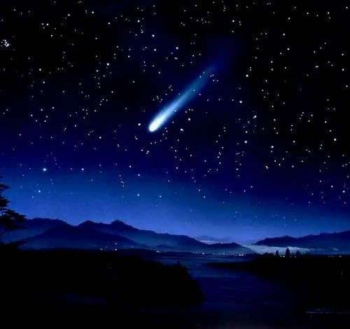

# Канадын эрдэмтэд, солирын хэлтэрхийнээс, харийн, үл танигдах ул мөр олжээ

Канадчуудын олдворыг NASA сонирхож байна.

Уг солирын уналт, 2016 оны 3 сард, Өмнөд Онтариогийн ажиглалтын камерт бүртгэгдсэн бөгөөд Солир судлалын төвийн шинжилгээ судалгаагаар, уг солирын хэлтэрхийнээс, урд нь шинжлэх ухаанд байгаагүй, амьд, танил бус бүтэцтэй организмыг олсон гэж, тус төвийн ажилтан Питер Браун мэдэгджээ. Уг организмуудыг, дэлхийн бус харь гаригийнх эсэхийг тогтоохоор үргэлжлүүлэн судалж байгаа бөгөөд NASA хамтран ажиллаж эхэлжээ.
