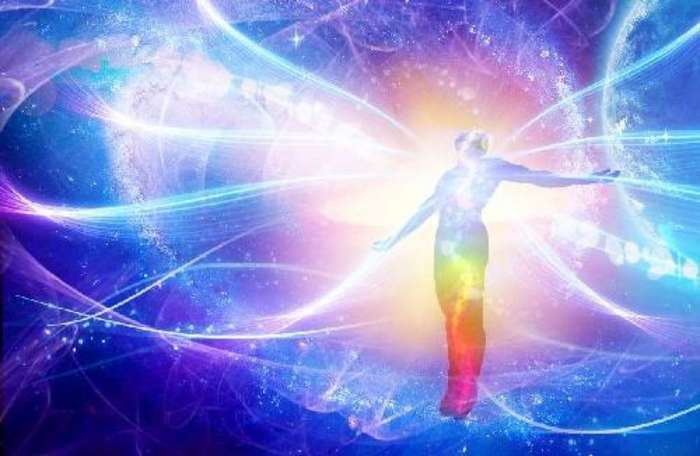
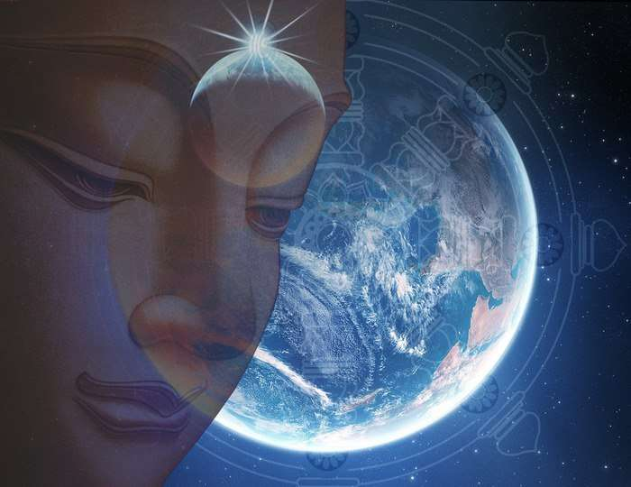

# Карма ба ертөнцийн нууц хууль

Карма гэдэг нь, Ертөнцийн хууль, мөн шалтгаан үр дагаварын хууль юм. Хүн, өөрийн карма-г, эерэг, сөрөг байлгахыг амьдралын явцдаа, өөрөө хийдэг.

Сөрөг карма, хүний амьдралын он жилүүдийн явцад бага багаар хуралдсаар, дааж давшгүй хүнд ачаа болох нь бий бөгөөд эхлэхдээ, аливааг хийж бүтээснийхээ дараа, Хайрын хуулийн анхдагч заалтыг зөрчин, өөрөөр хэлвэл хайр дээр тулгуурласан хариу нэхээгүй үйлчлэлийн оронд, заавал талархал, шагнал, шан харамж шаарддаг нүглийн анхдагч бодол, үйлдлээр өөрийн карма-г эвдсэнээр эхэлдэг. Сөрөг карма нь, зөвхөн бодол үйлдлээр ч бус, тухайн үеийн сэтгэл санааны байдлаар далд явагддаг. Мөн, бусдыг шүүх, муулах нь тухайн тэр хүний карма-г өөртөө татах байдалд оруулдаг гэнэ. Амьдрал бол яг одоо цаг буюу энэ хором гэдгийг маш сайн ойлгох хэрэгтэй байдаг. Яг одоохи, энэхүү хоромд байгаа сэтгэл санааны байдал нь, дараагийн хором, цаашхи мянга, түм, бум, сая живаа хором болох “одоо”-г төлөвшүүлэн ирээдүйг бүрдүүлдэг байна. Тиймээс, ирээдүйн маань нэг хэсэг, яг одоо байж байна гэсэн үг аж. Сэтгэл санааны байдал гэдэг нь, сэтгэл амар амгалан, хайраар дүүрэн, сэтгэл хөнгөн байхыг хэлдэг. Хэрэв сэтгэл тань уур бухимдалтай, учраа олохгүй, дарамттай өөр бусад сөрөг мэдрэмжүүдэд автдаг бол үүгээрээ ирээдүйгээ бүтээдэг. Хүсэл биелэхгүй, ажил бүтэхгүй байх нь, хором бүрийн, “одоо”-той холбоотой байдаг байх нь.Тиймээс, энэхүү яг одооны сэтгэл санааны байдлаа зөв байлгахыг хичээснээр, карма-гаа эерэг болгодог байна. Яг одоо, та, өөрийгөө сонс, ажигла, бодлоо хяна. Сөрөг бүхнийг толгойноосоо авч хая. Уртаар амьсгаа аваад, “амьдрал сайхан, эргэн тойронд минь байгаа бүх зүйл байгаа нь сайхан юм. Таагүй зүйлс бол таатай зүйлсийн улам сайхныг мэдрүүлэхэд тустай юм.” гэж бодоорой. Жаргал, зовлон, хүнд хэцүү байдал, амжилт, уналт, ялалт, алдаа, аз завшаан, өвчин, илааршилт бүгд, урд нь, хором бүрийг хэрхэн өнгөрүүлсэн сэтгэл санааны байдлын таньтусгал болдог. Тиймээс, яг одоо, үүнийг уншаад уртаар амьсгаа аваад, сэтгэлээ хөнгөлөн, ирээдүйн нэгээхэн хэсгээ бүтээх сайныг бодож инээмсэглээрэй. Ирээдүй тань инээмсэглэл, инээд баяраар дүүрэн байг. Баярлалаа.
