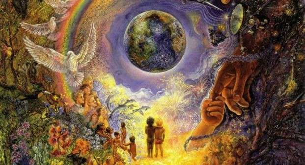
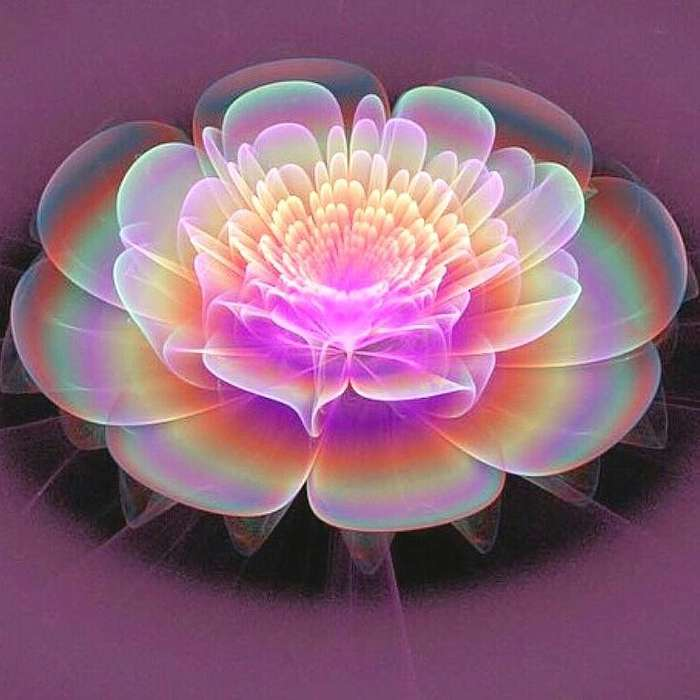

# “Карма”

Амьдралд тохиолдож байдаг бүхий л учирал, уулзалтууд санамсаргүй болж байдаггүй гэнэ. Эдгээр нь тухай бүр, тус бүрдээ хувь тавиланд тодорхой нэгэн ул мөр үлдээхээр заяагдаж байдаг бөгөөд “Карма”-ийн харилцаандах, амьдралын бүх учирал, тохиол нь, хувь тавиланд нөлөөлөх үйлчилээрээ, ерөнхийдөө 8 ангилалд хуваагддаг аж:

1. Хүүхдүүд /хамгийн дотно, бидний “Карма”-д хамгийн чухал хүмүүс/

2. Өөрийн тань хайртай хүн эсвэл эхнэр, нөхөр

3. Эцэг эх, ах, эгч

4. Хамаатан садан

5. Найз нөхөд

6. Хамт олон

7. Танилууд

8. Санамсаргүй тааралдан өнгөрч буй хүмүүс

“Карма”-р, хамгийн ойр холбоотой хүмүүсийг, урд насандаа уулзаж учирч, ойр дотно харилцаатай байсан, бие биедээ үйлийн өртэй эсвэл харилцаа нь дуусаагүй хүмүүс гэж үзэх нь бий. Тиймээс, яг л, “сагс” сагсаар хуваарилагдаж байдаг дэгдээхэй шиг, урд, одоо, хойд төрөлдөө ийнхүү давтан уулзалддаг гэнэ шүү. “Сагс” бүр хоорондоо нэгэн үезлэлээр ялгардаг гэх бөгөөд энэхүү үелзлэл нь, хувь тавилангийн эрхээр холдож салсан ч байсан таниулах, татах хүчтэй байдаг гэж үздэг. Энэ нь, санаандгүй уулзан, эхний үгнээсээ ойлголцож эхлэх, танил дотно санагдах, уулзмаар санагдаад байх, сэтгэлд үлдэж хоногших зэргээр илэрч байдаг. Өөр бусад “Сагс”-ны хүмүүстэй, ямар ч харилцаанд таарч тохирох хэцүү, таагүй харилцаа үүсч, хүнд амьдралыг туулах магадлалтай байдаг аж. Хамгийн ойр “Карма”-ын холбоотой хүүхдүүдийн хувьд, энэ хорвоод амьдарч байгаа хүн бүр, үр хүүхдийнхээ өмнө үүрэг хүлээнэ. Төрөл төрөгсөд буюу эцэг эх нь, хүүхдэд, хорвоо ертөнц, сайн муу зүйлсийн тухай ойлголтыг хамгийн түрүүн суулгаж өгдөг тул, үр удмынхаа өмнө хамгийн их хариуцлага үүрдэг. Хийж буй үйлдэл, хэлж буй үг тань хүртэл, үр удам тань ямархуу байхыг шууд илэрхийлдэг гэсэн үг. Эргэн тойрныхоо бүхий л зүйлсийг хайрлаж, үүнийгээ үр хүүхэддээ харуулж, зааж сургах нь хамгаас чухал байдаг байна. Мөн хайртай хүн, гэрлэлт давхцвал хамгийн сайн гэдэг. Хэрэв, хайрладаг хүнтэйгээ хамтын амьдрал зохиох боломжгүй, хариу хайр үгүй тохиолдолд, түүндээ зөвхөн сайн сайхныг хүсч амьдарч чадаж байвал жинхэнэ хайр, энэ нь оюун санааны шинэ түвшинд хүргэж байдаг гэнэ. Гэрлэлт тэнгэрт бүртгэгдэж байдаг гэгээн зүйл учираас, гэрлэж буй хүмүүс болох эхнэр нөхөр хоёр, хамтдаа амьдралаа бүтээх ариун үүрэг хүлээнэ. Гэр бүлийн хоёрын “Карма”-ын хамаарал, эцэг эхээс дамжих хамаарлаас илүү амьдралд нөлөөтэй байдаг бөгөөд явцын дунд, дундын “Карма” болж хувирдаг. Бодлогогүй сонголт, азгүй гэрлэлт нь, залуу насаа үрэх, итгэл найдвараа хугалах, зорилго төлөвлөгөөгөө устгах, үр хүүхдээ бодож хайргүй жаргалгүй амьдрах, заяа, хувь тавилангаа төөрөлдүүлэхэд хүргэх аюултай. Ийм тохиолдолд, гэрлэсэн хүн тань зүгээр зөрөөд өнгөрөх замын хэн нэгэн биш учираас, аль болох зохилдлогоонд хүрэхийн тулд мэрийх хэрэгтэй болдог. Хамгийн гол нь, оюун санаатайгаа ажиллаж, далд ухамсараа сонсож, сэтгэлийн эрх чөлөөнд хүрэх нь чухал бөгөөд уусан зохицохгүй, өөрийгөө хуурахгүй амьдрах зам, зөвхөн энэ тохиолдолд нээгддэг аж. Таны ойр дотныхонтойгоо харилцах харилцаа, удмын “Карма”-даа хандах хандлагыг харуулах хамгийн тод үзүүлэлт юм. Нэг гэр бүлийн хүүхдүүдийн гэр бүлдээ хандах хандлага өөр өөр байдаг нь үүнтэй холбоотой. Хоорондын таагүй харьцаа, гэр бүлийнхнээ үл хүндлэх байдал, тухайн гэр бүлийн гишүүн бүрийн “Карма”-д нөлөөлнө. Гэр бүлийн гишүүн тус бүр нь, хувь хүний онцлогоосоо хамаарч, ирээдүй, үр удамдаа цэвэр “Карма” үлдээх дамжуулах хүсэл, хайр, хүндэтгэл, буулт, эв нэгдэл зэргийг хүлээн авах ойлголтын хэмжээгээрээ, тус тус өөрсдийн заяаг засдаг гэсэн үг аж. Эцэг эхийн хувьд, тэдний хандлага, харилцаа, таатай таагүй байсан нь хамаагүй, зөвхөн хүндлэл, уучилалтай хандах нь ерөөлд хүргэнэ гэдэг. Гэр бүлийн харилцаанд, бие биедээ сайныг ерөөсөн хүсэл, бие биеэ дэмжих сэтгэл, дотно сайхан харилцаа зонхилж байвал тэнгэр таалж, хэзээ ч уруудахгүй, буян заяагаа бурханаар түшүүлэн амьдарна гэж үздэг. Мөн, мянга мянган хүмүүсийн дундаас, ижил сонирхол, үзэл бодолтой хүн санаандгүй таарч, найзлаж нөхөрлөхийг өнөөх нэг “Сагс”-ны хүмүүс гэдгийг илгэдэг гэж үзнэ. Найздаа насан туршдаа итгэхгүй явснаас, найздаа мэхлэгдэн хоцорсон нь дээр гэсэн эртний үг байдаг. Хэрэв та, найздаа хуурагдчихвал та, өөрийн “сагс”-ны бус хүнийг андуураад хүлээгээд авчихсан гэсэн үг учираас, өөрийн мэдрэмжийг сонс гэдэг байна.

