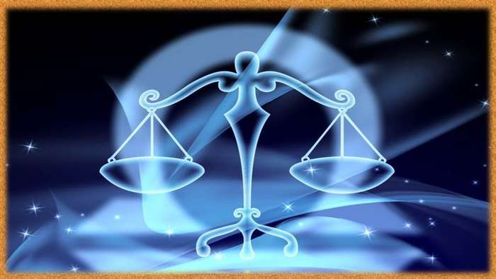

# Кармагийн тухай

Өшөө авахын оронд, хэсэгхэн хүлээж сур. Таныг гомдоосон, эсвэл танд муу зүйл хийсэн хүн, эцсийн эцэст өөрийгөө шийтгэж байдаг. Магадгүй танд, Бурхан энэхүү шийтгэлийг харах боломж өгөх нь ч бий. Карма нь, яг л үйлийн үр адил бөгөөд тухайн үйл хөдлөлийн үр дүн хэзээд өөрт буцаж ирдэг гэдгийг харуулдаг. Сайн үйл шагнагдаж, муу үйл шийтгэгддэг. Цаг хугацаа ба карма хоорондоо уялдаатай байдаг бөгөөд шувууд амьд байхдаа, шавьж хорхойгоор хоолллодог бол, шувуудыг үхсэний дараа шавьж хорхой түүгээр хооллодог. Нэг ширхэг ургаа модоор сая сая чүдэнз хийдэг ч, сая модыг түймэрдэхэд, ганц ширхэг чүдэнз хангалттай байдаг. Нөхцөл байдал хэзээд өөрчилөгдөж байдаг, өнөөдрийн таны эрх мэдэл, эд баялаг, агуу хүчит цаг хугацааны өмнө хүчин мөхөсддөг тул үүрдийнх биш байдаг. Цаг хугацаагаа өшөө хонзон авахад хэзээ ч бүү зориул. Танд мууг хийсэн хүн, жинхэнэдээ өөрийн Кармаг бүтээж байдаг гэдгийг ойлгох хэрэгтэй. Карма-д ямар нэг үндсэн цэс, жагсаалт байхгүй. Та, өөрийнхөө Карма буюу тавиланг өөрөө л зохиодог. Зөвхөн сайн үйл хийж, сайхан сэтгэлтэй, талархал дүүрэн байхад бүхий л сайн зүйлс амьдралыг тань дүүргэж байдаг юм.
