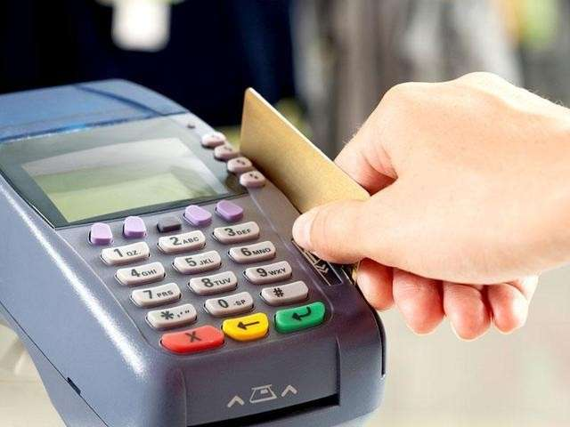
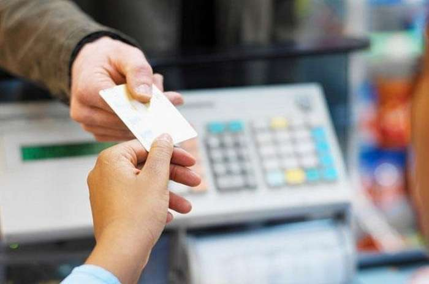

# Картаар төлбөр тооцоо, худалдан авалт хийхдээ, сэрэмжлэх зүйлс

Хүмүүс, халаасны хулгайгаас, анхааралтай явах, их хэмжээний мөнгө биедээ авч явахгүй байх зэргээр сэргийлэн болгоомжилдогч, хамгийн ихээр мөнгөө хадгалдаг банкны картаа мөн, хулгайд өртөж болохыг мэддэггүй. Хулгайч, луйварчидын арга заль ч мөн, хөгжил дагаад өөрчилөгдөж нарийссаар байгаа бөгөөд эдүгээ дэлхийн даяар, карт эзэмшигчид мянга мянгаараа өртсөөр буй картны хулгайнаас сэргийлэх аргыг эртхэн мэдээд авах нь илүүдэхгүй юм.

1. Дэлгүүрийн кассын ажилтан, картыг хоёр уншуулах үйлдэл хийхгүй байхад анхаарах. Хоёр уншуулснаар, эхний уншилт таны худалдан авалтын төлбөр болно, харин хоёр дох нь хий уншигдаж, авсан зүйлийн үнийг бусад хүн шамшигдуулах боломжтой болно\
2. Мөн картны дотор нүүрэн дэх, CVV –н дугаар буюу 3 оронтой кодыг цээжилсэн кассир, карт уншуулахад үлдсэн 16 оронтой тооны хамт ашиглан интернет худалдаа хийх бүрэн боломжтой болдог. Банкны картаас мөнгө хулгайлах хулгайн 80%, энэ аргаар хийгддэг бөгөөд зөвхөн АНУ, Англид энэ хулгайд хохирогсдын мөнгөний хэмжээ жилд, 1 миллиард доллараас давж байдаг гэнэ. \
Болгоомжилохын тулд:\
-Картаа хоёр уншуулахгүйн төлөө анзаарч байх. Дансаа шалгаж байх.\
-3 оронтой кодыг харах бололцоо олгохоос сэрэмжилэх.\
-Болж өгвөл, интернет худалдаа хийдэг тусдаа карттай болох, түүнийгээ өдөр тутам ашиглахгүй байх<br -Гадаад орнуудад, мөнгөний терминалын ойролцоо, үл танигдах төхөөрөмж байгаа эсэхийг шалгаж байхыг анхааруулдаг
