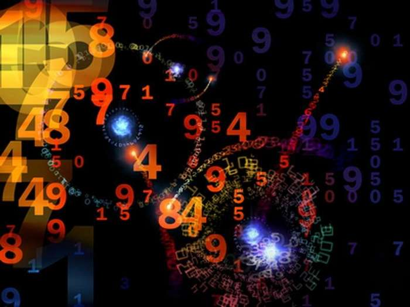
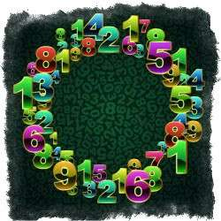

# Хаалганы дугаар ба фен-шуй

Эрт дээр үеэс, тоо болон тооны утгад их анхаарал хандуулан ирсэн байдаг. Тиймээс ч сайн тоо, таагүй тоо гэсэн ойлголт байдаг. Фен-шуйгаар хаалганы дугаарыг тодорхой мэдээлэл агуулдаг гэж үздэг бөгөөд тоон утгынх нь хувьд мэдэж зарим зүйлд багахан өөрчлөлт хийн өөрсдөдөө таатайгаар зохицуулж болдог гэж үздэг байна.

#### № 1

Нарны тоо. Ийм дугаартай байр, эзэддээ бүтээлч энерги баяр баясгаланг өгдөг. Олны дундаас ялгарах, олны анхаарал татах боломж өгөх ба зураач, яруу найрагч, зохиолч, сэтгүүлч нарт ээлтэй. Ийм байранд төрөл бүрийн улбар шар, улаан өнгөтэй гэрэл чийдэн, бүрхүүл ашиглах сайн. Байрны уур амьсгал хөнгөн, нээлтэй байдаг ба сайн, сайхан сэтгэлтэй хүмүүсийн амжилт бүтээл урагштай байдаг. Харин муу энергитэй хүмүүсийг алдагдал гарлага хүлээж байдаг.

#### № 2

Сарны тоо. Энэ дугаар, нялх бага хүүхэдтэй айл эсвэл хөгжим урлагийн хүмүүс, тогооч, хоол хүнсний мэргэжилтэй хүмүүст ээлтэй байдаг. Ийм байранд шинээр авсан толь нөлөө үзүүлдэг. Байнга цэвэрлэж арчиж байх хэрэгтэй байдаг ба байранд сүүн өнгө, маргад ногоон өнгө зонхилох сайн. Ялангуяа усны өрөөнд энэ өнгө хэрэглэхийг хичээх хэрэгтэй.

#### №3

Марс гаригийн тоо. Шийдэмгий байдал, үйл хөдлөлийн тоо. Энэ байр, залхуурал, идэвхигүй байдалд дургүй. Идэвхигүй байдлын шанд, усны хоолой, цоож цуурга, эд хэрэгсэл байнга эвдрэх асуудлууд мөн өвчин дагалдах магадлалтай. Улаан өнгө зонхилвол сайн ба коридор, 00-н өрөөг илүү анхаарч арчлах хэрэгтэй байдаг байна.

#### № 4

Буд гаригийн тоо. Харилцааг илэрхийлдэг. Энэ дугаартай байранд, шударга ёс тогтнож байх хэрэгтэй. Худал хуурмаг зүйл эргэж заавал тусдаг. Энэ байранд амьдардаг хүмүүс аялал, аян замд их явдаг. Хүмүүстэй их харилцдаг, ер нь бараг диспетчер шиг л байдаг. Интерьерийн хувьд зонхилох өнгө цэнхэр, саарал, хөх шарын хослол. Мэдээлэлтэй холбоотой, зурагт, утас, фото зураг, жаазласан уран зургууд энэ байранд тохиромжтой байдаг.

#### № 5

Бархасбадь гаригийн тоо. Өргөсөх утгатай тоо. Энэ байрандах бүх зүйл далайцтай байдаг ба дотор нь явагдах амьдрал, улс төр, шинжлэх ухаантай холбоотой эсвэл олныг нэгтгэх үзэл санааг илэрхийлсэн байдаг. Зонхилох өнгө нил ягаан байвал сайн. Мөн, болвол алс холоос ирсэн мөнгөлөг чимэглэл, бэлэг дурсгалын зүйлээр чимэх хэрэгтэй. Энэ байранд уур уцаар, хэрүүл маргаангүй байвал бүх зүйл сайн байдаг. Дүүрэн номтой, баялаг номын сан, уур амьсгалыг улам сайжруулна.

#### № 6

Сугар гаригийн тоо. Амралт, хайр, ая тух. Энэ дугаартай байранд орсон оршин суугчид азтай хүмүүс. Сайхан сэтгэлтэй, зочломтгой, аманцар хүмүүс амьдардаг. Зонхилох өнгө сүү, кофе. Зөөлөн буйдан, дугуй ширээ. цэцэг...ая тух дүүрэн амьдрал. Гэрийн тэжээвэр амьтдад хайртай байдаг. Энэ байранд хэзээ ч бүү хэрүүл хийгээрэй, хамаг сайхнаа булингартуулна.

#### № 7

Санчир гаригийн тоо. Үргэлжийн шалгуур. Энэ байранд оршин суугчид, хавчигдмал, хязгаарлагдмал байдалд байх нь элбэг. Гэхдээ бүх зүйл тийм ч муу биш. Энэ байранд хуримтлал үүсгэх, ур чадвар эзэмших боломжтой байдаг. Ажил хэрэг, алхам бүрээ шинжлэх хэрэгтэй бөгөөд мацаг, бясалгалаар хичээллэх сайн. Зонхилох өнгө хар хөх. Энэ өнгийг интерьерт ашиглах сайн үр дүнтэй.

#### № 8

Тэнгэрийн ван гаригийн тоо. Энэ байр зурхайч, зөн билэгчидийн байр. Материалист хүмүүс зөн совинтойгоо ажиллах хэрэгтэй болно. Найз нөхөд, зочид тасрахгүй. Интерьертээ, солонгын өнгүүд, тэнгэрийн цэнхэр өнгийг давамгай ашиглах хэрэгтэй. Цонхны цэвэрлэгээ арчилгааг сайн байлгах хэрэгтэй.

#### № 9

Далай ван гаригийн тоо. Лам хувраг, урлагийнхан, зөн билэгтнүүдэд ээлтэй. Бермудын гурвалжинг санагдуулна. 0-р төгссөн бол таагүй.

#### **Нөлөөллийг засах:**

• Хаалганы өнгө ногоон эсвэл саарал байхад, саарал өнгө дугаарын утгыг саармагжуулж, харин ногоон дугаарын нөлөөллийг устгадаг.\
• 0-р төгссөн хаалганы дугаарын дэргэд, хажууд нь бичих тооны нийлбэр нь 88 болохоор тоог бичиж жижигээр бичиж наадаг. Жишээ нь, 50, дэргэд нь 38. 5+3=8 0+8=8. Энэ тоо аз авчирдаг.\
• Фэн-шуйн мэргэжилтэнд хандаж болдог.
