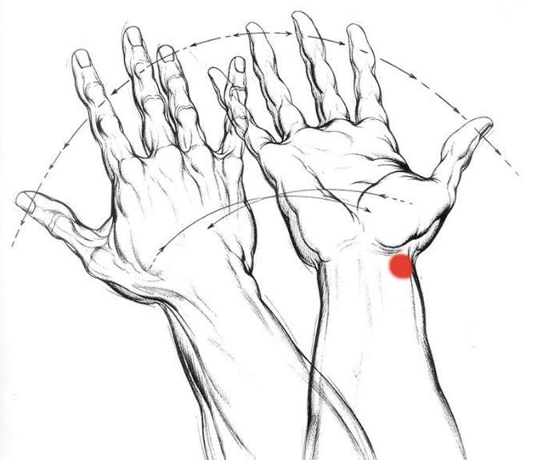

# Хааны маань нэртэй, эрүүл мэндийн цэг

Монголын байлдан дагуулалтын үеийн монголын цэргүүдийн дунд цөс хөөрөх болон цөстэй холбоотой өвчлөл бараг байгаагүйг дараах тохиолдолтой холбон үздэг гэнэ

Нэг удаа Их хаан маань, цэргүүдээ эргэж яваад, эвхрэн өвдөж, огиулж буй цэргээ хараад эмчээсээ, -“Учрыг нь ол. Энэ тахал биш биз?” гэхэд, эмч: -“Үгүй, их хаантан минь, энэ хүний цөсний өвчин хөдлөөд, ингэж байна” хаан:-“Тэгвэл, түүнд туслаач” гэсэнд, эмч –“Хаантаан, би түүнд тусалсан”. Гайхсан хаан, -“хэзээ, яаж?” гэж асуув. –“Би, түүнийг, гарынхаа хэрэгтэй цэг дээр дар гэсэн” гээд, өөрийнхөө гар дээрх тэрхүү тустай цэгийг заажээ. Чингис хаан, -“Тэгвэл, энэ цэгийг олонд мэдүүлж, таниул” хэмээн зарлигдав. Түүнээс хойш, тэр үед, монгол дайчдын дунд цөстэй холбоотой өвчлөл гарахаа больсон гэдэг. Уг цэг нь, алган талаасаа эрхий хурууны доор байдаг бөгөөд долоовор хуруугаараа эсвэл харандаа, үзэгний үзүүргүй талаар 1.5-2 минут, нар зөв дарж массажлахад, дотор муухайрах, цээж хорсох, ходоод гэдэс эвгүйрхэх, гэдэс өвдөх зовиурууд хурдан зогсдог байна. Энэ аргыг, хаана ч хэрэглэж болдог нь авууштай. Мөн энэ цэгийг, ердийн үед аль болох дарж массажлахгүй, харин өвдөх үедээ“түргэн тусламж” маягаар хэрэглэхийг зөвлөдөг байна.
