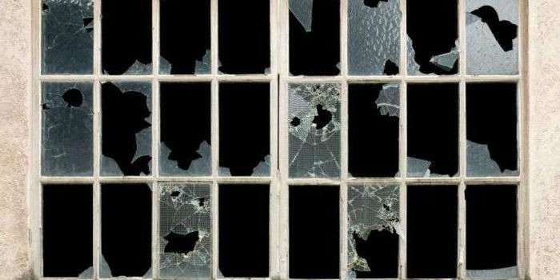

# Хагархай цонхны онол

Эмх замбараагүй байдал, жижиг жижиг журамгүй үйлдлүүдээс үүсдэг. Эзэнгүй барилгын нэг цонх л хагарвал бусад нь удалгүй хагарсан байдаг ба мөн хэн нэгэн улаан гэрлээр зам гарвал дагаад нэг хэсэг нь гарчих жишээний үргэлжилж өсдөг үйлдлүүдийг хагархай цонхны онол гэж нэрлэдэг бөгөөд цасан бөмбөлөг өнхрүүлэх тусам томордогийн адил, хүмүүсийн хийдэг ёс зүйгүй, журамгүй үйлдэл хуралдсаар гамшигийн хэмжээнд хүргэдгийг харуулдаг онол юм. Жижиг сажиг маргаан гэр бүлийн хэрүүл, үзэн ядалтад хүргэнэ. Асаагаад шидсэн ширхэг шүдэнз түймэр дэгдээнэ. Замын хажуу руу базаад шидсэн нэг тамхины хайрцаг замыг нэлэнхийд нь хогийн цэг болгон хувиргана. Нэг цохилт зодоон үүсгэнэ. Нэг буун дуу дайныг эхлүүлнэ. Тиймээс энэ онолоор, ёс журамгүй нэг үйлдэл гарахгүй байхад нийтээрээ журамтай байна гэж үздэг. Тэрхүү нэг үйлдлийг хүмүүс бидний хэн нэг нь хийдэг мөн бид, хэн нэгний хийсэн дээр нэмж хийдэг сэтгэхүйтэй байдаг нь нэн харамсалтай. Нэг ч хоггүй, эмх цэгцтэй газар хэн ч чихрийн цаас, тамхины иш хаяж чаддаггүй. Эв нэгдэлтэй гэр бүл, хамт олны харилцаанд эвгүй үг хэллэг огт байдаггүй. Тиймээс, өдөр тутмын үйлдлүүд, үйл хөдлөлийн тань үед, “Хагархай цонхны онол” байнга санаанд тань байгаасай, багахан буруу үйлдлийн тань араас өсч хуралдан томрох, муу журамгүй зүйлийн эхлэлийг бүү тавиасай гэсэн агуулгатай бяцхан санамжийг хүргэлээ. Эдгээр “Нэг үйлдлүүд” маань сайхан эмх журам, ёс зүйн эхлэл болохуйц байгаасай. Энгийн нэг инээмсэглэлээс энх тайван тогтноно гэдэг. Зөвхөн сайн зүйлийн эхлэлийн эзэн байхыг хичээж, харин “Хагархай цонхны онол”-г бодол санаандаа суулгаж хэлц үг болгоод хэргэлчихмээр...

