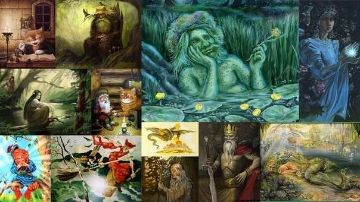
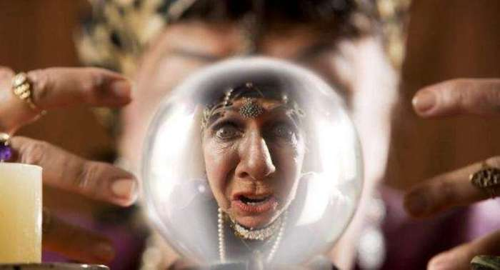

# Хамгийн инээдтэй, ганцаараа уншсан нь дээр, гашуухан зурхай

Энэ зурхайд, ордуудын алдаатай талуудыг хатуухан харуулсан бөгөөд хамаагүй хүндээр тусгаж авч хэрэггүй биз ээ. Бид бүгдээрээ л их бага хэмжээний ааш аяг, гэмтэй байдаг. Хамгийн гол нь тэдгээрээ засч, өөрт ашигтайгаар эргүүлэх боломжийг энэ зурхай өгнө бус уу? Харин, ганцаараа уншиж гашуудах уу, олуулаа уншиж хөхрөлдөх үү? сонголт нь танд байна. Өөрийн тань зурхай эвгүйхэн байвал, өөр ордыг өөрийнх гэж будилуулаад өнгөрсөн ч болно доо... хаха

#### Хонь

Хүмүүсийг дээрээс харж, ихэмсэг царайлахдаа гарамгай. Толгойд нь орсныг бодолгүй ярьж, тэрхүү ярьснаа бодлогогүй хийдэг. Гэхдээ хийх нь даанч урамгүй, түүнийгээ огт мэдэхгүй. Хониныхонд, алдаа дутагдлыг нь хэлж зүрхэлвэл, хоёр бөөрөө санжуулах магадлалтай тул тун болгоомж сэрэмжтэй байх хэрэгтэй. Хонь, загас хоёр салшгүй найзууд. Учир нь, хониныхон загасны ордныхны дэргэд л өөрөөрөө байж, давуу талаа мэдэрдэг. Хонинууд, хүмүүжигдэх шаардлагагүй. Төрөхдөө л биеэ даасан, сэтгэл зүй нь төлөвшсөн бусдаар заалгах дургүй байдаг. Тэд хэд хэдэн удаа гэрлэх ч, хэзээ ч салалтаа өөрөө хийдэггүй. Хамт амьдарсан хүмүүс нь хачин байдлаар салж оддог. Ингээд хонь дараагийн ханиа хайж эхэлдэг. Хонинууд ихэнхидээ удирдах ажил эрхэлдэг. Цэвэрлэгчидийн багийн ахлахын албан тушаалд ч сэтгэл хангалуун явдаг. Доод хүмүүс нь түүнийг хүндлэхээсээ илүүтэй айж байдаг. Хониныхон, аминч зантай хилэнцийнхнээс ч хамаагүй илүү хувиа хичээмтгий. Яг үнэндээ, бүх ордныхноос хамгийн хорлонтой хүмүүс.

#### Үхэр

Сэтгэл санааны байдал нь маш тогтворгүй. Уурлаж цухалдан үглэж, хормын дараа үхтлээ инээж байдаг. Инээмсэглэл нь хуурамч, тэр дороо өвдөгний чинь нүдрүү сэтгэл амар өшиглөж чадна. Тэд үүлэн дээгүүр хэзээ ч хөвөхгүй газар дээр бат зогсно. Гэхдээ сайхан аз жаргалтай төгсгөлтэй кинонд ухаангүй дуртай, мөн цагийг хөгжилтэй, сайхан өнгөрүүлэх дуртай. Эрэгтэй үхрүүд, хөгжил цэнгээний үед зоогийн газрыг буулгасан, үйлчлэгчтэй зодолдсон хүмүүсийн ихэнхи хувийг эзэлдэг. Тэд их хачин хүмүүс, үргэлж сэтгэл хангалуун бус байдаг. Бүх зүйл дээр нэгдүгээрт байхыг хүсдэгээс нь болдог байж болох юм. Бүх үхрийнхэн эрх мэдэлд дуртай. Тэдэнтэй учираа ололцох хэцүү. Асуултад асуултаар хариулж, маргаан үүсгэх дуртай. Хэн нэгнийг өдөөд хүссэндээ хүрэхгүй бол сэтгэл санаагаар унаж өөрийгөө шүүж, хажуу хавиргынхнаа өөлж эхэлдэг. Тэд тэвчээргүй, гэсэн ч туйлбартай хүмүүс. Тэд байнга яарч байдаг ч, хэзээ ч цагтаа амждаггүй. Үүнийгээ, гол нь зорилго шүү дээ гэж өөрийгөө тайтгаруулан, өршөөдөг хүмүүс.

#### Ихэр

Ихрүүдэд бүх хүн хайртай. “Шизо”-той хүнийг хайрлахгүй байж болох уу? Тэд алдартай хүмүүсийн хольцтой, жишээ нь, Сократ Микеланджелогийн үргэлжлэл гэж өөрсдийгөө бодож явдаг. Ихрүүд тууштай, эзэрхүү. Тэд жинлүүрийн ордныхныг жинхэнэ эзэгнэнэ. Тэд эхлээд амьдрал ахуйгаа сайхнаар босговч, нэг л өдөр түүнийгээ сэтгэл ханамжтай устгахаас сийхгүй, зугаа гэж бодно. Ховорхон оролцдог уралдаан тэмцээнд гайхалтай амжилт үзүүлж байдаг. Уул нь байнга оролцдогсон бол доо... Өөрийгөө сонсгохын тулд чанга ярьдаг. Үүнийг нь хүмүүс өөртэйгээ ярьж байна гэж бодоод байдаг. Ихрүүд, сэрдэмтгий Хумхынхантай их төстэй авиртай.

#### Мэлхий

Мэлхийнхэн эргэн тойрныхоо бүх зүйлийг сонирхдог ч, өөрийнхөө хувийн амьдралыг ойшоохгүй орхичих талтай. Сугалаанд хожсоноо анзаарахгүй бусдаас сонсож мэдэх жишээний. Хувцаслалтын хувьд, хамаа намаагүй. Индүүдээд яах вэ, хоёр цагийн дараа өөрөө тэнийчихнэ гэх маягтай. Тэд ганцаар байх сонирхолтой, хэдэн жилээр ч даяанч амьдарлаар амьдарч чадах хүмүүс. Тиймээс, тэд нэгэн хэмийн нэг зүйлийг удаанаар эрхэлж явуулах чадвартай. Мөн бүх дэлхийд энх тайван, эв эеийг тогтоох эрмэлзлэлтэй амьдардаг. Биеийн тамир спортын амжилт тэдний хувьд тун бүтэшгүй зүйл. Тиймдээ ч тэд, 15 минут гүйгээд эсвэл дасгал хийгээд, хэд дахин урт хугацаагаар амрах хандлагатай. Албан тушаалын өсөлтдөө хэвтэж байгаад хүрэхсэн гэж мөрөөддөг. Тэдний зөв хооллолт, бургер ундаа гэх мэтийн зүйлс. Сэтгэл санааны тавгүй байдлаа гэртээ ганцаар байж, идэж өнгөрүүлэх байдлаар засдаг. Хөгжилтэй нь, тэдэнд халамцуу гөлөмцүү найз нараа гэрээр нь тараах, хүргэх үүрэг оногдож байдаг нь инээдтэй. Эдгээр найзуудынх нь ихэнхи нь загасныхан байдгийг нь яана?

#### Арслан

Арслангийнхан анхаарлын төвд байх дуртай. Чингис хаан арслангийн ордных байсан гэхээр ойлгомжтой биз ээ. Арслангийнхан тоох ч үгүй, бусдын яриаг тасалж, өөрөө бурж өгнө. Ярьж байхад нь орхиод явах гээд үзээрэй, дагаад л ярьна шүү дээ. Бүх арслангийнхан, төрсөн өдрөөр нь, түүнд зориулсан парад жагсаал болж, түүнийг нь зурагтаар дамжуулаасай гэж мөрөөддөг. Тэдний хань ижил нь, агуу Арсланд гэрийн шаахайг нь зөөх үүрэгтэй чимээгүй хаагдмал нэгэн болдог. Үнэн хэрэгтээ, арслангууд өөртөө учиргүй хайртай, тиймээс хайр дурлалд азгүйтдэг. Тоогдоогүй, хаягдсан хүмүүсээ үхсэн хойно нь ч дийлэхийг хүссээр явдаг. Тэд яг л арслан шиг аяглаж, архирах мэт чангаар ярьж, өөртөө аймаар итгэлтэй, мөн ичиж зовохгүй модны ёроолд ч юм уу, ер нь хүссэн газраа морь харчихна. Эвлэрэх гэсэн ойлголт тэдний хувьд хэцүү. Их бага юун дээр ч тэр, төрөлхийн манлайлагч. Хумхын ордныхны хана рок оддын зургаар, хилэнцийнхэний хана байгалийн үзэгдэл гамшгийн зургаар, матрынханых агуу математикчидын зураг хөргөөр дүүрсэн байдаг бол, арслангийнханы хана өөрийнх нь зураг хөргөөр дүүрэн байдаг.

#### Охин

Охиныхон ердийн хүмүүсийн хувьд өргөс шиг хүмүүс. Тэдний хувцас шүүгээнд нь өнгөөрөө ялгарч эвхэгдэн хураагдсан байна. Засаршгүй нямбай цэвэрч. Гэр орныхоо өнцөг буланг сойздон цэвэрлэдэг. Томруулдаг шил бариад нян бактерийг эрж хайн устгана. Энэ нь тэдний төрөлх зан чанар нь бөгөөд, хэрэв гэмт хэрэгтний хэргийн тухай байцаалт өгөх болвол, тэрхүү гэмт хэрэгтний гар хумс нь хачин заваан байсан талаар ярьж хамгийн сүүлд хэргийн тухай хэдхэн үгээр ярьдаг улс. Та багахан хөгжмөөр байвал, охины ордны хүнд, шүдэн завсарт нь юм хавчуулагдчихаж гэж хэлээд үзээрэй. Тэгээд, дараа нь тэр, хэдэн цагийн турш тэрхүү төсөөллийн зүйлийг тань цэвэрлэх гэж янз бүрээр оролдохыг нь харж баахан инээгээрэй. Охиныхны хувьд, хар цагаан гэж байхгүй зөвхөн цэвэр бохир гэж л байгаа.

#### Жинлүүр

Та байнга хэлбэлзэж байдаг. Ямар нэг шийдвэр гаргахын тулд, хөрш, нэр хүндтэй хүн, бүр эмч гэх мэтчилэн хүмүүсээс зөвлөгөө авч жинхэнэ үнэнийг нь олох гэж оролддог. Буян, өргөл хандивт дургүй. Үнэтэй сайхан гутал, бариу өмд өмсөх дуртай, нийтийн хоол, түргэн хоолны газарт ордоггүй. Есөн шидийн хэрэгт хэрэггүй зүйлс цуглуулж, түүнийгээ ихэд хайрлан хамгаалдаг. Мөн Голливудаар дүүрэн жинлүүрийнхэн байдаг. Жинлүүрийнхнээс болж хадаасан өсгийт, эрвээхэй зангиа, өргөн өмд гэх мэт урдны загварууд эргэн ирж моодонд орж, гарч байдаг гэнэ. Жинлүүрийнхэн хичнээн уусан ч амт ялгах чадвараа алддаггүй бөгөөд ямар ч кофенуудыг хооронд нь ялгаж чаддаг. Тиймээс ганцхан жинлүүрийнхний, бусад бүх хүн төрөлхтөн мэддэггүй нулимж явдаг маш нарийн хил хязгаарыг мэдэрдэг чадвар нь гайхалтай байдаг.

#### Хилэнц

Ихэнхи хакерууд хилэнцийнхэн байдаг. Харь гаригийнхан эсвэл засгийн газарт хулгайлагдчихвий гэж айж явдаг. Сониноос Билл Гейтс хилэнцийн ордных. Тэдэнд, дэлхийн удирдлагыг гартаа авах хувийн төлөвлөгөө байдгийг нуусаар л яваа. Тийм цаг үеийг бидэнд Бурхан бүү өгөөсэй! Хилэнцийнхэний бодол маш хүчтэй байдаг. Мөн тэд, нулимс унагаахгүй харж чадмааргүй, өрөвдөлтэй унасан хүмүүсийн дэргэд эргэлддэг. Юуны төлөө ингэж шийтгүүлсэн юм бүү мэд. Эрэгтэй эмэгтэйгүй үс, сахлаасаа салах дургүй байдаг бөгөөд өөртөө итгэх итгэл нь үүнтэй нь хамааралтай байдаг гэнэ.

#### Нум

Төрөлхийн адал явдалд дуртай хүмүүс. Тэд нүцгэн гараараа аравганасан аалзыг ч айхгүй няцална. Тэд амар хялбар замыг эрж хайж байдаг. Ойр дотныхон, найз нөхдөө хөгжөөхийн тулд юу ч хийнэ. Бараг бүх нумынхан, өөрийн бус биед байгаа юм шиг мэдрэмжтэй амьдарч байдаг. Тэд маш энгийн, гялгар цалгарт дургүй, орчины дүрэм журамд баглагддаггүй хүмүүс. Томчуулд, нумынхны дуртай орчин таалагддагүйг тэд мэддэг. Хамгийн хайртай хамт олон нь, түүний хувьд, амьтад, жаахан хүүхдүүд байдаг. Нумынхан гайхалтай авъяаслаг циркчид, гимнастикчид болох боломжтой. Тэд, үнэтэй ресторанд хооллохоос гар татдаггүй. Шашин шүтлэгийн хувьд хэт их асуулт тавьж байдаг ертөнцөөс тасарсан хэтэрхий бодит хүмүүс. Нумтай гэрлэх гэж буй хүмүүс, түүнийг гэр орныхонтойгоо яаран танилцуулж хэрэггүй. Шууд суувал суу, үгүй бол орхи.

#### Матар

Матрынхан маш хөдөлмөрч, найдвартай хүмүүс. Гэхдээ тэдэнтэй байх уйдмаар. Матрынхан математикийн номнуудаа тэврэхээрээ л хөгжилтэй байдаг. Декарт агуу математикч, уйтгартай гүн ухаантан байсан. Ихэнхи улс төрчид матрынхан байдаг. Тэд өөрсдийгөө их бодлоготой, ялгаж салгах гүн ойлголттой гэж тооцдог. Мөн зиндаархуу. Бодит байдал дээр, тэд их хэцүү. Яг арслангийнхан шиг ярвигтай, охиныхон шиг түвэгтэй. Цөмийн дайн болвол жоом, Матрынхан хоёр л амьд үлднэ. Хамгийн ярвигтай том гэмт хэргүүдийн эзэд дунд олон матрынхан байдаг нь хачин.

#### Хумх

Хумхынхан хэзээ ч, хаана ч өөрийнхөөрөө зүтгэдэг хүмүүс. Бага жаахандаа нүцгэн харайж явдаг байсан үеийнхээ чөлөөт мэдрэмжээ дурсаж, санаж уяран суудаг. Зөвхөн тэр мэдрэмжийнхээ төлөө шүү... Бараг бүх хумхынхан цаг хугацаагаар аялагчид. Байнга үүлэн дээгүүр нэг бол өнгөрсөнд зорчиж, үгүй бол ирээдүйд хөвж явдаг. Та хэрэв, хумхын ордны хүнтэй ярьж байгаад хариу өгөхгүй бол зүгээр л орхиод яваарай. Тэр үүнийг чинь анзаарахгүй, бодол дотроо амьдарч байгаа гэсэн үг. Хумхынхан хүмүүсийг үнэн мөний замд чиглүүлэх дуртай. Тэд хорвоо дээрхи бараг бүх зүйлсийг мэднэ. Та, Сугар гаригийн идэх юм нь юутай төстэй вэ? гээд туйлын хийсвэр асуулт тавиад үз. Тэр ямар нэг юм заавал олж, хариулж тайлбарлана. Тэдний өөрийн үнэлэмж, өөрийгөө дээгүүр тавих үзэл нь хэтэрсэн учираас бусад бүх зүйлийг нулимж явдаг хүмүүс. Ихэнх рок одод хумхынхан байдаг.

#### Загас

Загаснууд ерөнхийдөө аливаа тохиолдолд тэнэг байдалд орчих гээд байдаг. Онигооны гол баатар болох нь юу ч биш. Урт хувцас өмсөх дуртай, мөн алт мөнгөн эдлэл хурааж цуглуулах дуртай. Тэд, Гуччигийн шинэ загвар хэзээ гарсаныг он, сар өдрөөр нь хэлж чадах ч, гэрийнхээ хаягийг бүтнээр нь хэлж чадахгүй мартчихсан байх жишээний инээдтэй улс. Хэрэв хурдны замаар ямар нэг машин 50км/цагийн хурдтай мөлхөж явбал жолооных нь ард, баталгаатай загас байгаа гэдэгтэй маргаад хэрэггүй. Мөн тэд ослын хохирогч болсноо ч мэдэхгүй бодолдоо умбан суух нь наад захын асуудал. Гэхдээ загасныхан харагддаг шигээ тийм ч гэмгүй дорой улс биш шүү. Урьдчилан сануулаагүй, өөрт нь хамаатай таагүй үйлдэлд жинхэнэ уур хилэнг утгаар нь үзүүлээд өгнө. Загаснууд ямар ч хүчин зүтгэл гаргахгүйгээр түүхэнд нэрээ мөнхлөхийг мөрөөддөг. Тэд, Микеланджело, Галилео, Джордж Вашингтон, Альберт Эйнштейн загасны ордонд төрсөн гэж боломж гарах бүрт хэлэх дуртай. Загасныхан шударга шүүмжлэлд дуртай гэж аман дээрээ ярих болов ч, үнэндээ үргэлж, зөвхөн магтаал сайшаалыг л хүлээж байдаг. Мөн тэд, гэмтэж бэртсэн амьтдыг өрөвдөн нулимсаа ч дуслуулах сэтгэлтэй ч, харин дайснаа бол хайр найргүй устгаж чадна. Мэлхийнхэн нэг зүйл яриад, нөгөөг хийдэг бол, загасныхан маш олон зүйлийг ярьж, зөвхөн хүссэн цөөхнөө л хийдэг.
