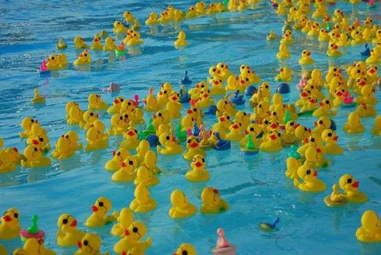

# Хамгийн хөөрхөн “орчин бохирдуулагчид”

1992 онд нэгэн ачааны хөлөг онгоц Номхон далайд, тээвэр хийж явахдаа 28000 ширхэг тоглоомын резинэн нугас бүхий ачаагаа санамсаргүй унагажээ. 20 жилийн дараа далайн эргүүдээр жижигхэн резинэн шар нугаснууд хөвж үзэгддэг болсон байна. Хамгийн хөөрхөн “орчин бохирдуулагч” нугаснууд маань далай судлаачидын далайн урсгал хянах ажилд нь ихээхэн тус болсоор яваа гэнэ шүү.
