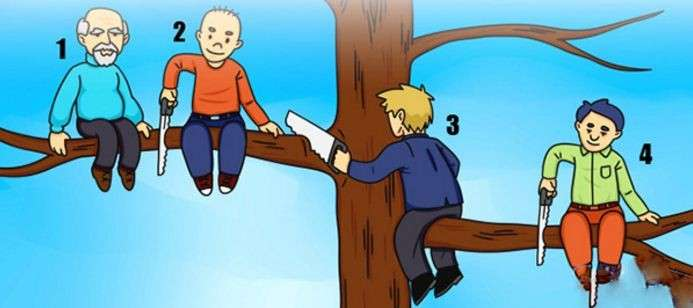

# Хамгийн тэнэг нь, таныхаар аль нь вэ?

Ямар ч зүйлийг сонгох сонголт нь, хүний зан чанарын зарим хэсгийг илэрхийлдэг гэж үздэг. Зураг дээрх эдгээр хүмүүсийн хийж байгаа үйлдлээс хамгийн тэнэг гэж үзсэнийгээ сонгоод хариултыг уншаарай.

**№1.** Та, ер нь бууж өгөмтгий, гараа өргөчих гээд байдаг хүн юм. Та өөртөө итгэлгүй, ямар нэг зүйлд өөрийгөө нөлөөлж чадахгүй гэж боддог, тиймээс бусдын нөхцөлийг хүлээн авдаг. Хэнтэй ч маргадаггүй, нам гүм байхыг эрхэмлэдэг, хэрүүл маргаанаас болж уй гашууд автдаг. Та, маш сайхан сэтгэлтэй, үнэнч шударга хүн.\
**№2.** Та, маш яаруу шийдвэр гаргадаг, бодож тунгаах хугацааг өөртөө гарагадаггүйгээс алдаа гаргах магадлалтай. Олон хүмүүс таныг зөрүүд гэж боддог нь таны хатуу зан чанартай холбоотой.\
**№3.** Та, зорьсоныхоо төлөө эцсийг нь хүртэл явдаг, хүчирхэг хүн. Таны сэтгэж чаддаг олон сайхан стратегууд, таныг гайхалтай бизнесмен болохыг харуулж байна. Энэ салбарт хүчээ үзэхийг зөвлөж байна.\
**№4.** Та, жинхэнэ босогч. Зарим тохиолдолд өөрийнхөө эсрэг ч байх үе байдаг. Энэ чанар чинь, аливааг бодитоор хүлээж авах, бодоход чинь саад болдогийг анхааруулах нь зүйтэй. Ер нь төрлөхийн хувьсгалч хүн юм.
