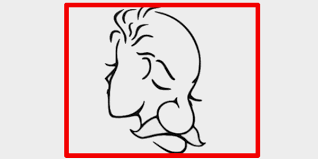

# Хамгийн түрүүнд харсан зүйл, дотоод ухамсрыг тань илэрхийлнэ /тест/

Хүн бүр өөр өөрийн давтагдашгүй чанартай байдаг. Хүн бүр өөр өөрийн онцлогтой, ив ижил хоёр хүн байх боломжгүй, хэн нэгнийг тэр чигт нь дуурайя гэсэн ч хэзээ ч өөрийн чанар арилан устдаггүй, ердийн бус тайлагдашгүй ертөнцөд бид амьдардаг. Дотоод ухамсрыг тань илэрхийлэх хялбархан сорилыг санал болгож байна. Ганцхан асуултад хариулаад харгалзах хариултыг уншаарай.

Та, энэ зурган дээр хамгийн түрүүнд юу харснаа харгалзах тайллаас уншаарай.

---

#### Бүсгүй

Та бол бүтээлч хүн юм. Таны уран зөгнөлийн ертөнцөд болон гялалзсан сайхан санаанууд, урам зоригт атаархмаар. Хэрэгт дуртай сониуч, шинэ сонин зүйлсийг хүлээж авч мэдрэх дуртай. Хэрэв сонирхол төрвөл ямар ч хэцүү хүнд зүйлийг гүйцэтгэхээс айдаггүй. Харин хуучин зүйлсээс уйдах шинэ зүйлрүү тэмүүлэх хандлагатай. Таныг, нөхөрсөг, төрөл бүрийн үзэл бодол, итгэл үнэмшил, үзэл сонирхолтой хүмүүстэй хэл амаа олж чаддаг гэж үнэлдэг. Та, өөдрөг амьдралд хайртай. Хамгийн хүнд хэцүү нөхцөлд ч эерэг зүйлийг харах чадвартай. Түүнээс гадна таны сэтгэл санааны сайн байдал бусдад дамжин “халдварладаг”. Үүнийг тань, найз нөхөд тань их үнэлж байдаг.

#### Өвгөн

Та их тайван хүн юм. Таны сэтгэл санааны тогтвортой байдалд атаархмаар, бодлоготой, аливааг хийхээс өмнө сайн тооцож чаддаг. Хэлсэн үгэндээ хүрдэг. Хүнд хэцүү үед, ойр дотныхон найз нөхөддөө тусламжийн гар сунгахад хэзээд бэлэн байдаг. Таныг “төгс” гэж нэрлэж болохуйц, төгсрүү тэмүүлж, мөн бусдыг боловсроход тусалж байдаг сайхан чанартай. Урдаа зорилго тавьсан л бол ямар ч бэрх хэцүү замаар мөрөөдөлдөө хүрэх л болно. Түүнээс гадна, та, өөрийн үлгэр жишээ байдлаараа бусдад урам зориг өгч байдаг. Таны удирдан зохион байгуулах барил гайхалтай.
