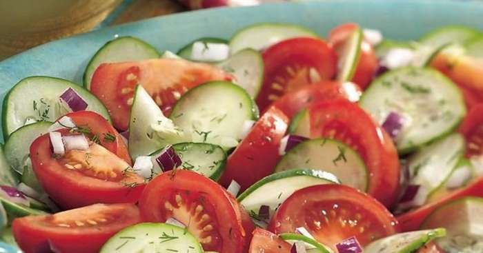
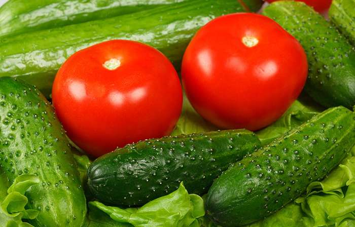
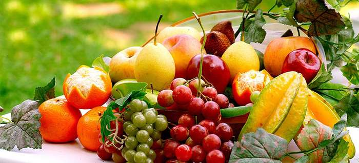
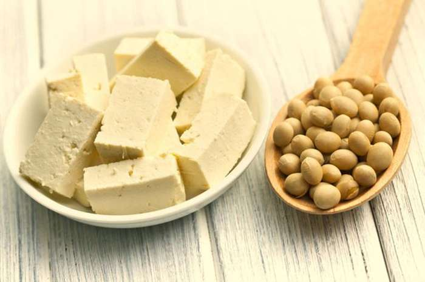
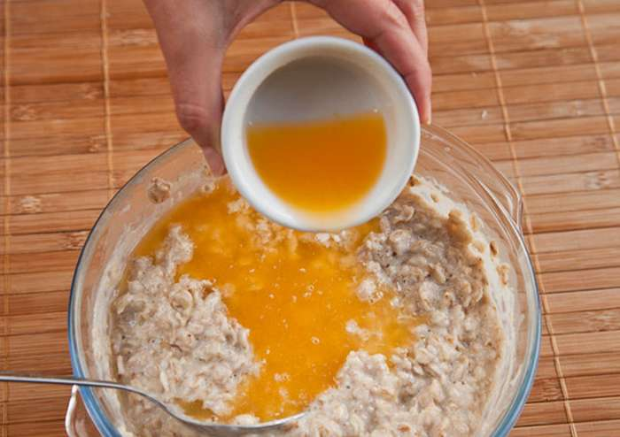
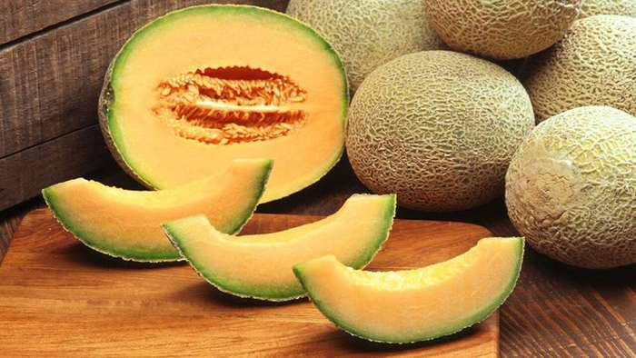
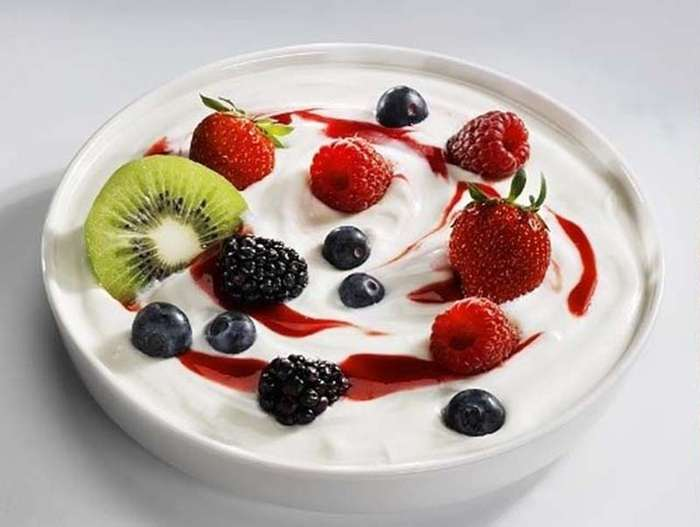
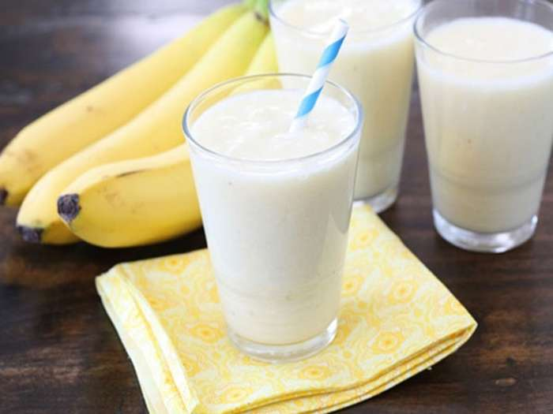

# Хамт хэрэглэж болдоггүй зарим хүнснүүд

Зарим хүнснүүд, хоорондоо тохирохгүй, хамт хэрэглэхэд боловсрох хугацаа нь өөр өөр байдгаас, хоол боловсруулах эрхтэний үйл ажиллагаанд муу нөлөөлөн бие организмыг өвчлөлд хүргэдэг байна.

#### Өргөст хэмх, улаан лооль

Хамгийн их хольж, зууш болгон хэрэглэж ирсэн, өргөст хэмх, улаан лооль хоёрыг зэрэг хэрэглэж болдоггүй байна. Өргөст хэмхийг боловсруулах хүчил ялгаран, боловсруулах зуур, улаан лооль исэлдэн мууддаг аж.

---

#### Сыртэй талх

Талх, сыр хоёрыг боловсруулахад, хоёр өөр хүчилийн түвшинтэй ходоодны шүүс ялгарах ёстой болдог. Нэг нь, нөгөөгөө боловсорч дуусахыг хүлээх хэрэгтэй болдог байна.

---

#### Хоолны дараа жимс жимсгэнэ идэх

Жимсийг бие организм, хурдан боловсруулдаг. Хоолны дараа идэхэд, ходоодонд исэлдэх муу нөлөөтэй.

---

#### Сыр, омлет

Нэг дор хэт их уураг хэрэглэх хэрэггүй

---

#### Сыр, шош

Гэдэс дүүрүүлдэг

---

#### Овъёосны зутан, сүү

Овъёосыг боловсруулах ходоодны шүүсний ферментүүд, сүүг гашилгадаг.

---

#### Амтат гуа, мах

Амтат маш удаан боловсордог. Махтай зэрэг идэж болохгүй.

---

#### Йогурт, жимс жимсгэнэ

Хамт хэрэглэхэд, хоол боловсруулах үйл ажиллагааг удаашруулж, гэдэсний бичил орчинд таагүй нөлөөлдөг.

---

#### Банан, сүү

Бодисын солилцооны үйл ажилагааг сааруулна.

Эрүүл сайхан байхын тулд, эдгээр хүнсүүдийг хамт хэрэглэхгүй байхыг зөвлөж байна.

Бид эдгээр хүнсүүдийг хамт хэрэглэж, дассан. Гэтэл, энэ хүнсүүдийг хэрэглэдэг болохоос өмнөх хүнсүүд ээ ор тас мартжээ. Эцэг өвгөдөөс маань уламжилж ирсэн хоол, идээгээ хэдийд, хэрхэн хэрэглэдэг байсныг мэдэхээ больсон. Мөн дэлхий нийтээр, зөв хооллолтыг чухалчилж байгаа өнөө үед, олон төрлийн хоолыг нэг дор идэхийг дэмжихээ больж буй энэ цаг үед, бие организмаа эрүүл, эрч хүчтэй байлгахын тулд, зарим хүнсүүдийг салангид хэрэглэхийг санал болгож байна.
