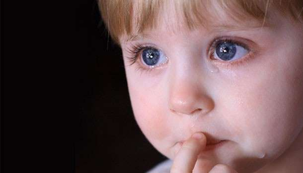
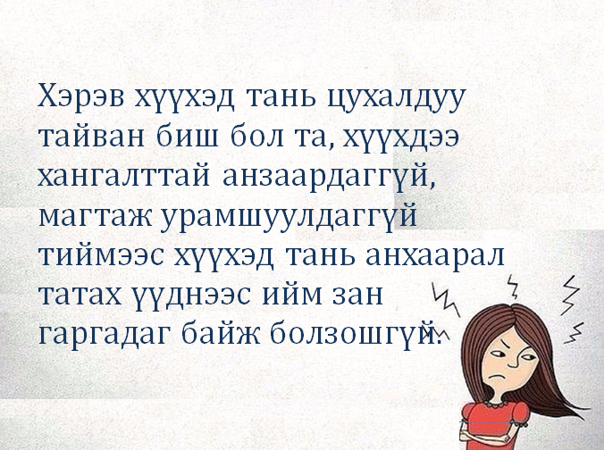
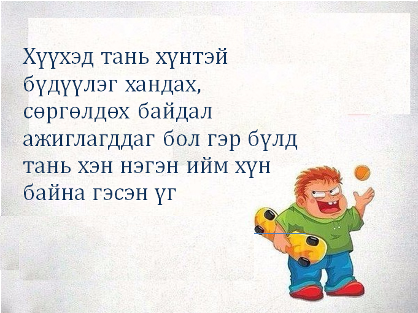
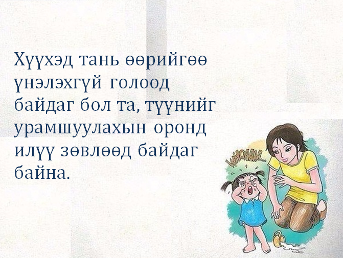
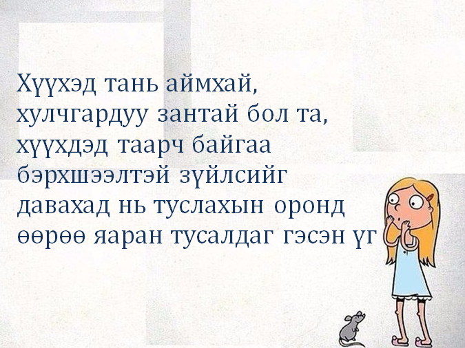
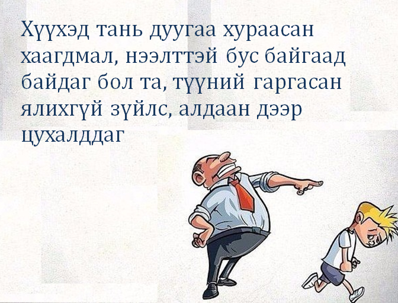
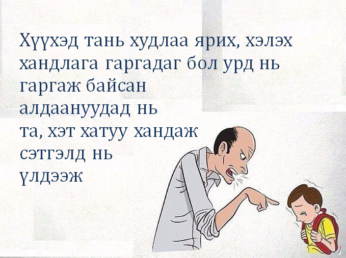
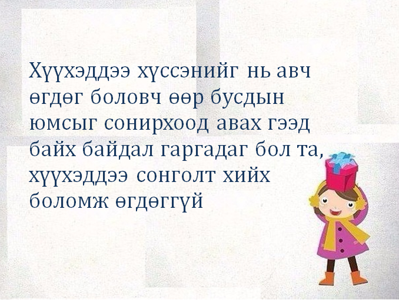

# Хамтдаа уншаарай

Хүүхдээ сайн зөв хүмүүжүүлэхийн төлөө ээж аав нар хамтдаа зүтгэх, сэтгэл гаргах, анхаарал тавих үүрэгтэй байдаг. Хүүхдийнхээ гаргадаг зан авирыг байнга анхаарч дараах зүйлсийг мэдэж авах нь тустай юм.

---

---

---

---

---

---

Хүүхэд өсгөх хүмүүжүүлэхтэй зэрэгцэн мөн хүн, өөрөө өөрчлөгдөх, үлгэр болохуйц зан ааштай болдог гэж үздэг.
