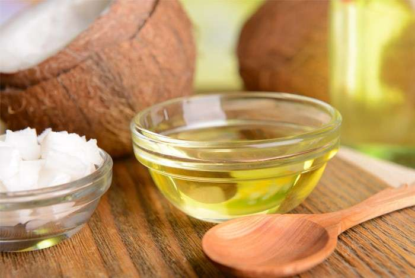

# Ханиалга дарж уушиг цэвэрлэх зөгийн балны наалт

Энэ наалтыг хийхэд, зөгийн бал, кокосын тос, гурил ордог. Кокосын тосон дох их хэмжээний лаурины хүчил нь, нянгийн хамгаалах бүрхэвчийг устгах, дархлааны системний үйлчилгээг өсгөдөг. Зөгийн бал нь, ханиалга, хоолой ирвэгнэх зовиурыг гайхалтай дардаг.

Цэвэр зөгийн бал\
Кокосын тос \
Гурил \
Салфетка\
Эмнэлгийн наалт\
1 цайны халбага гурилыг зөгийн балтай зуурч, бага зэрэг халаасан кокосын тосоо нэмж хутгаад салфеткандаа түрхэж, цээжнийхээ голд нааж эмнэлгийн наалтаар тогтооно. Том хүн шөнийн турш хэргэлж болно. Харин хүүхдэд 2-3 цагаас илүү наалттай байлгаж болохгүй. Эхний наалтаас эхлэн илт үр дүн үзүүлж ханиалга дарж, цэр ховхлох үйлчилгээтэй байдаг байна.
