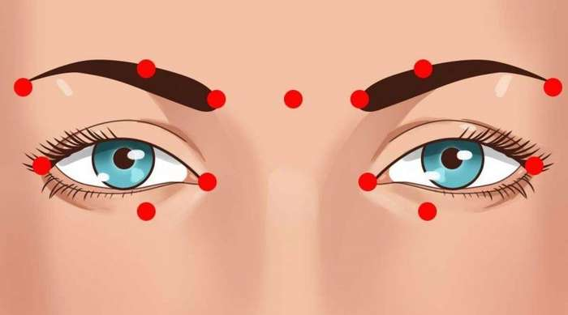
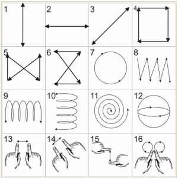
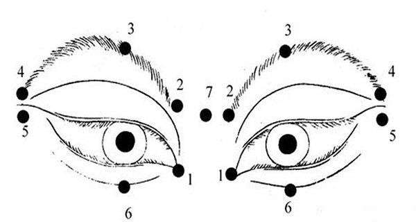
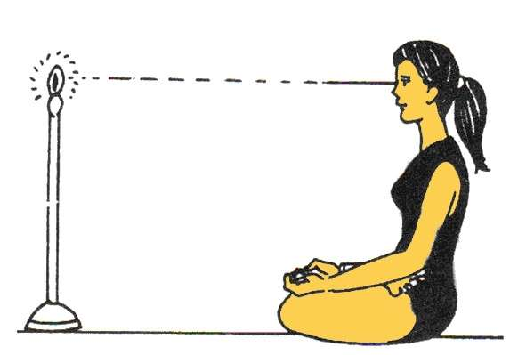

# Хараа сайжруулах аргууд

Анагаахын шинжлэх ухаан, хүний биеийн булчинг, “булчинг ажиллуулахгүй л бол сулрана” гэж тодорхойлдог. Яг ийм асуудал нүдний харааг муутгадаг бөгөөд орчин үеийнхэн өдрийн ихэнхийг өмнөх компьютерийн дэлгэцээ харж сууснаас алсыг харахад ажиллах ёстой нүдний булчин ажиллахгүй суларч орчин үеийн хамгийн түгээмэл харааны эмгэгтэй болдог байна. Тэгээд харааны шил зүүдэг бол байдал бүр муугаар эргэж, нүд тодорхой харахын тулд хүчлэх, чангалах булчингийн үйл ажиллагаа шаардлагагүй болдогоос хараа улам илүү муудаж байдаг гэнэ. Тиймээс, харааг сайжруулахын тулд нүдний булчингаа ажиллуулах дасгал хийх, болон дараах зөвлөгөөнүүдийг дагаж мөрдсөнөөр эргэж хараагаа хэвийн болгох боломжтой гэж зөвлөдөг байна.

-Дараах дүрсүүдийг дагуулан харж булчингийн дасгал хийж занших

---

-Хуруугаараа нүдний эргэн тойрон дох цэгүүд дээр хөнгөн дарж массаж хийх.

---

-“Тратака” хэмээх энэтхэгийн хараа сайжруулах дасгалыг хийж занших. Энэ дасгал нүд, оюун хоёрыг хамтад нь төвлөрүүлж сургадаг байна. Өөрөөсөө холгүй харааныхаа түвшинд лаа асааж харц болон анхаарлаа төвлөрүүлнэ. Нүдээ анивчиж болохгүй. Харж буй зүйл тань буюу дөл оюун тархинд буух мэт мэдрэмжийг ав. Дараа нь нүдээ аниад хөмсөгний хоорондох хэсэгт төвлөрөн тухайн дүрсээ аньсан нүдэндээ аль болох удаан хадгал. 10 орчим минут хийдэг. Тодорхой харж чадахгүй байсан зүйлээ тод харж чаддаг болгодог үр дүнтэй дасгал гэнэ.

---

-Хараагаа хэт ачаалахаас зайлсхийх мөн өдөрт, 2-3 цаг тутамд нүдээ аньж суллан хэдэн минут амрааж байх. -Шил зүүдэг бол шил зүүх хугацаагаа аль болох багасгах -Гадуур явах үедээ, аль болох алсыг хараж явахыг хичээж байх -Өдөр бүр луувангийн шүүс уух. Уг шүүсэндээ оливын тос нэг хоёр дусал нэмж хэрэглэх илүү үр дүнтэй -Нүд ядрах үед бүлээн усаар угааж байх -Унтахаас өмнө 2 цагийн хугацаанд компьютер дээр суухгүй, зурагт үзэхгүй байх
